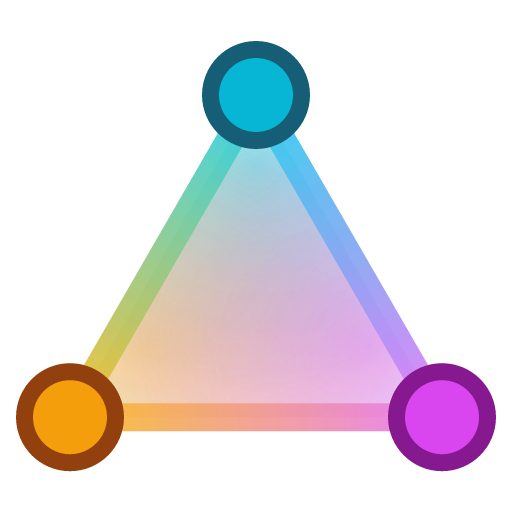
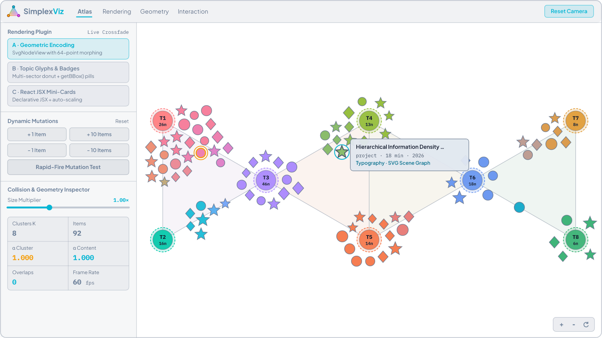
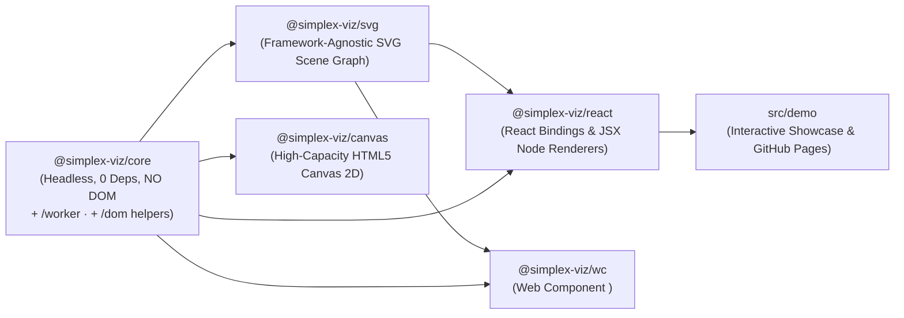

<p align="center">
  
</p>

<h1 align="center">SimplexViz</h1>

<p align="center">
  <strong>Triangulation-based, strictly overlap-free visualization of arbitrary domain collections (vector embeddings, pairwise similarities, or tagged items) on a dynamic 60° equilateral triangle mesh with hierarchical 1:4 zoom/drill-down and chronological timeline playback.</strong>
</p>

<p align="center">
  <a href="https://hackenberg.tech/simplex-viz/"></a>
  <a href="#local-development--scripts"></a>
  <a href="./LICENSE"></a>
</p>

SimplexViz partitions arbitrary collections—whether **single- or multi-modal vector embeddings** (text, images, videos, voice audio signatures, body-shape latents), **custom pairwise similarity functions**, or **tagged knowledge items**—into balanced clusters, embeds them onto an adaptive 60° simplex lattice with perceptual OKLab color mixing, resolves every convex node hull to a guaranteed `0.0 px` overlap layout, and supports continuous camera navigation, conformal **`1:4` hierarchical zoom / drill-down**, and path-independent **chronological timeline playback**. It is structured as a modular three-layer TypeScript stack across five packages—a zero-dependency headless core (`@simplex-viz/core`, `@simplex-viz/core/worker`, plus structural-DOM helpers in `@simplex-viz/core/dom`), framework-agnostic SVG (`@simplex-viz/svg`) and independent high-capacity Canvas 2D (`@simplex-viz/canvas`) renderers, type-safe React bindings (`@simplex-viz/react`), and a framework-agnostic Web Component (`@simplex-viz/wc`).

## Live Showcase

Explore the interactive demo at **<https://hackenberg.tech/simplex-viz/>**. It brings together the headless layout solver (`@simplex-viz/core`), SVG scene graph (`@simplex-viz/svg`), and React bindings (`@simplex-viz/react`) in a browser workbench built from `src/demo`:

<p align="center">
  <a href="https://hackenberg.tech/simplex-viz/">
    
  </a>
</p>

*Figure: The interactive SimplexViz showcase. Topic clusters (`T1`–`T8`) sit as topic badges or double-ring vertex anchors on the adaptive 60° equilateral triangle lattice, while content items render inside their covering vertices, edges, or triangles as colored shapes, multi-sector glyphs, or React cards blended in perceptual OKLab space. Drillable triangles preview their internal `1:4` subdivision directly in the active mesh edge style, and clicking drills smoothly into sub-triangles or 1-ring cluster stars with dimmed clickable neighborhood context and breadcrumbs. The collapsible left inspector offers independent controls across all five core strategy stages (`Mesh`, `Clustering`, `Color`, `Layout`, `Zoom`) plus node, triangle face, and edge renderers (`0` overlaps at `60 fps`).*

## Project Vision & 5-Stage Pluggable Pipeline

Classical force-directed layouts and raw UMAP/t-SNE scatters often turn multi-dimensional collections into unreadable hairballs or overlapping blobs. **SimplexViz** embeds cluster centroids or medoids onto an adaptive **toothed equilateral 60° triangle lattice** through **five pluggable, independently hot-swappable strategy stages**:

1. **Mesh Strategy (`SimplexMeshStrategy`)**: Defaults to `createAdaptiveHexMeshStrategy()` (`buildSimplexMesh`), which chooses the most area-efficient 60° lattice orientation (`horizontal` or `vertical`) and row parity (`wideFirst`) from `(W, H)` (with optional explicit `sideLength`), or swaps to `createFixedLatticeMeshStrategy({ cols, rows, sideLength? })`.
2. **Clustering & Anchoring Strategy (`SimplexClusteringStrategy`)**: Representation-agnostic via `requiresTags?: boolean`:
   - **Tag Specializations**: `createJaccardAnnealingClusteringStrategy()` *(Quickstart default)*, `createSoftSimplexTagClusteringStrategy({ triangleSpread })` (smooth interior spreading across covering triangles while preserving 360° halos for single-cluster items), and `createIncrementalAnchorClusteringStrategy()` (`initialize` vs. incremental `update`).
   - **Single & Multi-Modal Vector Embeddings (`requiresTags: false`)**: `createEmbeddingClusteringStrategy()` and `createSoftSimplexEmbeddingClusteringStrategy()` cluster untagged items from one or multiple weighted feature vectors (`getEmbedding`), embed centroids via QAP (`embedSimilarityMatrixOnMesh` / load-balanced QAP), preserve cluster UIDs via Hungarian matching, and project items into planar simplex coordinates.
   - **Pairwise Similarity Matrices (`requiresTags: false`)**: `createSimilarityClusteringStrategy({ getSimilarity })` partitions any untagged domain model using PAM k-Medoids, QAP mesh embedding, and simplex projection.
   - **Chronological / Subset Pinning Wrapper**: `createFinalSeededClusteringStrategy(baseStrategy?, options?)` wraps any clustering strategy to pin canonical full-corpus clusters, vertices, UIDs, and colors across chronological timeline steps (`0..N`) or filtered subsets.
3. **Color Strategy (`SimplexColorStrategy`)**: Defaults to `createOklabContrastColorStrategy()` (perceptual OKLab edge-contrast coloring + chroma-preserving barycentric mixing), or swaps to `createThemeAdaptiveOklabColorStrategy()` or `createPaletteColorStrategy(hexColors)`.
4. **Layout & Collision Strategy (`SimplexLayoutStrategy`)**: Defaults to `createPbdUniformLayoutStrategy()`, or swaps to `createWarmStartPbdLayoutStrategy()`, `createLocalAdaptiveLayoutStrategy()`, `createCollisionDrivenLayoutStrategy()`, `createFinalSeededLayoutStrategy()` (full-corpus position pinning with `scaleMode: 'pinned' | 'adaptive'` for zero-drift chronological replay), or any custom **`LayoutSeeder` × `PositionRelaxer` × `ScaleController`** trio via `createComposedLayoutStrategy()`—strictly guaranteeing **`0.0 px` overlap** and triangle containment.
5. **Zoom & Drill-Down Strategy (`SimplexZoomStrategy`)**: Defaults to `createFreeCameraZoomStrategy()` (wheel zoom-to-cursor, 2-finger touch pinch, and drag-to-pan), or swaps to hierarchical **`1:4` drill-down** via `createBarycentricZoomStrategy()`, `createSemanticZoomStrategy()` (`6`-vertex tag re-partitioning), or `createSubspaceZoomStrategy()` (`6`-vertex representation-agnostic subspace refinement)—featuring conformal `1:4` equilateral subdivision, single-triangle leaf focus (`'triangle-focus'`, `leafTriangleFocus: true`) with directly clickable content items, uniform `1`-ring `'incident-star'` cluster/subcluster stars with barycentric simplex-distance dimming, internal `1:4` subdivision mesh previews, dimmed clickable neighborhood context, and discrete 2-finger pinch.

## Architecture (Strict 3-Layer / 5-Package Separation)

The diagram and package table below summarize how domain logic, SVG / Canvas 2D rendering, and framework adapters are strictly decoupled across layers so the core math engine runs anywhere while renderers and UI adapters remain hot-swappable:



| Package | Role | Documentation |
| --- | --- | --- |
| [`@simplex-viz/core`](./packages/core) | Pure TypeScript triangulation, clustering, OKLab color science, composable 2-phase convex SAT solver, `1:4` zoom/drill-down strategies, headless `SimplexTimelineController`, shared preset/color/option-equality helpers, serializable view state, multi-selection, reduced-motion springs, convex + triangle hit-testing, Web Worker offloading (`@simplex-viz/core/worker`), and optional structural-type DOM/interaction helpers (`@simplex-viz/core/dom`). Zero DOM/SVG/React dependencies in root entrypoint (`ES2022`). | [Core README](./packages/core/README.md) |
| [`@simplex-viz/svg`](./packages/svg) | Framework-agnostic SVG engine (`Vanilla TS`, `Vue`, `Angular`, `Svelte`) with root-SVG hit-testing, offscreen `getBBox()` hull measurement, pluggable node/triangle/edge `Svg*View` plugins, `1:4` subdivision previews, breadcrumbs, timeline HUD, `Shift+Click`/`Shift+Drag` multi-selection, `prefers-reduced-motion`, shared host/tooltip/a11y primitives (`@simplex-viz/core/dom`), client-side `exportSvg()`/`exportPng()`, and zero-DOM SSR string rendering via `@simplex-viz/svg/ssr`. | [SVG README](./packages/svg/README.md) |
| [`@simplex-viz/canvas`](./packages/canvas) | High-capacity HTML5 Canvas 2D renderer (independent of `@simplex-viz/svg`) for 2,000–10,000+ items at 60 FPS with zero per-node DOM overhead, HiDPI DPR scaling, world-space frustum culling, automatic `lodThresholdPx` LOD simplification, `'geometric'`/`'glyphs'`/`'badges'` presets + custom Canvas 2D hooks, `1:4` drill-down, timeline playback, multi-selection, WCAG 2.1 AA keyboard navigation, tooltips, shared `@simplex-viz/core/dom` interaction mechanics, and native `exportPng()`. | [Canvas README](./packages/canvas/README.md) |
| [`@simplex-viz/react`](./packages/react) | Thin, end-to-end type-safe React bindings (`<SimplexTopicGraph />`, `useSimplexGraphController`, `useSimplexTimeline`) supporting portable `SvgNodeView` / `SvgTriangleView` / `SvgEdgeView` plugins, declarative JSX node renderers, viewport edge-flipped built-in tooltips (`@simplex-viz/core/dom`), linked-view controls, multi-selection, deep-link view state, SVG/PNG export, chronological timeline playback, and hierarchical drill-down. | [React README](./packages/react/README.md) |
| [`@simplex-viz/wc`](./packages/wc) | Dedicated framework-agnostic Web Component (`<simplex-topic-graph>`, zero React dependency) with SSR-safe registration (`@simplex-viz/wc/define`), reactive HTML attributes, inline `<script type="application/json">` support, typed JS properties, standard bubbling `CustomEvent`s, shared `@simplex-viz/core` / `@simplex-viz/core/dom` navigation/timeline plumbing, and full imperative delegation. | [WC README](./packages/wc/README.md) |

## Quickstart (Zero-Config)

Each higher-level package re-exports core/SVG runtime primitives from lower layers—install just the single package matching your stack and pass `{ id, tags }` items directly (specialized runtimes like `@simplex-viz/core/worker`, `@simplex-viz/core/dom`, `@simplex-viz/svg/ssr`, and `@simplex-viz/wc/define` are imported directly from their exclusive subpath).

### React (`@simplex-viz/react`)

```bash
npm install @simplex-viz/react
```

```tsx
import { SimplexTopicGraph } from '@simplex-viz/react';

const items = [
  { id: '1', label: 'Simplex Mesh', tags: ['geometry', 'triangulation', 'math'] },
  { id: '2', label: 'OKLab Mixing', tags: ['color', 'geometry', 'perception'] },
  { id: '3', label: 'SAT Solver', tags: ['collision', 'geometry'] },
];

export function TopicMap() {
  return (
    <div style={{ width: '100%', height: 560 }}>
      <SimplexTopicGraph items={items} preset="glyphs" tooltip />
    </div>
  );
}
```

### Vanilla TypeScript / Vue / Angular / Svelte (`@simplex-viz/svg`)

```bash
npm install @simplex-viz/svg
```

```ts
import { createSimplexSvg } from '@simplex-viz/svg';

// One-liner mount (enables built-in 'geometric' preset, pan/zoom, focus, and hover tooltips):
const controller = createSimplexSvg('#graph', items);
```

### Web Component — Plain HTML / Astro / Vue / Svelte / Angular (`@simplex-viz/wc`)

```bash
npm install @simplex-viz/wc
```

```html
<simplex-topic-graph preset="badges" theme="dark" tooltip style="width: 100%; height: 520px;">
  <script type="application/json">
    [
      { "id": "1", "label": "Simplex Mesh", "tags": ["geometry", "triangulation", "math"] },
      { "id": "2", "label": "OKLab Mixing", "tags": ["color", "geometry", "perception"] },
      { "id": "3", "label": "SAT Solver", "tags": ["collision", "geometry"] }
    ]
  </script>
</simplex-topic-graph>
<script type="module">
  import '@simplex-viz/wc/define';
</script>
```

### High-Capacity HTML5 Canvas 2D (`@simplex-viz/canvas`)

For **2,000–10,000+ item** corpora where SVG DOM node overhead becomes a bottleneck, render onto a single HiDPI `<canvas>` with world-space frustum culling, automatic `lodThresholdPx` simplification, and native `exportPng()`:

```bash
npm install @simplex-viz/canvas
```

```ts
import { createSimplexCanvas, createSubspaceZoomStrategy } from '@simplex-viz/canvas';

const controller = createSimplexCanvas('#graph', {
  items: largeCorpus,
  preset: 'badges',
  theme: 'dark',
  zoomStrategy: createSubspaceZoomStrategy(),
  tooltip: true,
});
```

### Off-Main-Thread Web Worker Solving (`@simplex-viz/core/worker`)

Offload heavy QAP annealing and PBD/SAT solving to a Web Worker (or Node.js `worker_threads`) with automatic stale-generation cancellation, `AbortSignal`, zero-copy `Float32Array` embedding transfers, and SSR async fallback:

```ts
// worker.ts
import { attachSimplexWorkerHandler } from '@simplex-viz/core/worker';
attachSimplexWorkerHandler();

// main.ts
import { createSimplexWorkerClient } from '@simplex-viz/core/worker';
import { renderSimplexSnapshotToCanvas } from '@simplex-viz/canvas';

const worker = createSimplexWorkerClient(
  () => new Worker(new URL('./worker.ts', import.meta.url), { type: 'module' }),
);

const { snapshot } = await worker.solve(largeCorpus, { width: 1200, height: 760 });
renderSimplexSnapshotToCanvas(canvasEl, snapshot, { theme: 'dark' });
```

### Quickstart Default Settings Reference

Every setting has a deterministic zero-config default out of the box—you only specify what you want to customize:

| Setting | Default Value | Behavior Out of the Box |
| --- | --- | --- |
| `getId` | `(item) => item.id` | Auto-extracts `.id` (required by TypeScript only if `TItem` has no `id: string`). |
| `getTags` | `(item) => item.tags` | Auto-extracts `.tags` (optional when passing an embedding/similarity `clusteringStrategy`). |
| `getLabel` | Heuristic (`label \| title \| headline \| name \| id`) | Used by built-in presets and hover tooltips when `getLabel` is omitted. |
| `preset` | `'geometric'` | Renders `GeometricShapeSvgView` content nodes + `ClusterAnchorSvgView` anchors (`'glyphs'` and `'badges'` also built in); customize shapes via `getShape` and lightweight hover/dimming/stroke styling via `shapeOptions`. |
| `theme` | `'dark'` | Dark canvas styling for presets, tooltips, breadcrumbs, and theme-adaptive colors (`'light'` supported). |
| `triangleView` | `OklabTintTriangleSvgView` | Subtle OKLab-blended triangle fills with hover/focus perimeter highlights. |
| `edgeView` | `DashedMeshEdgeSvgView` | Dashed 60° lattice edges (also used 1:1 for internal `1:4` drillable triangle previews). |
| `meshStrategy` | `createAdaptiveHexMeshStrategy()` | Aspect-aligned 60° equilateral lattice (adaptive `innerPadding: 32–48`, `minSideLength: 130`, `maxClusters: 14`, full-canvas scaling). |
| `clusteringStrategy` | `createJaccardAnnealingClusteringStrategy()` | Jaccard tag partitioning + QAP Simulated Annealing + `'planar-hitting-set'` + `'explaining-away'`. |
| `colorStrategy` | `createOklabContrastColorStrategy()` | Perceptual OKLab edge-contrast vertex colors + barycentric OKLab item mixing. |
| `layoutStrategy` | `createPbdUniformLayoutStrategy()` | Mesh-inward fan seeding + space-filling PBD dispersion + global uniform scale search (`clusterGapPx: 14`, `itemGapPx: 5`, `minContentScale: 0.2`, `0.0 px` overlap). |
| `zoomStrategy` | `createFreeCameraZoomStrategy()` | Continuous cursor wheel zoom (`onWheel: 'zoom-to-cursor'`), 2-finger touch pinch, and drag-to-pan. |
| `showZoomBreadcrumbs` | `true` | Automatically displays clickable navigation breadcrumbs whenever drilled into a sub-level (`depth > 0`). |
| `timeline` | `false` | Opt-in chronological frame stepping & playback (`boolean \| TimelinePlayerOptions`) with built-in HUD bar, `autoFinalSeed`, `autoFinalSeedLayout` (`false \| 'pinned' \| 'adaptive'`), and `emptyClusterBehavior`. |
| `emptyClusterBehavior` | `'normal'` | `'normal' \| 'dim' \| 'hide'` — Controls how clusters with `0` active items render (e.g., future clusters during chronological playback). |
| `itemFilter` / `itemFilterMode` | `null` / `'dim'` | Zero-relayout item filtering (`(item) => boolean`, `'dim' \| 'hide'`) that dims or hides non-matching items without re-clustering or shifting any SAT coordinates. |
| `deferInitialLayout` | `false` | Automatically recovers from `0×0` mounts on the first non-zero `ResizeObserver` entry (zero spring jump); pass `true` or `{ fallbackTimeoutMs }` to skip provisional `960×620` solving until visible. |
| `touchScrollLockPx` / `clickTolerancePx` | `8` / `12` | Embedded mobile ergonomics: vertical single-finger swipes yield to page scrolling (`touch-action: pan-y`; set `0` for `touch-action: none`), and gestures exceeding `clickTolerancePx` suppress trailing clicks. |
| `ariaLabel` / `keyboardNavigation` | `'Interactive simplex topic graph'` / `true` | WCAG 2.1 AA single-tabstop keyboard navigation (`Arrow` keys, `Home`/`End`, `Enter`/`Space`, `Shift+Enter`/`Shift+Space`, `Escape`), high-contrast double-halo SVG focus ring, semantic ARIA labels, and polite `aria-live` announcements. |
| `reducedMotion` | `'auto'` | `'auto' \| boolean` — Respects OS `prefers-reduced-motion: reduce` automatically (snapping node springs, camera flights, zoom transitions, and morphs immediately without jitter). |
| `selectedIds` / `marqueeSelection` | `[]` / `true` | Independent multi-selection state supporting `Shift+Click`, `Shift+Drag` rectangular marquee selection, keyboard `Shift+Enter`/`Shift+Space`, and high-contrast violet selection rings. |
| `focusOnClusterClick` / `focusOnTriangleClick` | `true` / `true` | Clicking a cluster or triangle isolates its neighborhood in `free-camera` mode (clicking background clears). |
| `tooltip` | `true` in `createSimplexSvg(el, items)`, `false` in options/React | Floating hover tooltip for `'content'`, `'cluster'`, and `'triangle'` targets (accepts `boolean` or custom formatter). |

---

## Step-by-Step Customization Guide

You can customize any aspect of SimplexViz independently—each step below works identically in `@simplex-viz/react` (via props) and `@simplex-viz/svg` (via constructor options or runtime `set*` methods).

### Step 1 — Custom Domain Schema & Cluster Metadata (`getId`, `getTags`, `getLabel`, `deriveClusterMeta`)

Keep your existing domain objects without mapping them to `{ id, tags }`:

```tsx
import { SimplexTopicGraph } from '@simplex-viz/react';

interface ResearchPaper {
  readonly doi: string;
  readonly headline: string;
  readonly topics: readonly string[];
  readonly citations: number;
}

interface ClusterSummary {
  readonly totalCitations: number;
}

<SimplexTopicGraph<ResearchPaper, unknown, unknown, undefined, ClusterSummary>
  items={papers}
  getId={(p) => p.doi}
  getTags={(p) => p.topics}
  getLabel={(p) => p.headline}
  normalizeTag={(raw) => raw.trim().toLowerCase()}
  deriveClusterMeta={(ctx) => ({
    totalCitations: ctx.members.reduce((sum, m) => sum + m.item.citations, 0),
  })}
  tooltip
/>;
```

### Step 2 — Visual Presets, Themes & Custom Tooltips (`preset`, `theme`, `tooltip`)

Switch between `'geometric'`, `'glyphs'`, and `'badges'`, toggle `'dark'` / `'light'` themes, and format rich tooltips for items, clusters, and triangles:

```tsx
<SimplexTopicGraph
  items={papers}
  getId={(p) => p.doi}
  getTags={(p) => p.topics}
  preset="glyphs"
  theme="light"
  tooltip={(target) => {
    if (target.kind === 'content') return `${target.item.headline} (${target.item.citations} cites)`;
    if (target.kind === 'cluster') return `${target.cluster.code}: ${target.cluster.defaultLabel}`;
    return `Triangle #${target.triangle.index + 1} · ${target.triangle.coveredItemCount} papers`;
  }}
/>
```

### Step 3 — Custom Node, Triangle Face & Mesh Edge Views

Customize any visual layer independently—use keyless React JSX (`renderContentNode` / `renderClusterNode`, auto-measured via `getBBox()`) or portable `SvgNodeView`, `SvgTriangleView`, and `SvgEdgeView` plugins:

```tsx
import {
  SimplexTopicGraph,
  GradientTriangleSvgView,
  ClusterTintedEdgeSvgView,
} from '@simplex-viz/react';

const triangleView = new GradientTriangleSvgView({ baseOpacity: 0.2 });
const edgeView = new ClusterTintedEdgeSvgView({ strokeWidth: 1.4 });

<SimplexTopicGraph
  items={papers}
  getId={(p) => p.doi}
  getTags={(p) => p.topics}
  triangleView={triangleView}
  edgeView={edgeView}
  renderContentNode={(paper, ctx, state) => (
    <g>
      <rect
        x={-52}
        y={-14}
        width={104}
        height={28}
        rx={6}
        fill="#0f172a"
        stroke={state.interaction.isHovered ? '#f8fafc' : ctx.mixedColorHex}
        strokeWidth={state.interaction.isHovered ? 2 : 1.2}
      />
      <text textAnchor="middle" y={4} fill="#f8fafc" fontSize={10}>
        {paper.headline.slice(0, 14)}
      </text>
    </g>
  )}
/>;
```

### Step 4 — Mesh Topology & Explicit Triangle Sizing (`meshStrategy`, `meshOptions`)

Control padding, maximum cluster count, or pin an exact equilateral triangle `sideLength` (or fixed `cols × rows` lattice):

```tsx
import {
  createAdaptiveHexMeshStrategy,
  createFixedLatticeMeshStrategy,
} from '@simplex-viz/react';

// Option A: Adaptive lattice with explicit 210px equilateral triangle edge length
const adaptiveMesh = createAdaptiveHexMeshStrategy();
const meshOptions = { innerPadding: 56, sideLength: 210, maxClusters: 10 };

// Option B: Fixed 3×3 lattice (always K = 9 vertices)
const fixedMesh = createFixedLatticeMeshStrategy({ cols: 3, rows: 3, sideLength: 190 });
```

### Step 5 — Clustering: Soft-Simplex Tags, Multi-Modal Embeddings & Pairwise Similarity

Choose the clustering strategy matching your data representation—`getTags` becomes completely optional whenever a non-tag `clusteringStrategy` is supplied:

```tsx
import {
  createSoftSimplexTagClusteringStrategy,
  createSoftSimplexEmbeddingClusteringStrategy,
  createSimilarityClusteringStrategy,
} from '@simplex-viz/react';

// 5a. Tagged items with smooth interior triangle spreading:
const softTagClustering = createSoftSimplexTagClusteringStrategy({
  triangleSpread: 0.45,
  sharedTagRule: 'planar-hitting-set',
  anchorRule: 'explaining-away',
});

// 5b. Untagged items with weighted multi-modal embeddings (e.g. scene + style vectors):
interface MediaAsset {
  readonly id: string;
  readonly title: string;
  readonly sceneEmbedding: readonly number[];
  readonly styleEmbedding: readonly number[];
}

const softEmbeddingClustering = createSoftSimplexEmbeddingClusteringStrategy<MediaAsset>({
  getEmbedding: [
    { name: 'Semantic Scene', getVector: (m) => m.sceneEmbedding, weight: 0.65 },
    { name: 'Visual Style', getVector: (m) => m.styleEmbedding, weight: 0.35 },
  ],
  metric: 'cosine',
  triangleSpread: 0.45,
  balanceLoad: true,
});

// 5c. Untagged items with a custom domain similarity kernel in [0, 1]:
const similarityClustering = createSimilarityClusteringStrategy<MediaAsset>({
  getSimilarity: (a, b) => computeCustomKernel(a, b),
});
```

### Step 6 — Color Strategies & Brand Palettes (`colorStrategy`)

Swap between static dark-tuned OKLab contrast, theme-adaptive dark/light OKLab, or your own hex palette:

```tsx
import {
  createOklabContrastColorStrategy,
  createThemeAdaptiveOklabColorStrategy,
  createPaletteColorStrategy,
} from '@simplex-viz/react';

const brandColors = createPaletteColorStrategy(
  ['#06b6d4', '#f59e0b', '#d946ef', '#10b981', '#3b82f6', '#f43f5e'],
  { mode: 'edge-contrast', preserveMatchedColors: true },
);
```

### Step 7 — Layout Presets & Composable `Seeder × Relaxer × ScaleController` (`layoutStrategy`, `layoutOptions`)

Pick a high-level layout preset (`createCollisionDrivenLayoutStrategy`, `createLocalAdaptiveLayoutStrategy`, `createWarmStartPbdLayoutStrategy`, `createPbdUniformLayoutStrategy`) or compose orthogonal building blocks directly:

```tsx
import {
  createComposedLayoutStrategy,
  createMeshInwardFanSeeder,
  createSpaceFillingPbdRelaxer,
  createCollisionLocalScaleController,
} from '@simplex-viz/react';

const layoutStrategy = createComposedLayoutStrategy({
  seeder: createMeshInwardFanSeeder(),
  relaxer: createSpaceFillingPbdRelaxer({
    springFactor: 0.7,
    dispersionGapPx: 18,
    dispersionStrength: 0.35,
  }),
  scaleController: createCollisionLocalScaleController({
    minLocalScale: 0.34,
    shrinkFactor: 0.85,
  }),
  warmStart: true,
});
```

### Step 8 — Hierarchical `1:4` Zoom / Drill-Down vs. Free Camera (`zoomStrategy`, `showZoomBreadcrumbs`)

Enable conformal `1:4` triangle & cluster drill-down with a single prop or option. Drillable triangles automatically display their internal `1:4` subdivision edges in the active `edgeView` style, pass clicks through non-leaf content nodes straight to the triangle, highlight the zoomed region, dim clickable neighbors, and render breadcrumbs:

```tsx
import {
  SimplexTopicGraph,
  createBarycentricZoomStrategy,
  createSemanticZoomStrategy,
  createSubspaceZoomStrategy,
} from '@simplex-viz/react';

// Geometric 1:4 barycentric drill-down (with leafTriangleFocus: true by default):
const barycentricZoom = createBarycentricZoomStrategy({
  clusterZoomMode: 'incident-star', // 'incident-star' | 'spotlight' | 'none'
  adaptiveContrastStretch: true,
  stopWhenFullScale: true,
});

// Or representation-agnostic 6-vertex subspace refinement across embeddings, similarity & tags:
const subspaceZoom = createSubspaceZoomStrategy({
  clusterZoomMode: 'incident-star',
});

// Or tag-aware 6-vertex semantic re-partitioning on drill-down:
const semanticZoom = createSemanticZoomStrategy({
  clusterZoomMode: 'incident-star',
});

<SimplexTopicGraph
  items={items}
  zoomStrategy={barycentricZoom}
  showZoomBreadcrumbs
  onZoomStateChange={(zoom) => {
    console.log('Depth:', zoom.depth, 'Leaf:', zoom.isLeafReached);
  }}
/>;
```

### Step 9 — Custom Interactions & Imperative Controller (`useSimplexGraphController` / `SimplexSvgController`)

Drive live mutations, strategy hot-swaps, camera transforms, or programmatic drill-down imperatively without remounting:

```tsx
import { SimplexTopicGraph, useSimplexGraphController } from '@simplex-viz/react';

export function ControlledAtlas({ items }: { items: readonly { id: string; tags: string[] }[] }) {
  const { controllerRef, handle } = useSimplexGraphController();

  return (
    <div style={{ width: '100%', height: 620 }}>
      <div>
        <button onClick={() => handle.drillUp()}>Drill Up</button>
        <button onClick={() => handle.drillToRoot()}>Overview</button>
        <button onClick={() => handle.addItems({ id: 'live-1', tags: ['geometry', 'svg'] })}>
          Add Item
        </button>
      </div>
      <SimplexTopicGraph
        controllerRef={controllerRef}
        items={items}
        onRightClick={(target) => {
          if (target.kind === 'content') console.log('Inspect item:', target.item.id);
          return true; // Suppress browser context menu
        }}
      />
    </div>
  );
}
```

### Step 10 — Chronological Timeline Playback, Final-Seeded Layout & Empty-Cluster Dimming

Turn any timestamped or chronologically bucketed collection into a smooth frame-by-frame replay with one prop (`timeline`). By default, `autoFinalSeed: true` pins canonical full-corpus clusters via `createFinalSeededClusteringStrategy`; add `autoFinalSeedLayout: 'adaptive'` (or `'pinned'`) to also pin item coordinates via `createFinalSeededLayoutStrategy`, and `emptyClusterBehavior: 'dim'` (or `'hide'`) to fade future clusters until their first item arrives:

```tsx
import {
  SimplexTopicGraph,
  useSimplexGraphController,
  useSimplexTimeline,
} from '@simplex-viz/react';

export function ChronologicalAtlas({ papers }: { papers: readonly (ResearchPaper & { year: number })[] }) {
  const { controllerRef } = useSimplexGraphController();
  const timeline = useSimplexTimeline(controllerRef);

  return (
    <SimplexTopicGraph
      controllerRef={controllerRef}
      items={papers}
      getId={(p) => p.doi}
      getTags={(p) => p.topics}
      timeline={{
        getTimestamp: (p) => p.year,
        stepIntervalMs: 900,
        position: 'bottom',              // 'bottom' | 'top'
        autoFinalSeed: true,             // pin full-corpus clusters & colors
        autoFinalSeedLayout: 'adaptive', // false | 'pinned' | 'adaptive'
        emptyClusterBehavior: 'dim',     // 'normal' | 'dim' | 'hide'
      }}
      onTimelineStateChange={(state) => {
        console.log(state.activeLabel, state.activeItemCount, timeline.isReady);
      }}
    />
  );
}
```

### Step 11 — Zero-Relayout Item Filtering, Batched Updates & Keyboard Accessibility

Filter items visually without re-clustering or shifting any layout positions (`itemFilter`, `itemFilterMode: 'dim' | 'hide'`), coalesce multi-option updates into a single recomputation (`batch()`, `setOptions()`, plus automatic batched prop sync in `<SimplexTopicGraph />`), and customize WCAG 2.1 AA keyboard navigation & screen-reader labels (`ariaLabel`, `keyboardNavigation`):

```tsx
<SimplexTopicGraph
  items={papers}
  getId={(p) => p.doi}
  getTags={(p) => p.topics}
  itemFilter={(p) => p.citations >= minCitations}
  itemFilterMode="dim" // 'dim' | 'hide' — zero relayout or spring jump
  ariaLabel="Research papers topic map"
  keyboardNavigation
  tooltip
/>
```

```ts
// Imperative atomic multi-option updates in @simplex-viz/svg (or via handle.batch / handle.setOptions):
controller.setOptions({
  theme: 'light',
  preset: 'badges',
  itemFilter: (p) => p.citations >= 50,
  itemFilterMode: 'hide',
  ariaLabel: 'Highly cited papers map',
});
```

### Step 12 — Linked-View Search, Programmatic Focus/Zoom & Client-Side SVG/PNG Export

Synchronize external search boxes, tables, or sidebars with the graph (`setHighlightedItems`, `focusItem`, `zoomToItem`) and export publication-grade vector SVG or HiDPI PNG snapshots directly from the live scene (`exportSvg`, `exportPng`):

```ts
// Highlight search matches, focus a specific result, or zoom/drill right to it:
handle.setHighlightedItems(matchingIds); // accepts Iterable<string> | null
handle.focusItem('paper-42');            // emphasizes node + triggers tooltip/announcements
handle.zoomToItem('paper-42', { zoom: 2.2, maxDrillSteps: 4 });

// Export a self-contained SVG or 2x HiDPI PNG Blob / dataUrl:
const svgMarkup = handle.exportSvg({ padding: 24, title: 'Research Atlas' });
const pngBlob = await handle.exportPng({ scale: 2, padding: 24 });
```

### Step 13 — Multi-Selection (`Shift+Click` / `Shift+Drag`), Reduced Motion & Deep-Link View State

Enable interactive cohort selection (`Shift+Click` toggles items, `Shift+Drag` draws a marquee rectangle), honor OS `prefers-reduced-motion` (`reducedMotion: 'auto'`), and persist or share the exact camera, drill-down path, timeline frame, focus, and selection in URLs or `localStorage` via `getViewState()` / `restoreViewState()`:

```ts
// Read and restore a JSON-serializable view snapshot (camera, zoomPath, focus, selection, timelineStep):
const state = handle.getViewState();
const encoded = encodeURIComponent(JSON.stringify(state));

// Later (e.g., on page load — snaps immediately by default without dizzying flight):
handle.restoreViewState(JSON.parse(decodeURIComponent(encoded)));

// Programmatic multi-selection & motion preference:
handle.setSelectedIds(['paper-1', 'paper-7']);
handle.setReducedMotion('auto'); // 'auto' | true | false
```

### Headless One-Shot Layout & Zero-DOM SSR SVG Rendering (`solveSimplexSnapshot` & `@simplex-viz/svg/ssr`)

For static site generation (Astro, Next.js, Eleventy), OG/social card pipelines, or headless PNG rasterization with `@resvg/resvg-js` without Puppeteer, render a complete `<svg>` string directly in Node.js via `@simplex-viz/svg/ssr`—or compute raw solved coordinates via `solveSimplexSnapshot` from `@simplex-viz/core`:

```ts
import { renderSimplexSvgString } from '@simplex-viz/svg/ssr';

const svg = renderSimplexSvgString(
  [
    { id: '1', label: 'Simplex Mesh', tags: ['geometry', 'math'] },
    { id: '2', label: 'OKLab Mixing', tags: ['geometry', 'color'] },
  ],
  { width: 1200, height: 720, preset: 'badges', theme: 'dark', padding: 24 },
);
```

```ts
import { solveSimplexSnapshot } from '@simplex-viz/core';

const snapshot = solveSimplexSnapshot(
  [
    { id: '1', tags: ['geometry', 'math'] },
    { id: '2', tags: ['geometry', 'color'] },
  ],
  { width: 960, height: 600 },
);

console.log(snapshot.metrics.overlapCount); // 0
```

## Local Development & Scripts

Use these npm workspace scripts to run the interactive demo locally, enforce module boundaries, execute unit and integration tests, build package artifacts, and verify package exports:

```bash
npm install
npm run dev                # Starts the interactive demo app at http://localhost:3000
npm run lint               # ESLint (module boundary checks) + TypeScript typecheck
npm test                   # Vitest invariant, type-level, and DOM integration tests
npm run build:packages     # Builds dist/ + .d.ts for all five packages
npm run validate:packages  # Validates package exports with publint
```

## License

[MIT](./LICENSE)
