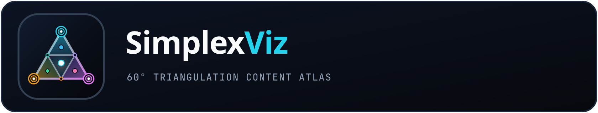
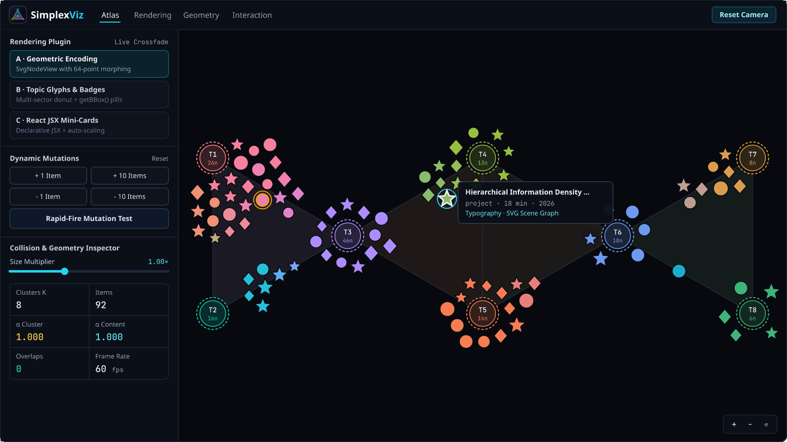
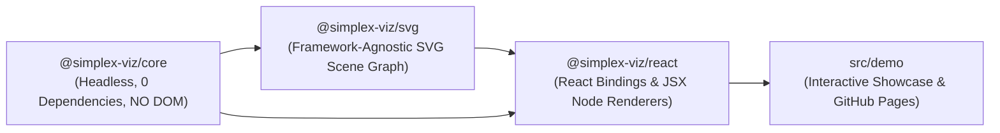

<p align="center">
  
</p>

<p align="center">
  <strong>Triangulation-based, strictly overlap-free visualization of tagged content collections on a dynamic 60° equilateral triangle mesh (simplex mesh).</strong>
</p>

<p align="center">
  <a href="https://hackenberg.tech/simplex-viz/"></a>
  <a href="#local-development--scripts"></a>
  <a href="./LICENSE"></a>
</p>

<p align="center">
  <a href="https://hackenberg.tech/simplex-viz/">
    
  </a>
</p>

---

## Live Demo

Explore the interactive showcase at **<https://hackenberg.tech/simplex-viz/>**.

---

## Project Vision & Mathematical Principle

Classical force-directed layouts often turn tagged knowledge collections into unreadable hairball graphs with crossing edges and overlapping labels. **SimplexViz** embeds topic centroids onto an adaptive **toothed equilateral 60° triangle lattice**:

1. **Adaptive Simplex Mesh (`buildSimplexMesh`)**: From viewport dimensions `(W, H)`, padding, and a target edge-length interval `[minSideLength, maxSideLength]`, selects the most area-efficient lattice orientation (`horizontal` or `vertical`) and row parity (`wideFirst`) so every mesh triangle has exact 60° interior angles.
2. **Two-Stage Topic Clustering (`computeSimplexClustering`)**:
   - **Stage 1**: Regularized Jaccard co-occurrence partitions all tags into `K` balanced disjoint core sets `T_k^core` and embeds them onto adjacent mesh vertices via Simulated Annealing (Quadratic Assignment Problem).
   - **Stage 2**: A Weighted Hitting-Set pass plus backward pruning adds minimal `sharedTags` until 100% of items are planar-covered by at least one mesh triangle `f = {a, b, c}` (`C_i ⊆ T_a ∪ T_b ∪ T_c`).
3. **Explaining-Away & OKLab Color Mixing**: Each item is assigned to the smallest covering simplex unit (`vertex ≺ edge ≺ triangle`) with normalized barycentric weights and perceptual OKLab color mixing (preserving chroma).
4. **Hierarchical Two-Phase Collision Solver (`solveTwoPhaseLayout`)**: Fixes scaled topic clusters first (Priority 1), then solves all content hulls via binary search over `α_content`, position-based relaxation, and exact SAT / circle-polygon Minimum Translation Vector (MTV) separation — guaranteeing **0.0 px overlap**.

---

## Architecture (Strict 3-Package Separation)



| Package | Role | Documentation |
| --- | --- | --- |
| [`@simplex-viz/core`](./packages/core) | Pure TypeScript triangulation, clustering, OKLab color science, 2-phase convex SAT solver, spring animation, and hit-testing. Zero DOM/SVG/React dependencies (`ES2022`). | [Core README](./packages/core/README.md) |
| [`@simplex-viz/svg`](./packages/svg) | Framework-agnostic SVG engine (`Vanilla TS`, `Vue`, `Angular`, `Svelte`, Web Components) with root-SVG hit-testing, offscreen `getBBox()` hull measurement, built-in `SvgNodeView` plugins, and dual-layer crossfading. | [SVG README](./packages/svg/README.md) |
| [`@simplex-viz/react`](./packages/react) | Thin, end-to-end type-safe React bindings (`<SimplexTopicGraph />`, `useSimplexGraphController`) supporting both portable `SvgNodeView` plugins and declarative JSX node renderers. | [React README](./packages/react/README.md) |

---

## Quickstart

### React (`@simplex-viz/react`)

```bash
npm install @simplex-viz/core @simplex-viz/svg @simplex-viz/react
```

```tsx
import { SimplexTopicGraph } from '@simplex-viz/react';
import { GeometricShapeSvgView, ClusterAnchorSvgView } from '@simplex-viz/svg';

interface Article {
  readonly slug: string;
  readonly hashtags: readonly string[];
  readonly readingMinutes: number;
}

export function KnowledgeMap({ articles }: { articles: readonly Article[] }) {
  return (
    <SimplexTopicGraph
      items={articles}
      getId={(a) => a.slug}
      getTags={(a) => a.hashtags}
      deriveClusterMeta={(ctx) => ({
        count: ctx.members.length,
        avgMin:
          ctx.members.reduce((sum, m) => sum + m.item.readingMinutes, 0) /
          Math.max(1, ctx.members.length),
      })}
      visualResolver={{
        resolveContentVisual: (a, ctx) => ({
          shape: a.readingMinutes > 12 ? 'star' : 'circle',
          radius: 10,
          fillHex: ctx.mixedColorHex,
        }),
        resolveClusterVisual: (cluster) => ({
          code: cluster.code,
          label: cluster.defaultLabel,
          memberCount: cluster.meta.count,
          colorHex: cluster.colorHex,
          radius: 22,
        }),
        getVisualCacheKey: (v) =>
          'shape' in v ? `${v.shape}:${v.fillHex}` : `${v.code}:${v.memberCount}`,
      }}
      contentView={new GeometricShapeSvgView()}
      clusterView={new ClusterAnchorSvgView()}
    />
  );
}
```

### Vanilla TypeScript / Vue / Angular / Svelte (`@simplex-viz/svg`)

```bash
npm install @simplex-viz/core @simplex-viz/svg
```

```ts
import {
  SimplexSvgController,
  GeometricShapeSvgView,
  ClusterAnchorSvgView,
} from '@simplex-viz/svg';

const controller = new SimplexSvgController(document.getElementById('graph')!, {
  items: myItems,
  visualResolver: myResolver,
  contentView: new GeometricShapeSvgView(),
  clusterView: new ClusterAnchorSvgView(),
});

// Interruptible real-time mutations
controller.addItems({ id: 'new-1', tags: ['geometry', 'svg'] });
controller.removeItems('old-1');
```

---

## Writing Custom `SvgNodeView` Plugins

```ts
import type { SvgNodeView } from '@simplex-viz/svg';
import { rectToConvexPolygon } from '@simplex-viz/core';

interface PillVisual {
  readonly text: string;
  readonly colorHex: string;
}

export const CustomPillView: SvgNodeView<PillVisual> = {
  // Optional: omit measureConvexHull to let @simplex-viz/svg measure via offscreen getBBox()
  measureConvexHull: (visual) =>
    rectToConvexPolygon(visual.text.length * 7 + 20, 26, 6),
  mountOrUpdate: (groupEl, visual) => {
    // Build pure SVG elements centered around local origin (0, 0)
  },
};
```

---

## Local Development & Scripts

```bash
pnpm install
pnpm dev                # Starts the interactive demo app at http://localhost:3000
pnpm lint               # ESLint (module boundary checks) + TypeScript typecheck
pnpm test               # Vitest invariant, type-level, and DOM integration tests
pnpm build:packages     # Builds dist/ + .d.ts for all three packages
pnpm validate:packages  # Validates package exports with publint
```

---

## License

[MIT](./LICENSE)
