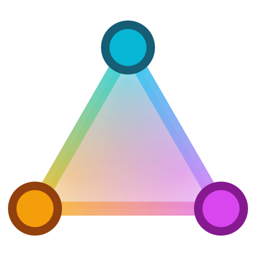
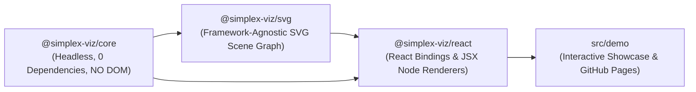

<p align="center">
  
</p>

<h1 align="center">SimplexViz</h1>

<p align="center">
  <strong>Triangulation-based, strictly overlap-free visualization of tagged content collections on a dynamic 60° equilateral triangle mesh (simplex mesh).</strong>
</p>

<p align="center">
  <a href="https://hackenberg.tech/simplex-viz/"></a>
  <a href="#local-development--scripts"></a>
  <a href="./LICENSE"></a>
</p>

SimplexViz partitions tagged collections into balanced topic clusters, embeds them onto an adaptive 60° simplex lattice with perceptual OKLab color mixing, and resolves every convex node hull to a guaranteed `0.0 px` overlap layout. It is structured as a modular three-layer TypeScript stack—a zero-dependency headless core (`@simplex-viz/core`), a framework-agnostic SVG engine (`@simplex-viz/svg`), and type-safe React bindings (`@simplex-viz/react`).

## Live Showcase

Explore the interactive demo at **<https://hackenberg.tech/simplex-viz/>**. It brings together the headless layout solver (`@simplex-viz/core`), SVG scene graph (`@simplex-viz/svg`), and React bindings (`@simplex-viz/react`) in a browser workbench built from `src/demo`:

<p align="center">
  <a href="https://hackenberg.tech/simplex-viz/">
    
  </a>
</p>

*Figure: The interactive SimplexViz showcase in Geometric Encoding mode. Topic clusters (`T1`–`T8`) sit as dashed double-ring vertex anchors on the adaptive 60° equilateral triangle lattice, while content items render inside their covering vertices, edges, or triangles as colored circles, diamonds, and stars blended in perceptual OKLab space. The left inspector provides live controls for rendering presets, core algorithm strategies (`Mesh`, `Clustering`, `Color`, `Layout`), dataset mutations, size scaling, and solver telemetry (`0` overlaps at `60 fps`), while hovering any node opens a contextual inspection tooltip.*

## Project Vision & Mathematical Principle

Classical force-directed layouts often turn tagged knowledge collections into unreadable hairball graphs with crossing edges and overlapping labels. **SimplexViz** embeds topic centroids onto an adaptive **toothed equilateral 60° triangle lattice** through four **pluggable, independently swappable strategy stages**:

1. **Mesh Strategy (`SimplexMeshStrategy`)**: Defaults to `createAdaptiveHexMeshStrategy()` (`buildSimplexMesh`), which selects the most area-efficient 60° lattice orientation (`horizontal` or `vertical`) and row parity (`wideFirst`) from viewport dimensions `(W, H)`, or can be swapped for `createFixedLatticeMeshStrategy({ cols, rows })`.
2. **Clustering & Anchoring Strategy (`SimplexClusteringStrategy`)**: Defaults to `createJaccardAnnealingClusteringStrategy()` (or incremental `createIncrementalAnchorClusteringStrategy()` with `initialize` + `update`):
   - **Stage 1**: Regularized Jaccard co-occurrence partitions tags into `K` balanced disjoint core sets `T_k^core` and embeds them onto mesh vertices via Simulated Annealing (Quadratic Assignment Problem).
   - **Stage 2 (`sharedTagRule`)**: A Weighted Hitting-Set pass plus backward pruning adds minimal `sharedTags` (`'planar-hitting-set'`, or `'none'` for strict disjoint partitions) until 100% of items are planar-covered (`C_i ⊆ T_a ∪ T_b ∪ T_c`).
   - **Stage 3 (`anchorRule`)**: Assigns each item to its covering simplex unit (`'explaining-away'`, `'raw-overlap'`, or `'barycentric-all'`) and computes `(anchorX, anchorY)`.
3. **Color Strategy (`SimplexColorStrategy`)**: Defaults to `createOklabContrastColorStrategy()` (perceptual OKLab edge-contrast coloring + chroma-preserving barycentric mixing), or swaps cleanly to `createThemeAdaptiveOklabColorStrategy()` or `createPaletteColorStrategy(hexColors)`.
4. **Layout & Collision Strategy (`SimplexLayoutStrategy`)**: Defaults to `createPbdUniformLayoutStrategy()` (`solveTwoPhaseLayout`: binary search over `α_content`, position-based relaxation, and exact SAT / circle-polygon MTV separation), or swaps to `createWarmStartPbdLayoutStrategy()` or `createLocalAdaptiveLayoutStrategy()`—strictly guaranteeing **0.0 px overlap** across all built-in solvers.

## Architecture (Strict 3-Package Separation)

The diagram and package table below summarize how domain logic, SVG DOM rendering, and framework bindings are strictly decoupled across layers so the core math engine runs anywhere while renderers remain hot-swappable:



| Package | Role | Documentation |
| --- | --- | --- |
| [`@simplex-viz/core`](./packages/core) | Pure TypeScript triangulation, clustering, OKLab color science, 2-phase convex SAT solver, spring animation, and hit-testing. Zero DOM/SVG/React dependencies (`ES2022`). | [Core README](./packages/core/README.md) |
| [`@simplex-viz/svg`](./packages/svg) | Framework-agnostic SVG engine (`Vanilla TS`, `Vue`, `Angular`, `Svelte`, Web Components) with root-SVG hit-testing, offscreen `getBBox()` hull measurement, built-in `SvgNodeView` plugins, and dual-layer crossfading. | [SVG README](./packages/svg/README.md) |
| [`@simplex-viz/react`](./packages/react) | Thin, end-to-end type-safe React bindings (`<SimplexTopicGraph />`, `useSimplexGraphController`) supporting both portable `SvgNodeView` plugins and declarative JSX node renderers. | [React README](./packages/react/README.md) |

## Quickstart (Zero-Config)

Each package re-exports the helpers and types you need from lower layers—install just the single package matching your stack and pass `{ id, tags }` items directly. Pan, cursor zoom, cluster click-focus, and hover tooltips work out of the box.

### React (`@simplex-viz/react`)

Install `@simplex-viz/react` (it installs `@simplex-viz/core` and `@simplex-viz/svg` automatically):

```bash
npm install @simplex-viz/react
```

Render `<SimplexTopicGraph />` with built-in presets (`'geometric'`, `'glyphs'`, or `'badges'`) and optional hover tooltips in one component call:

```tsx
import { SimplexTopicGraph } from '@simplex-viz/react';

const items = [
  { id: '1', label: 'Simplex Mesh', tags: ['geometry', 'triangulation', 'math'] },
  { id: '2', label: 'OKLab Mixing', tags: ['color', 'geometry', 'perception'] },
  { id: '3', label: 'SAT Solver', tags: ['collision', 'geometry'] },
];

export function TopicMap() {
  return (
    <div style={{ width: '100%', height: 560 }}>
      <SimplexTopicGraph items={items} preset="glyphs" tooltip />
    </div>
  );
}
```

### Vanilla TypeScript / Vue / Angular / Svelte (`@simplex-viz/svg`)

For non-React apps or Web Components, install `@simplex-viz/svg` alone:

```bash
npm install @simplex-viz/svg
```

Pass a DOM element or CSS selector together with your items array to `createSimplexSvg`. Built-in presets, drag-to-pan, cursor zoom, cluster click-focus, and floating hover tooltips start immediately:

```ts
import { createSimplexSvg } from '@simplex-viz/svg';

const controller = createSimplexSvg('#graph', items);
```

To choose a preset explicitly, customize tooltips, or subscribe to metrics, pass an options object instead of a bare array:

```ts
const controller = createSimplexSvg('#graph', {
  items,
  preset: 'badges',
  tooltip: true,
});

// Mutate data live without resetting camera pan/zoom:
controller.addItems({ id: '4', label: 'SVG Morphing', tags: ['svg', 'geometry'] });
controller.setPreset('glyphs');
```

## Progressive Customization Path

Zero-config defaults never lock you in—you can opt into deeper control one layer at a time as your application grows:

1. **Level 1 — Built-in Presets & Interactivity (`preset`, `theme`, `tooltip`, `focusOnClusterClick`)**: Switch between `'geometric'`, `'glyphs'`, and `'badges'`, pair with `'dark'` or `'light'` themes, toggle `tooltip` (`boolean` or custom formatter), and rely on built-in drag-to-pan, wheel zoom, and cluster focus toggles.
2. **Level 2 — Custom Domain Schemas (`getId`, `getTags`, `getLabel`, `deriveClusterMeta`)**: Keep your existing domain records (`Article`, `Bookmark`, `Document`) without mapping them to `{ id, tags }`. TypeScript enforces `getId` and `getTags` whenever your type lacks `id` or `tags`.
3. **Level 3 — Keyless React JSX or Portable `SvgNodeView` Plugins**: Supply `renderContentNode` / `renderClusterNode` in React *without* writing a `VisualResolver` (auto-measured via offscreen `getBBox()`), or pass any `SvgNodeView` plugin for 60 fps imperative SVG updates.
4. **Level 4 — Pluggable Core Strategies (`meshStrategy`, `clusteringStrategy`, `colorStrategy`, `layoutStrategy`)**: Mix and match built-in factories (`createFixedLatticeMeshStrategy`, `createIncrementalAnchorClusteringStrategy`, `createThemeAdaptiveOklabColorStrategy`, `createPaletteColorStrategy`, `createLocalAdaptiveLayoutStrategy`) or supply your own implementations—orthogonal to any visual preset.
5. **Level 5 — Full `VisualResolver` & Headless `solveSimplexSnapshot` / `SimplexGraphEngine`**: Define typed visual descriptors and crossfade keys, compute one-shot static layouts with `solveSimplexSnapshot(items)` in Node.js/SSR/Canvas, or drive custom WebGL engines frame by frame with `SimplexGraphEngine`.

### Example: Custom Domain Record with Keyless React JSX

Notice that you do not need to install `@simplex-viz/core` or write a `VisualResolver`—import `SimplexTopicGraph` from `@simplex-viz/react` and return standard SVG JSX centered at `(0, 0)`:

```tsx
import { SimplexTopicGraph } from '@simplex-viz/react';

interface Article {
  readonly slug: string;
  readonly title: string;
  readonly hashtags: readonly string[];
}

export function ArticleAtlas({ articles }: { articles: readonly Article[] }) {
  return (
    <SimplexTopicGraph
      items={articles}
      getId={(a) => a.slug}
      getTags={(a) => a.hashtags}
      renderContentNode={(article, ctx, state) => (
        <g>
          <rect
            x={-52}
            y={-14}
            width={104}
            height={28}
            rx={6}
            fill="#0f172a"
            stroke={state.interaction.isHovered ? '#f8fafc' : ctx.mixedColorHex}
            strokeWidth={state.interaction.isHovered ? 2 : 1.2}
          />
          <text textAnchor="middle" y={4} fill="#f8fafc" fontSize={10}>
            {article.title.slice(0, 14)}
          </text>
        </g>
      )}
    />
  );
}
```

### Example: Portable Custom `SvgNodeView` Plugin

When you need reusable imperative SVG shapes across React, Vue, or Vanilla TypeScript, implement `SvgNodeView<TVisual>` centered at `(0, 0)`. Supply an analytical hull via `measureConvexHull` (below using `rectToConvexPolygon` re-exported from `@simplex-viz/svg`) or omit it completely to measure via offscreen `getBBox()`:

```ts
import { rectToConvexPolygon, type SvgNodeView } from '@simplex-viz/svg';

interface PillVisual {
  readonly text: string;
  readonly colorHex: string;
}

export const CustomPillView: SvgNodeView<PillVisual> = {
  measureConvexHull: (visual) =>
    rectToConvexPolygon(visual.text.length * 7 + 20, 26, 6),
  mountOrUpdate: (groupEl, visual) => {
    // Build pure SVG elements centered around local origin (0, 0)
  },
};
```

### Example: Headless One-Shot Layout (`solveSimplexSnapshot`)

For static SVG generation, server-side rendering, or HTML5 `<canvas>` prototypes without setting up a full renderer adapter, compute solved `(x, y)` coordinates and OKLab colors in a single synchronous call:

```ts
import { solveSimplexSnapshot } from '@simplex-viz/core';

const snapshot = solveSimplexSnapshot(
  [
    { id: '1', tags: ['geometry', 'math'] },
    { id: '2', tags: ['geometry', 'color'] },
  ],
  { width: 960, height: 600 },
);

console.log(snapshot.metrics.overlapCount); // 0
```

### Example: Combining Presets with Pluggable Core Strategies

Every preset (`'geometric'`, `'glyphs'`, `'badges'`) or custom JSX renderer can be paired with custom mesh, incremental clustering (`initialize` vs `update`), palette, and local-adaptive layout strategies in React or Vanilla TypeScript:

```tsx
import {
  SimplexTopicGraph,
  createFixedLatticeMeshStrategy,
  createIncrementalAnchorClusteringStrategy,
  createLocalAdaptiveLayoutStrategy,
  createPaletteColorStrategy,
} from '@simplex-viz/react';

export function ConfiguredTopicMap({ items }: { items: readonly { id: string; tags: string[] }[] }) {
  return (
    <SimplexTopicGraph
      items={items}
      preset="glyphs"
      meshStrategy={createFixedLatticeMeshStrategy({ cols: 3, rows: 3 })}
      clusteringStrategy={createIncrementalAnchorClusteringStrategy({
        sharedTagRule: 'planar-hitting-set',
        anchorRule: 'explaining-away',
      })}
      colorStrategy={createPaletteColorStrategy(['#0ea5e9', '#f59e0b', '#10b981', '#ec4899'])}
      layoutStrategy={createLocalAdaptiveLayoutStrategy({ warmStart: true })}
    />
  );
}
```

## Local Development & Scripts

Use these pnpm workspace scripts to run the interactive demo locally, enforce module boundaries, execute unit and integration tests, build package artifacts, and verify package exports:

```bash
pnpm install
pnpm dev                # Starts the interactive demo app at http://localhost:3000
pnpm lint               # ESLint (module boundary checks) + TypeScript typecheck
pnpm test               # Vitest invariant, type-level, and DOM integration tests
pnpm build:packages     # Builds dist/ + .d.ts for all three packages
pnpm validate:packages  # Validates package exports with publint
```

## License

[MIT](./LICENSE)
