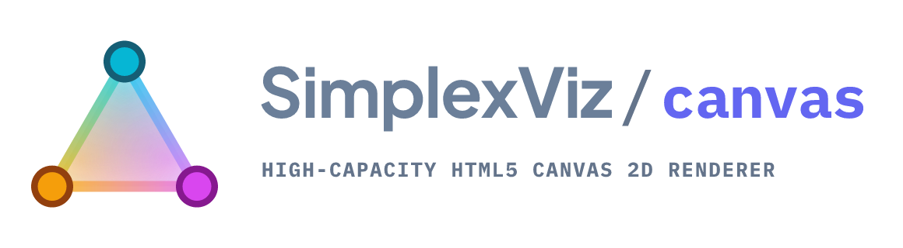
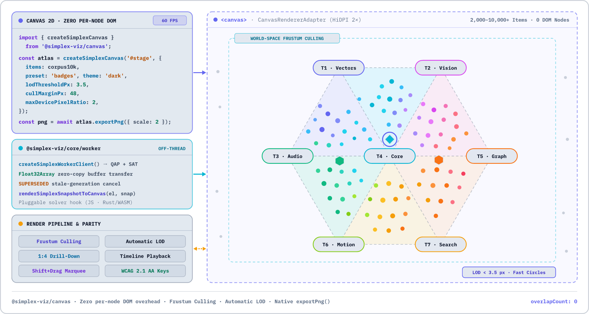

<p align="center">
  
</p>

# `@simplex-viz/canvas`

High-capacity, framework-agnostic **HTML5 Canvas 2D** renderer for [`@simplex-viz/core`](https://www.npmjs.com/package/@simplex-viz/core), built to sustain smooth **60 FPS** interaction on **2,000–10,000+ item** corpora where SVG DOM node overhead becomes a bottleneck.

- **Live Demo:** <https://hackenberg.tech/simplex-viz/>
- **Source & Monorepo:** <https://github.com/ghackenberg/simplex-viz/tree/main/packages/canvas>
- **Companion Packages:** [`@simplex-viz/core`](https://www.npmjs.com/package/@simplex-viz/core) · [`@simplex-viz/svg`](https://www.npmjs.com/package/@simplex-viz/svg) · [`@simplex-viz/react`](https://www.npmjs.com/package/@simplex-viz/react) · [`@simplex-viz/wc`](https://www.npmjs.com/package/@simplex-viz/wc)

## High-Capacity Canvas 2D & Worker Architecture

<p align="center">
  
</p>

*Figure: Architecture of `@simplex-viz/canvas`. Instead of creating thousands of SVG DOM elements, `CanvasRendererAdapter` paints the entire 60° simplex mesh, cluster badges, OKLab content shapes, selection rings, and focus halos onto a single HiDPI `<canvas>` with world-space frustum culling and automatic `lodThresholdPx` simplification—optionally paired with off-thread `@simplex-viz/core/worker` solving.*

## Why `@simplex-viz/canvas`?

- **Zero per-node DOM overhead**: Renders triangles, internal `1:4` drillable previews, lattice edges, cluster badges/anchors, content nodes, multi-selection rings, marquee overlays, and WCAG focus halos onto a single HiDPI `<canvas>`.
- **Frustum culling & automatic LOD**: World-space viewport culling skips off-screen items/triangles/edges before draw calls, and `lodThresholdPx` automatically collapses sub-pixel polygons to fast zero-allocation circles when zoomed out.
- **Full `@simplex-viz/core` API parity (independent of `@simplex-viz/svg`)**: Uses the exact same `SimplexGraphEngine`, `SimplexLayoutSnapshot`, hit-testing, `1:4` hierarchical zoom (`createBarycentricZoomStrategy`, `createSemanticZoomStrategy`, `createSubspaceZoomStrategy`), `SimplexTimelineController`, `getLegendModel()`, `setItemFilter()`, `Shift+Click`/`Shift+Drag` multi-selection, `getViewState()`/`restoreViewState()`, and WCAG 2.1 AA keyboard navigation—sharing preset color/shape/timeline math (`@simplex-viz/core`) and container/tooltip/a11y/interaction mechanics (`@simplex-viz/core/dom`) without pulling in SVG DOM code.
- **Pairs with `@simplex-viz/core/worker`**: Render snapshots solved off the main thread directly via `renderSimplexSnapshotToCanvas(canvas, snapshot)`.

## Installation

```bash
npm install @simplex-viz/canvas
```

## Quickstart: Interactive Canvas Controller

```ts
import {
  createSimplexCanvas,
  createSubspaceZoomStrategy,
  createCollisionDrivenLayoutStrategy,
} from '@simplex-viz/canvas';

const controller = createSimplexCanvas('#atlas', {
  items: largeCorpus, // 2,000–10,000+ records
  preset: 'badges',
  theme: 'dark',
  layoutStrategy: createCollisionDrivenLayoutStrategy(),
  zoomStrategy: createSubspaceZoomStrategy(),
  tooltip: true,
});

// Native zero-serialization PNG export:
const pngBlob = await controller.exportPng({ scale: 2 });
```

## One-Shot Off-Thread Snapshot Rendering (`@simplex-viz/core/worker`)

```ts
import { createSimplexWorkerClient } from '@simplex-viz/core/worker';
import { renderSimplexSnapshotToCanvas } from '@simplex-viz/canvas';

const worker = createSimplexWorkerClient(
  () => new Worker(new URL('./worker.ts', import.meta.url), { type: 'module' }),
);

const { snapshot } = await worker.solve(records, { width: 1200, height: 760 });
renderSimplexSnapshotToCanvas(canvasEl, snapshot, { theme: 'dark' });
```

---

## Configuration Options (`createSimplexCanvas` & `SimplexCanvasController`)

| Option | Default | Description |
| --- | --- | --- |
| `preset` | `'badges'` | Built-in Canvas 2D preset (`'geometric' \| 'glyphs' \| 'badges'`). Defaults to `'badges'` (unlike `@simplex-viz/svg`, which defaults to `'geometric'`) to optimize label legibility on dense corpora. |
| `theme` | `'dark'` | Color theme (`'dark' \| 'light'`) for canvas fill, presets, tooltips, breadcrumbs, and timeline overlay. |
| `backgroundColor` | Theme default | Explicit CSS background fill color, or `'transparent'` for alpha-composited `<canvas>` exports. |
| `maxDevicePixelRatio` | `2` | Maximum HiDPI rasterization cap to sustain 60 FPS on 3×–4× displays. |
| `lodThresholdPx` | `3.5` | Screen-space node radius (CSS px) below which polygons collapse to zero-allocation filled circles (`0` disables LOD). |
| `cullMarginPx` | `48` | World-space margin (px) around viewport bounds for frustum culling of items, edges, and triangles. |
| `badgeOptions` | `{ showCode: true }` | Cluster badge formatting (`{ showCode?, maxTitleChars?, formatTitle? }`). |
| `getShape` | Auto (by unit cluster count) | Fixed or per-item shape (`CanvasShapeSpec` or `(item, ctx) => CanvasShapeSpec`). |
| `shapeOptions` | `{}` | `CanvasShapeOptions`: `{ hoverScale?, hoverRingColor?, dimmedOpacity?, strokeColor?, strokeWidth? }`. |
| `contentRenderer` / `clusterRenderer` | Built-in preset | Custom `CanvasNodeRenderer<TVisual>` plugins overriding built-in item/cluster Canvas drawing and convex hulls. |
| `triangleRenderer` / `edgeRenderer` | Built-in default | Custom `CanvasTriangleRenderer` / `CanvasEdgeRenderer` plugins for simplex faces and edges. |
| `meshStrategy` / `clusteringStrategy` / `colorStrategy` / `layoutStrategy` / `zoomStrategy` | Core defaults | Identical pipeline strategy hooks as `@simplex-viz/svg` and `@simplex-viz/core` (all strategy factories are re-exported directly from `@simplex-viz/canvas`). |
| `timeline` | `false` | Opt-in chronological playback (`true` or `CanvasTimelineConfig<TItem>`) with shared `.sv-timeline-bar` HUD or headless `showControls: false`. |
| `itemFilter` / `itemFilterMode` | `null` / `'dim'` | Zero-relayout predicate filter (`'dim' \| 'hide'`). |
| `emptyClusterBehavior` | `'normal'` | `'normal' \| 'dim' \| 'hide'` for empty clusters (e.g., future timeline frames). |
| `selectedIds` / `shiftClickSelects` / `marqueeSelection` | `[]` / `true` / `true` | Multi-selection via `Shift+Click`, `Shift+Drag` marquee, and `selectItemsInScreenRect()`. |
| `tooltip` | `true` (array shorthand) / `false` | `boolean`, `(target) => string \| false \| null`, `CanvasStructuredTooltipOption` (`{ formatContent?, formatCluster?, formatTriangle? }`), or `CanvasDomTooltipRenderer`. |
| `reducedMotion` | `'auto'` | `'auto' \| boolean` respecting `(prefers-reduced-motion: reduce)`. |
| `relayoutOnFontLoad` | `true` | Invalidates text/hull caches and re-solves layout on `document.fonts.ready` / `loadingdone`. |
| `deferInitialLayout` | `false` | Skips provisional `960×620` layout when mounted at `0×0` until first non-zero `ResizeObserver` entry or `fallbackTimeoutMs`. |
| `touchScrollLockPx` / `clickTolerancePx` | `8` / `12` | Touch vertical scroll lock (`pan-y`; `0` sets `touch-action: none`) and drag-vs-click threshold in CSS px. |
| `ariaLabel` / `keyboardNavigation` | `'Interactive SimplexViz topic graph canvas'` / `true` | WCAG 2.1 AA single-tabstop keyboard navigation, ARIA announcements, and focus ring. |
| `showZoomBreadcrumbs` | `true` | Displays clickable breadcrumbs when `zoomDepth > 0` in drill-down modes. |
| `onMetricsChange` / `onClustersChange` / `onZoomStateChange` / `onSelectionChange` / `onLegendChange` / `onFpsUpdate` | `undefined` | Reactive controller event callbacks (`onFpsUpdate` samples rendered FPS every ~500 ms). |

---

## Custom Canvas 2D Renderers (`CanvasNodeRenderer`, `CanvasTriangleRenderer`, `CanvasEdgeRenderer`)

Override individual scene layers without reimplementing layout, camera math, hit-testing, or keyboard accessibility:

```ts
import { createSimplexCanvas, type CanvasNodeRenderer } from '@simplex-viz/canvas';

interface DocVisual {
  readonly radius: number;
  readonly fillHex: string;
}

const customNodeRenderer: CanvasNodeRenderer<DocVisual> = {
  hoverScale: 1.25,
  dimmedOpacity: 0.25,
  measureConvexHull(visual) {
    return { kind: 'circle', radius: visual.radius };
  },
  draw(ctx, visual, state, { simplifiedLod }) {
    ctx.beginPath();
    ctx.arc(0, 0, visual.radius, 0, Math.PI * 2);
    ctx.fillStyle = visual.fillHex;
    ctx.fill();
    if (!simplifiedLod && state.interaction.isHovered) {
      ctx.lineWidth = 1.5;
      ctx.strokeStyle = '#ffffff';
      ctx.stroke();
    }
  },
};

const ctrl = createSimplexCanvas('#canvas-host', {
  items,
  visualResolver: {
    resolveContentVisual: (_item, ctx) => ({ radius: 8, fillHex: ctx.mixedColorHex }),
    resolveClusterVisual: (c) => ({
      kind: 'badge',
      code: c.code,
      showCode: true,
      title: c.defaultLabel,
      colorHex: c.colorHex,
      memberCount: c.members.length,
      variant: c.role === 'intermediate' ? 'intermediate' : 'primary',
      theme: 'dark',
    }),
    getVisualCacheKey: (v) => ('fillHex' in v ? `${v.radius}:${v.fillHex}` : v.code),
  },
  contentRenderer: customNodeRenderer,
});

// Swap custom renderers live:
ctrl.setRenderers({ triangleRenderer: myTriangleRenderer, edgeRenderer: myEdgeRenderer });
```

---

## Performance Telemetry & Native PNG Export

```ts
// Inspect culling & LOD efficiency per frame:
const stats = controller.getRenderStats();
// {
//   lastFrameMs, totalItems, drawnItems, culledItems,
//   lodSimplifiedItems, drawnClusters, drawnTriangles, drawnEdges, devicePixelRatio
// }

// Export synchronous canvas buffer after flushing latest camera/state:
const blob = await controller.exportPng({ scale: 2, backgroundColor: '#020617' });
const dataUrl = await controller.exportPng({ format: 'dataUrl', backgroundColor: 'transparent' });
```

---

## API Reference Summary

- **Factory & Controller**: `createSimplexCanvas(container, itemsOrOptions)`, `SimplexCanvasController`
  - **Data & Updates**: `setItems`, `addItems`, `removeItems`, `setOptions`, `batch`, `relayout`, `requestRender`, `destroy`
  - **Visuals & Strategies**: `setPreset`, `setTheme`, `setBackgroundColor`, `setShapeOptions`, `setVisualResolver`, `setRenderers`, `setMeshStrategy`, `setClusteringStrategy`, `setColorStrategy`, `setLayoutStrategy`, `setZoomStrategy`, `setShowHulls`, `setEmptyClusterBehavior`
  - **Selection, Focus & Filtering**: `setSelectedIds`, `toggleSelectedId`, `clearSelection`, `getSelectedIds`, `selectItemsInScreenRect(x1, y1, x2, y2, opts?)` / `selectItemsInScreenRect({ x, y, width, height }, opts?)`, `setHighlightedIds`, `setHighlightedItems`, `getHighlightedIds`, `setPinnedIds`, `getPinnedIds`, `focusItem`, `getFocusedItemId`, `zoomToItem`, `setFocusedClusterUid`, `setFocusedTriangleIndex`, `setItemFilter`, `getItemFilter`
  - **Camera & Hierarchical 1:4 Drill-Down**: `camera`, `drillDownTriangle`, `drillDownCluster`, `drillToNeighbor`, `drillUp`, `drillToDepth`, `drillToRoot`, `getZoomState`, `setZoomUiOptions`
  - **Timeline, Legend & View State**: `timeline`, `getTimeline`, `subscribeTimeline`, `setTimelineOptions`, `getLegendModel`, `setOnLegendChange`, `getViewState`, `restoreViewState`
  - **Telemetry, Accessibility & Export**: `getCanvasElement`, `getMetrics`, `getClusters`, `getRenderStats`, `setAriaLabel`, `setKeyboardNavigation`, `getKeyboardFocusTarget`, `clearKeyboardFocus`, `getInteractiveTargets`, `setReducedMotion`, `getReducedMotion`, `isReducedMotionActive`, `exportPng`, `stepForTest`
- **Adapter & Stateless Snapshot Renderer**: `CanvasRendererAdapter`, `renderSimplexSnapshotToCanvas`, `createCanvasPresetVisualResolver`

## License

MIT — see [LICENSE](https://github.com/ghackenberg/simplex-viz/blob/main/LICENSE).

