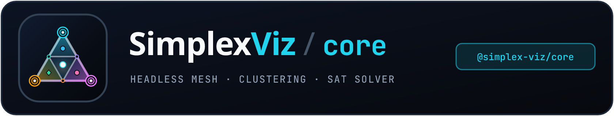
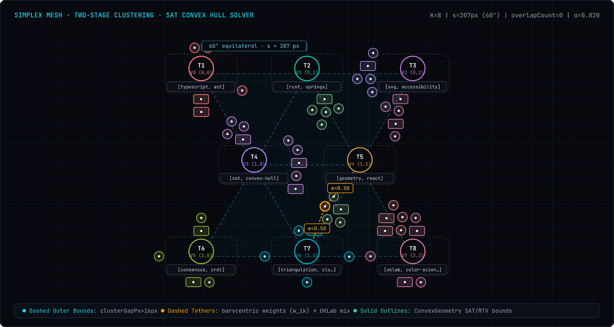

<p align="center">
  
</p>

# @simplex-viz/core

Headless, zero-dependency TypeScript engine for triangulation-based visualization of tagged content collections on a dynamic 60° equilateral simplex mesh.

- **Live Demo:** <https://hackenberg.tech/simplex-viz/>
- **Source & Monorepo:** <https://github.com/ghackenberg/simplex-viz/tree/main/packages/core>
- **Companion Packages:** [`@simplex-viz/svg`](https://www.npmjs.com/package/@simplex-viz/svg) · [`@simplex-viz/react`](https://www.npmjs.com/package/@simplex-viz/react)

> Most browser apps should start with [`@simplex-viz/react`](https://www.npmjs.com/package/@simplex-viz/react) (for React) or [`@simplex-viz/svg`](https://www.npmjs.com/package/@simplex-viz/svg) (for Vanilla TypeScript, Vue, Angular, Svelte, or Web Components). Use `@simplex-viz/core` directly when building a custom Canvas/WebGL renderer, running layout calculations in a Web Worker or Node.js, or using low-level geometry, OKLab, and clustering primitives.

<p align="center">
  
</p>

---

## Key Capabilities

- **Zero dependencies & zero DOM**: Compiled strictly against `lib: ["ES2022"]` with `"dependencies": {}`. Runs identically in browsers, Node.js, Deno, Bun, Web Workers, and Edge runtimes.
- **Schema-free & end-to-end type safe**: Works with arbitrary `<TItem, TContentVisual, TClusterVisual, TTagMeta, TClusterMeta>` via conditional hybrid accessors (`ItemIdentityConfig<TItem>` and `ClusterMetaConfig`). If your items don't use `{ id, tags }`, TypeScript enforces `getId` and `getTags` at compile time without any `any` casts.
- **Two-stage topic clustering**: Regularized Jaccard tag partitioning, Simulated Annealing QAP mesh embedding, Weighted Hitting-Set planar triangle completion, backward tag pruning, and Hungarian bipartite identity matching for stable cluster UIDs across mutations.
- **Perceptual OKLab palette & mixing**: Edge-contrast-optimized cluster colors and chroma-preserving barycentric OKLab blending.
- **Guaranteed 0.0 px overlap**: Hierarchical two-phase convex hull solver combining Separating Axis Theorem (SAT), circle-polygon Minimum Translation Vectors (MTV), uniform spatial hash grids, and binary scale search.
- **Interruptible C1-continuous animation**: Critically damped scalar springs and retargetable dual-layer transition state machines.
- **Mathematical hit-testing**: Resolution-independent convex-hull pointer hit-testing in world coordinates.

---

## Installation

```bash
npm install @simplex-viz/core
```

---

## Quickstart: Using `SimplexGraphEngine` with a Custom Renderer

`SimplexGraphEngine` is completely decoupled from the DOM. You provide:

1. Your domain items (`items`) + optional `getId`, `getTags`, `resolveTagMeta`, and `deriveClusterMeta`.
2. A `VisualResolver` converting domain items/clusters into pure serializable visual descriptors.
3. A `SimplexRendererAdapter` implementing `measureContentHull`, `measureClusterHull`, `renderFrame`, and `destroy`.

```ts
import {
  SimplexGraphEngine,
  rectToConvexPolygon,
  type SimplexRendererAdapter,
  type VisualResolver,
  type SceneFrameSnapshot,
} from '@simplex-viz/core';

// 1. Your domain item type (does not need { id, tags }!)
interface Article {
  readonly slug: string;
  readonly title: string;
  readonly hashtags: readonly string[];
  readonly readingMinutes: number;
}

// 2. Pure visual descriptor types
interface ArticleVisual {
  readonly kind: 'circle' | 'pill';
  readonly radius: number;
  readonly colorHex: string;
  readonly label: string;
}

interface TopicVisual {
  readonly code: string;
  readonly title: string;
  readonly colorHex: string;
  readonly memberCount: number;
}

interface TopicStats {
  readonly count: number;
  readonly avgMinutes: number;
}

// 3. VisualResolver decoupled from rendering
const visualResolver: VisualResolver<
  Article,
  ArticleVisual,
  TopicVisual,
  undefined,
  TopicStats
> = {
  resolveContentVisual: (item, ctx) => ({
    kind: item.readingMinutes > 10 ? 'pill' : 'circle',
    radius: 10,
    colorHex: ctx.mixedColorHex,
    label: item.title,
  }),
  resolveClusterVisual: (cluster) => ({
    code: cluster.code,
    title: cluster.defaultLabel,
    colorHex: cluster.colorHex,
    memberCount: cluster.meta.count,
  }),
  getVisualCacheKey: (v) =>
    'kind' in v
      ? `${v.kind}:${v.colorHex}:${v.label}`
      : `${v.code}:${v.memberCount}`,
};

// 4. Minimal renderer adapter (e.g., Canvas2D, WebGL, or headless snapshot consumer)
const myRenderer: SimplexRendererAdapter<ArticleVisual, TopicVisual> = {
  measureContentHull(visual) {
    return visual.kind === 'circle'
      ? { kind: 'circle', radius: visual.radius }
      : rectToConvexPolygon(visual.label.length * 7 + 16, 24, 6);
  },
  measureClusterHull() {
    return { kind: 'circle', radius: 24 };
  },
  renderFrame(snapshot: SceneFrameSnapshot<ArticleVisual, TopicVisual>) {
    // Draw snapshot.triangles, snapshot.edges, snapshot.clusters, snapshot.items
    // using snapshot.camera ({ zoom, panX, panY })
  },
  destroy() {
    // Release Canvas/WebGL resources
  },
};

// 5. Instantiate the headless engine
const engine = new SimplexGraphEngine<
  Article,
  ArticleVisual,
  TopicVisual,
  undefined,
  TopicStats
>({
  items: myArticles,
  getId: (a) => a.slug,
  getTags: (a) => a.hashtags,
  deriveClusterMeta: (ctx) => ({
    count: ctx.members.length,
    avgMinutes:
      ctx.members.reduce((sum, m) => sum + m.item.readingMinutes, 0) /
      Math.max(1, ctx.members.length),
  }),
  visualResolver,
  renderer: myRenderer,
  viewportWidth: 1200,
  viewportHeight: 800,
  meshOptions: {
    innerPadding: 48,
    minSideLength: 140,
    maxSideLength: 280,
    maxClusters: 12,
  },
  layoutOptions: {
    clusterGapPx: 14,
    itemGapPx: 5,
    seed: 42,
  },
  onMetricsChange: (metrics) => {
    console.log('Overlap count:', metrics.overlapCount); // Always 0 when settled
  },
});

// 6. Drive animation ticks (e.g., inside requestAnimationFrame or a fixed-step loop)
function tick(dtMs: number) {
  const settled = engine.step(dtMs);
  if (!settled) {
    requestAnimationFrame(() => tick(16.67));
  }
}
```

### Live Mutations & Interactions

```ts
// Interruptible item updates (critically damped springs smoothly retarget mid-flight)
engine.addItems({
  slug: 'sat-primer',
  title: 'Separating Axis Theorem',
  hashtags: ['geometry', 'collision'],
  readingMinutes: 8,
});
engine.removeItems('old-slug');
engine.setItems(nextArticles);
engine.setViewport(1440, 900);
engine.setSizeMultiplier(1.25);
engine.setShowHulls(true);

// Focus & highlight states
engine.setPinnedIds(['sat-primer']);
engine.setFocusedClusterUid(engine.getClusters()[0]?.clusterUid ?? null);

// Forward normalized pointer & wheel events from your surface
engine.handlePointerMove(screenX, screenY);
engine.handleLeftClick({
  screenX,
  screenY,
  button: 0,
  shiftKey: false,
  ctrlKey: false,
  altKey: false,
  metaKey: false,
});
engine.camera.zoomToCursor(screenX, screenY, 1.15);
```

---

## Configuration Reference

### `ItemIdentityConfig<TItem>` & `ClusterMetaConfig`

- If `TItem` has `{ readonly id: string; readonly tags: readonly string[] }`, `getId` and `getTags` are optional. Otherwise TypeScript requires both.
- If `TClusterMeta` is `undefined` (default), `deriveClusterMeta` is optional. When a custom `TClusterMeta` type is supplied, `deriveClusterMeta(ctx)` becomes compile-time required.

### `MeshOptions`

| Option | Type | Default | Description |
| --- | --- | --- | --- |
| `innerPadding` | `number` | `48` | Padding around the usable simplex lattice in pixels. |
| `minSideLength` | `number` | `140` | Minimum preferred equilateral triangle edge length in pixels. |
| `maxSideLength` | `number` | `280` | Maximum preferred equilateral triangle edge length in pixels. |
| `maxClusters` | `number` | `12` | Upper bound on cluster vertices `K`. |

### `LayoutSolverOptions`

| Option | Type | Default | Description |
| --- | --- | --- | --- |
| `clusterGapPx` | `number` | `14` | Minimum guaranteed clearance between cluster hulls (px). |
| `itemGapPx` | `number` | `5` | Minimum guaranteed clearance between content items and clusters (px). |
| `minContentScale` | `number` | `0.2` | Lower bound for the binary search over content scale factor `α_content`. |
| `relaxationIterations` | `number` | `36` | Maximum PBD/MTV relaxation iterations per binary search probe. |
| `sizeMultiplier` | `number` | `1.0` | Uniform scale multiplier applied before solving. |
| `seed` | `number` | `undefined` | Optional deterministic PRNG seed for reproducible QAP embedding and tie-breaking. |

---

## Low-Level Pure Utilities

Every algorithmic building block can also be imported standalone:

- **Mesh**: `buildSimplexMesh(width, height, tagCount, options)`
- **Clustering**: `computeSimplexClustering(...)`, `extractNormalizedItems(...)`, `defaultNormalizeTag(...)`
- **Layout Solver**: `solveTwoPhaseLayout(...)`
- **Geometry & Collision**: `computeConvexHull`, `rectToConvexPolygon`, `regularPolygon`, `starConvexHull`, `computeConvexMtv`, `computeCirclePolygonMtv`, `hitTestConvexGeometry`, `UniformSpatialHashGrid`
- **Color Science**: `hexToOklab`, `oklabToHex`, `mixOklabColors`, `lerpOklabHex`, `generatePerceptualClusterPalette`
- **Animation & Camera**: `stepCriticallyDampedSpring`, `retargetVisualTransition`, `stepVisualTransition`, `SimplexCamera`

---

## License

MIT — see [LICENSE](https://github.com/ghackenberg/simplex-viz/blob/main/LICENSE).
