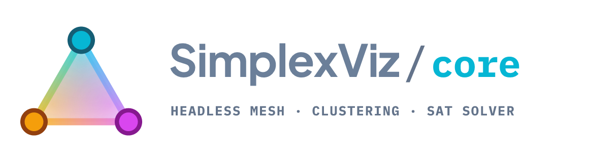
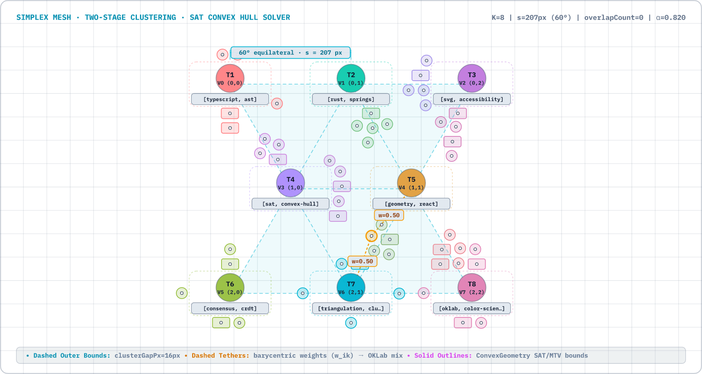

<p align="center">
  
</p>

# @simplex-viz/core

Headless, zero-dependency TypeScript engine for triangulation-based visualization of arbitrary domain collections—single/multi-modal vector embeddings, pairwise similarities, or tagged content—on a dynamic 60° equilateral simplex mesh with composable SAT collision layout and hierarchical `1:4` zoom/drill-down.

- **Live Demo:** <https://hackenberg.tech/simplex-viz/>
- **Source & Monorepo:** <https://github.com/ghackenberg/simplex-viz/tree/main/packages/core>
- **Companion Packages:** [`@simplex-viz/svg`](https://www.npmjs.com/package/@simplex-viz/svg) · [`@simplex-viz/react`](https://www.npmjs.com/package/@simplex-viz/react)

> Most browser apps should start with [`@simplex-viz/react`](https://www.npmjs.com/package/@simplex-viz/react) (for React) or [`@simplex-viz/svg`](https://www.npmjs.com/package/@simplex-viz/svg) (for Vanilla TypeScript, Vue, Angular, Svelte, or Web Components). Use `@simplex-viz/core` directly when building a custom Canvas/WebGL renderer, running layout calculations in a Web Worker or Node.js, or using low-level geometry, OKLab, zoom, and clustering primitives.

## Spatial Pipeline Overview

Before diving into the TypeScript API, the schematic diagram below traces a single tagged corpus through the engine's internal coordinate system—from raw lattice cells to final collision envelopes:

<p align="center">
  
</p>

*Figure: Schematic geometry view of the headless `@simplex-viz/core` pipeline. Dashed blueprint lines mark the adaptive 60° equilateral triangle lattice (`s = 207 px`) anchored at grid coordinates `V0`–`V7` (`row, col`), with each cluster displaying its top core tags and dashed `clusterGapPx` clearance envelope. The highlighted amber tethers (`w = 0.50`) illustrate how the explaining-away step computes barycentric weights along a shared simplex edge to blend perceptual OKLab colors, while solid circular and rounded-rectangle outlines show exact `ConvexGeometry` bounds separated by the SAT/MTV solver (`overlapCount = 0`).*

## Key Capabilities

- **Zero dependencies & zero DOM**: Compiled strictly against `lib: ["ES2022"]` with `"dependencies": {}`. Runs identically in browsers, Node.js, Deno, Bun, Web Workers, and Edge runtimes.
- **Representation-agnostic & end-to-end type safe**: Works with arbitrary `<TItem, TContentVisual, TClusterVisual, TTagMeta, TClusterMeta>` via conditional hybrid accessors (`StrategyItemIdentityConfig<TItem, TTagMeta>`). Passing a non-tag `clusteringStrategy` (embeddings, pairwise similarity, or custom) makes `getTags` completely optional; using the default tag path enforces `getTags` only when `TItem` lacks `tags`.
- **Pluggable 5-stage pipeline**: Swap algorithms cleanly at construction or runtime via `SimplexMeshStrategy`, `SimplexClusteringStrategy` (`requiresTags`, `initialize`, incremental `update`), `SimplexColorStrategy`, `SimplexLayoutStrategy`, and `SimplexZoomStrategy`.
- **Soft-Simplex, embeddings, similarities & tag specialization**:
  - **Soft-Simplex strategies** (`createSoftSimplexTagClusteringStrategy`, `createSoftSimplexEmbeddingClusteringStrategy`): Load-balanced QAP mesh embedding + continuous interior triangle spreading (`triangleSpread`) while leaving single-cluster items free in a 360° halo around their cluster vertex.
  - **Multi-modal embeddings** (`createEmbeddingClusteringStrategy`): Single or weighted multi-source feature vectors, k-Means++ / Spherical k-Means, QAP mesh embedding, Hungarian cluster UID stability, and closed-form NNLS barycentric planar simplex projection (`'simplex-projection'`, `'explaining-away'`, `'top-1'`).
  - **Pairwise similarities** (`createSimilarityClusteringStrategy`): PAM k-Medoids + QAP mesh embedding + simplex projection for arbitrary `(a, b) => [0, 1]` kernels.
  - **Tag clustering specialization** (`createJaccardAnnealingClusteringStrategy`, `createIncrementalAnchorClusteringStrategy`): Regularized Jaccard partitioning, Simulated Annealing QAP, Weighted Hitting-Set planar completion, and backward tag pruning.
- **Composable Layout (`Seeder × Relaxer × ScaleController`) & `0.0 px` SAT overlap**: Mix any `LayoutSeeder` (`phyllotaxis`, `mesh-inward-fan`, `warm-start`), `PositionRelaxer` (`barycentric-pbd`, `space-filling-pbd`), and `ScaleController` (`uniform-scale`, `collision-local-scale`, `density-prior-scale`, `fixed-scale`) via `createComposedLayoutStrategy()` / `solveComposedLayout()` with covering-triangle containment and zero convex overlap.
- **Conformal `1:4` Hierarchical Zoom & Drill-Down**: `createBarycentricZoomStrategy`, `createSemanticZoomStrategy`, and `createSubspaceZoomStrategy` subdivide triangles `1:4` while preserving exact `▲/▼/▶/◀` orientation, synthesize `'intermediate'` midpoint clusters, focus non-subdividable leaf triangles cleanly as single triangles (`'triangle-focus'`, `leafTriangleFocus: true`) while keeping content items directly clickable, resolve both primary and intermediate clusters as uniform 1-ring `'incident-star'` meshes with barycentric simplex-distance item dimming, animate affine camera flights (`ZoomAffineTransform`), and project dimmed clickable neighborhood context.
- **Interruptible C1-continuous animation & mathematical hit-testing**: Critically damped scalar springs, retargetable dual-layer transition state machines, and exact world-coordinate convex-hull + barycentric triangle-face hit-testing (`isPointInTriangle`).

## Installation

```bash
npm install @simplex-viz/core
```

## Quickstart: One-Shot Layout with `solveSimplexSnapshot`

If you want solved `(x, y)` coordinates, mesh triangles, topic clusters, and perceptual OKLab colors in a single synchronous call—without setting up a `SimplexRendererAdapter` or animation loop—call `solveSimplexSnapshot(items)`:

```ts
import { solveSimplexSnapshot } from '@simplex-viz/core';

const snapshot = solveSimplexSnapshot([
  { id: 'mesh', tags: ['geometry', 'triangulation', 'math'] },
  { id: 'oklab', tags: ['color', 'perception', 'geometry'] },
  { id: 'sat', tags: ['collision', 'geometry'] },
]);

console.log(snapshot.metrics.overlapCount); // 0
console.log(snapshot.clusters); // Solved vertex clusters + OKLab hex colors
console.log(snapshot.items); // Non-overlapping content coordinates & weights
```

For custom domain records that do not use `{ id, tags }`, supply `getId`, `getTags`, canvas dimensions, or custom hull callbacks in the second argument:

```ts
import { solveSimplexSnapshot, rectToConvexPolygon } from '@simplex-viz/core';

interface Paper {
  readonly doi: string;
  readonly keywords: readonly string[];
  readonly title: string;
}

const snapshot = solveSimplexSnapshot(papers, {
  getId: (p) => p.doi,
  getTags: (p) => p.keywords,
  width: 1200,
  height: 760,
  measureContentHull: (p) => rectToConvexPolygon(p.title.length * 7 + 16, 24, 6),
});
```

### Quickstart Without Tags (Single or Multi-Modal Embeddings)

Pass arbitrary objects without any `tags` property alongside `createSoftSimplexEmbeddingClusteringStrategy`, `createEmbeddingClusteringStrategy`, or `createSimilarityClusteringStrategy`:

```ts
import {
  solveSimplexSnapshot,
  createSoftSimplexEmbeddingClusteringStrategy,
} from '@simplex-viz/core';

interface AudioSample {
  readonly id: string;
  readonly timbreVec: readonly number[];
  readonly prosodyVec: readonly number[];
}

const snapshot = solveSimplexSnapshot(samples as readonly AudioSample[], {
  clusteringStrategy: createSoftSimplexEmbeddingClusteringStrategy<AudioSample>({
    getEmbedding: [
      { name: 'Timbre', getVector: (s) => s.timbreVec, weight: 0.75 },
      { name: 'Prosody', getVector: (s) => s.prosodyVec, weight: 0.25 },
    ],
    metric: 'cosine',
    triangleSpread: 0.45,
  }),
});
```

### Quickstart Default Settings (`solveSimplexSnapshot` & `SimplexGraphEngine`)

| Option | `solveSimplexSnapshot` Default | `SimplexGraphEngine` Default |
| --- | --- | --- |
| `width` / `height` | `960` × `600` | Required `viewportWidth` × `viewportHeight` (clamped `>= 160`) |
| `itemRadius` / `clusterRadius` | `10` px / `24` px (circle hulls) | Measured via `renderer.measureContentHull` / `measureClusterHull` |
| `getId` / `getTags` | `item.id` / `item.tags` | `item.id` / `item.tags` |
| `normalizeTag` | Lowercase trim + leading `#` strip | Lowercase trim + leading `#` strip |
| `theme` | `'dark'` | `'dark'` |
| `meshStrategy` | `createAdaptiveHexMeshStrategy()` | `createAdaptiveHexMeshStrategy()` |
| `clusteringStrategy` | `createJaccardAnnealingClusteringStrategy()` | `createJaccardAnnealingClusteringStrategy()` |
| `colorStrategy` | `createOklabContrastColorStrategy()` | `createOklabContrastColorStrategy()` |
| `layoutStrategy` | `createPbdUniformLayoutStrategy()` | `createPbdUniformLayoutStrategy()` |
| `zoomStrategy` | *(N/A — stateless single-frame solver)* | `createFreeCameraZoomStrategy()` |
| `onWheel` | *(N/A)* | `'zoom-to-cursor'` (blocked automatically when `zoomStrategy.mode === 'drill-down'`) |

---

## Full Engine Control: Using `SimplexGraphEngine` Step by Step

When building an interactive Canvas/WebGL surface with live mutations, hit-testing, hierarchical zoom/drill-down, and 60 fps critically damped springs, use `SimplexGraphEngine` across the five steps below.

### Step 1 — Define Domain & Visual Descriptor Types

```ts
import {
  SimplexGraphEngine,
  rectToConvexPolygon,
  type SimplexRendererAdapter,
  type VisualResolver,
  type SceneFrameSnapshot,
} from '@simplex-viz/core';

interface Article {
  readonly slug: string;
  readonly title: string;
  readonly hashtags: readonly string[];
  readonly readingMinutes: number;
}

interface ArticleVisual {
  readonly kind: 'circle' | 'pill';
  readonly radius: number;
  readonly colorHex: string;
  readonly label: string;
}

interface TopicVisual {
  readonly code: string;
  readonly title: string;
  readonly colorHex: string;
  readonly memberCount: number;
}

interface TopicStats {
  readonly count: number;
  readonly avgMinutes: number;
}
```

### Step 2 — Map Records to Visuals via `VisualResolver`

```ts
const visualResolver: VisualResolver<
  Article,
  ArticleVisual,
  TopicVisual,
  undefined,
  TopicStats
> = {
  resolveContentVisual: (item, ctx) => ({
    kind: item.readingMinutes > 10 ? 'pill' : 'circle',
    radius: 10,
    colorHex: ctx.mixedColorHex,
    label: item.title,
  }),
  resolveClusterVisual: (cluster) => ({
    code: cluster.code,
    title: cluster.defaultLabel,
    colorHex: cluster.colorHex,
    memberCount: cluster.meta.count,
  }),
  getVisualCacheKey: (v) =>
    'kind' in v
      ? `${v.kind}:${v.colorHex}:${v.label}`
      : `${v.code}:${v.memberCount}`,
};
```

### Step 3 — Implement a Custom `SimplexRendererAdapter`

```ts
const myRenderer: SimplexRendererAdapter<ArticleVisual, TopicVisual, Article, undefined, TopicStats> = {
  measureContentHull(visual) {
    return visual.kind === 'circle'
      ? { kind: 'circle', radius: visual.radius }
      : rectToConvexPolygon(visual.label.length * 7 + 16, 24, 6);
  },
  measureClusterHull() {
    return { kind: 'circle', radius: 24 };
  },
  renderFrame(snapshot: SceneFrameSnapshot<ArticleVisual, TopicVisual, Article, undefined, TopicStats>) {
    // Draw snapshot.triangles (with isDrillable, isContext, highlightBoundary,
    // interaction.isHovered / isFocused / isHighlighted / isDimmed),
    // snapshot.edges, snapshot.clusters, and snapshot.items (with isContext, isPassThrough)
    // using snapshot.camera ({ zoom, panX, panY })
  },
  destroy() {
    // Release Canvas/WebGL resources
  },
};
```

### Step 4 — Instantiate `SimplexGraphEngine`

```ts
const engine = new SimplexGraphEngine<
  Article,
  ArticleVisual,
  TopicVisual,
  undefined,
  TopicStats
>({
  items: myArticles,
  getId: (a) => a.slug,
  getTags: (a) => a.hashtags,
  deriveClusterMeta: (ctx) => ({
    count: ctx.members.length,
    avgMinutes:
      ctx.members.reduce((sum, m) => sum + m.item.readingMinutes, 0) /
      Math.max(1, ctx.members.length),
  }),
  visualResolver,
  renderer: myRenderer,
  viewportWidth: 1200,
  viewportHeight: 800,
  meshOptions: { innerPadding: 48, minSideLength: 130, maxClusters: 14 },
  layoutOptions: { clusterGapPx: 14, itemGapPx: 5, seed: 42 },
  onMetricsChange: (metrics) => {
    console.log('Overlap count:', metrics.overlapCount); // Always 0 when settled
  },
  onZoomStateChange: (zoom) => {
    console.log('Zoom depth:', zoom.depth, 'Drillable triangles:', zoom.drillableTriangleIndices);
  },
});
```

### Step 5 — Drive the Spring Simulation Loop & Interactions

```ts
function tick(dtMs: number) {
  const settled = engine.step(dtMs);
  if (!settled) {
    requestAnimationFrame(() => tick(16.67));
  }
}

// Live mutations, focus, and hierarchical drill-down:
engine.addItems({ slug: 'sat-primer', title: 'SAT', hashtags: ['geometry'], readingMinutes: 8 });
engine.setZoomStrategy(createBarycentricZoomStrategy());
engine.drillDownTriangle(0);
engine.drillUp();
engine.drillToRoot();
```

---

## Pluggable 5-Stage Core Strategies Reference

Every algorithmic stage of `SimplexGraphEngine` (and stages 1–4 in `solveSimplexSnapshot`) can be configured at initialization or hot-swapped at runtime (`setMeshStrategy`, `setClusteringStrategy`, `setColorStrategy`, `setLayoutStrategy`, `setZoomStrategy`, `setTheme`).

### 1. `SimplexMeshStrategy` (Triangulation & Lattice Sizing)

- `createAdaptiveHexMeshStrategy(defaults?)` *(default)* — Automatically chooses `horizontal` / `vertical` orientation and `wideFirst` parity via `buildSimplexMesh` (respecting optional explicit `MeshOptions.sideLength`).
- `createFixedLatticeMeshStrategy({ cols, rows, orientation?, wideFirst?, innerPadding?, sideLength? })` — Pins an exact `(cols × rows)` 60° equilateral lattice (`K = cols * rows` vertices) across resizes.

### 2. `SimplexClusteringStrategy` (Soft-Simplex, Embeddings, Similarities & Tags)

Clustering strategies declare `requiresTags?: boolean` and support `initialize(ctx)` plus optional incremental `update(ctx)`:

- **Tag Specializations (`requiresTags: true`)**:
  - `createJaccardAnnealingClusteringStrategy({ getTags?, normalizeTag?, sharedTagRule?, anchorRule? })` *(default)* — Full Jaccard tag partitioning + Simulated Annealing QAP vertex embedding + Hungarian identity matching.
  - `createSoftSimplexTagClusteringStrategy({ triangleSpread?, getTags?, normalizeTag?, sharedTagRule?, anchorRule? })` — Load-balanced QAP + soft interior spreading (`triangleSpread`, default `0.45`) for multi-cluster items while keeping single-cluster items unconstrained around their vertex.
  - `createIncrementalAnchorClusteringStrategy({ getTags?, normalizeTag?, sharedTagRule?, anchorRule? })` — Preserves existing vertex topics/UIDs/colors on `update`, attaching new tags incrementally.
  - **`sharedTagRule`**: `'planar-hitting-set'` *(default)*, `'none'`, or custom function.
  - **`anchorRule`**: `'explaining-away'` *(default)*, `'raw-overlap'`, `'barycentric-all'`, or custom function.
- **Vector Embeddings (`requiresTags: false`)**:
  - `createEmbeddingClusteringStrategy({ getEmbedding, metric?, clusterCount?, maxIterations?, anchorRule?, deriveLabel?, representativeCount?, similaritySharpness? })` — Single or weighted multi-modal `EmbeddingSource[]` (`'cosine'` default or `'euclidean'`), k-Means++ / Spherical k-Means, QAP mesh embedding, and NNLS barycentric projection (`'simplex-projection'` default, `'explaining-away'`, or `'top-1'`).
  - `createSoftSimplexEmbeddingClusteringStrategy({ getEmbedding, metric?, triangleSpread?, minSecondaryWeight?, balanceLoad?, clusterCount?, maxIterations?, deriveLabel? })` — Load-balanced QAP (`balanceLoad: true` default) + temperature-scaled softmax/NNLS interior projection (`triangleSpread: 0.45`, `minSecondaryWeight: 0.08`).
- **Pairwise Similarity (`requiresTags: false`)**:
  - `createSimilarityClusteringStrategy({ getSimilarity, clusterCount?, anchorRule?, deriveLabel?, representativeCount? })` — PAM k-Medoids + QAP mesh embedding + simplex projection.

### 3. `SimplexColorStrategy` (Cluster Colors & Item Mixing)

- `createOklabContrastColorStrategy()` *(default)* — Perceptual OKLab edge contrast + barycentric OKLab mixing.
- `createThemeAdaptiveOklabColorStrategy()` — Adapts lightness & chroma targets dynamically to `theme: 'dark' | 'light'`.
- `createPaletteColorStrategy(hexColors, { mode?: 'edge-contrast' | 'sequential', preserveMatchedColors? })` — Assigns colors from a custom hex palette.

### 4. `SimplexLayoutStrategy` & Composable Building Blocks (`Seeder × Relaxer × ScaleController`)

Built-in layout strategy presets (all strictly guaranteeing **`0.0 px` overlap** and covering-triangle containment):
- `createPbdUniformLayoutStrategy()` *(default)* — `createMeshInwardFanSeeder` + `createSpaceFillingPbdRelaxer` + `createUniformScaleController` (`warmStart: false`) so open covering triangles are utilized cleanly while preserving exact global size ratios.
- `createWarmStartPbdLayoutStrategy()` — Same as above with `warmStart: true` for minimal movement across updates.
- `createLocalAdaptiveLayoutStrategy({ crowdRadiusPx?, minLocalScale?, warmStart? })` — Combines `createMeshInwardFanSeeder` + `createSpaceFillingPbdRelaxer` + `createDensityPriorScaleController` (`crowdRadiusPx: 76`, `minLocalScale: 0.35`, `warmStart: true`) to spread pockets first, compute smooth radial crowd gradients on dispersed positions, and polish locally without global shrink.
- `createCollisionDrivenLayoutStrategy({ minLocalScale?, shrinkFactor?, warmStart? })` — Combines `createMeshInwardFanSeeder` + `createSpaceFillingPbdRelaxer` + `createCollisionLocalScaleController` (`minLocalScale: 0.32`, `shrinkFactor: 0.85`, `warmStart: true`) to keep every non-colliding item at `1.0` scale and shrink only locally colliding pockets.

Or compose custom layout pipelines via `createComposedLayoutStrategy(options)` / `solveComposedLayout(params)`:
- **Seeders (`LayoutSeeder`)**: `createPhyllotaxisSeeder(opts?)`, `createMeshInwardFanSeeder(opts?)`, `withWarmStartSeeder(seeder)`.
- **Relaxers (`PositionRelaxer`)**: `createBarycentricPbdRelaxer(opts?)`, `createSpaceFillingPbdRelaxer(opts?)`.
- **Scale Controllers (`ScaleController`)**: `createUniformScaleController(opts?)`, `createCollisionLocalScaleController(opts?)`, `createDensityPriorScaleController(opts?)`, `createFixedScaleController({ scale? })`.

### 5. `SimplexZoomStrategy` (Hierarchical `1:4` Drill-Down & Free Camera)

- `createFreeCameraZoomStrategy()` *(default)* — Continuous 2D camera (`mode: 'free-camera'`).
- `createBarycentricZoomStrategy(options?)` (`mode: 'drill-down'`):
  - `clusterZoomMode`: `'incident-star'` *(default — uniform 1-ring incident-star mesh for both primary and intermediate clusters with barycentric simplex-distance dimming)* | `'spotlight'` | `'none'`
  - `adaptiveContrastStretch`: `true` *(default)* — Re-centers skewed parent weight distributions across the 4 sub-triangles.
  - `enableSectorFallback`: `true` *(default)* — Falls back to radial sector partitioning when weights are degenerate.
  - `stopWhenFullScale`: `true` *(default)* — Stops `1:4` subdivision once all covered items reach `fullScaleThreshold` (`0.995` default).
  - `leafTriangleFocus`: `true` *(default)* — Keeps non-subdividable leaf triangles focusable as single triangles (`'triangle-focus'`) while leaving their content items directly clickable.
- `createSemanticZoomStrategy(options?)` (`mode: 'drill-down'`):
  - Re-partitions a focused triangle's discriminative tags across all `6` sub-vertices (`clusterZoomMode: 'incident-star'`, `stopWhenFullScale: true`, `fullScaleThreshold: 0.995`, `leafTriangleFocus: true`, `barycentricFallback: true`).
- `createSubspaceZoomStrategy(options?)` (`mode: 'drill-down'`):
  - Representation-agnostic `6`-vertex local subspace refinement across embeddings, pairwise similarity kernels, and tags (`clusterZoomMode: 'incident-star'`, `stopWhenFullScale: true`, `fullScaleThreshold: 0.995`, `leafTriangleFocus: true`, `minItemsForRecluster: 6`, `blendFactor: 0.35`).
- **Imperative Zoom Methods on `SimplexGraphEngine`**:
  `setZoomStrategy(strategy)`, `getZoomStrategy()`, `getZoomState()`, `drillDownTriangle(index)`, `drillDownCluster(uid)`, `drillToNeighbor(neighborId)`, `drillUp()`, `drillToDepth(depth)`, `drillToRoot()`.

---

## Configuration Tables

### `MeshOptions`

| Option | Type | Default | Description |
| --- | --- | --- | --- |
| `innerPadding` | `number` | `32`–`48` (adaptive) | Padding around the usable simplex lattice in pixels (scales adaptively with viewport size when omitted). |
| `sideLength` | `number` | `undefined` | Explicit equilateral triangle side length in pixels (overrides automatic sizing). |
| `minSideLength` | `number` | `130` | Minimum preferred equilateral triangle edge length in pixels when `sideLength` is omitted. |
| `maxSideLength` | `number` | `undefined` | Optional upper cap on equilateral triangle edge length in pixels (scales freely to fill the canvas when omitted). |
| `maxClusters` | `number` | `14` | Upper bound on cluster vertices `K` in adaptive meshes. |

### `LayoutSolverOptions`

| Option | Type | Default | Description |
| --- | --- | --- | --- |
| `clusterGapPx` | `number` | `14` | Minimum guaranteed clearance between cluster hulls (px). |
| `itemGapPx` | `number` | `5` | Minimum guaranteed clearance between content items and clusters (px). |
| `minContentScale` | `number` | `0.16`–`0.20` | Safety lower bound for content scale factor `α_content`. |
| `relaxationIterations` | `number` | Strategy default (`38`–`46`) | Maximum PBD/MTV relaxation iterations per pass. |
| `sizeMultiplier` | `number` | `1.0` | Uniform node scale multiplier applied before solving. |
| `seed` | `number` | `0x51a7c0de` | Deterministic PRNG seed for reproducible QAP embedding and tie-breaking. |

## Low-Level Pure Utilities

Every algorithmic building block can also be imported standalone:

- **Mesh & Zoom Geometry**: `buildSimplexMesh`, `buildSimplexLattice`, `resolveDefaultInnerPadding`, `buildSubdividedTriangleMesh`, `buildIncidentStarMesh`, `applyZoomAffine`, `invertZoomAffine`, `composeZoomAffine`
- **Clustering**: `computeSimplexClustering`, `embedSimilarityMatrixOnMesh`, `extractIdentifiedItems`, `analyzeTagCorpus`, `partitionTagsJaccard`, `computeMeshHopDistances`, `embedClustersQapAnnealing`, `completePlanarSharedTags`, `matchClustersHungarian`, `assignItemsToSimplexUnits`, `assignDiscriminativeClusterLabels`, `resolveDiscriminativeClusterLabel`, `disambiguatePeerClusterTitle`, `extractNormalizedItems`, `defaultNormalizeTag`
- **Layout Solver**: `solveComposedLayout`, `solveTwoPhaseLayout`, `solveLocalAdaptiveLayout`, `solveCollisionDrivenLayout`, `buildItemCoveringTriangles`, `measureLayoutOverlaps`
- **Geometry & Collision**: `computeConvexHull`, `rectToConvexPolygon`, `regularPolygon`, `starConvexHull`, `isPointInTriangle`, `computeConvexMtv`, `computeCirclePolygonMtv`, `hitTestConvexGeometry`, `UniformSpatialHashGrid`
- **Color Science**: `hexToOklab`, `oklabToHex`, `mixOklabColors`, `lerpOklabHex`, `generatePerceptualClusterPalette`, `buildDistinctOklabPalette`, `assignMeshClusterColors`, `assignGreedyEdgeContrastColors`
- **Animation & Camera**: `stepCriticallyDampedSpring`, `retargetVisualTransition`, `stepVisualTransition`, `SimplexCamera`

## License

MIT — see [LICENSE](https://github.com/ghackenberg/simplex-viz/blob/main/LICENSE).
