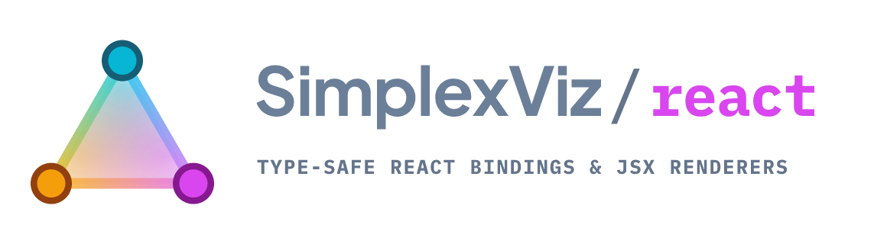
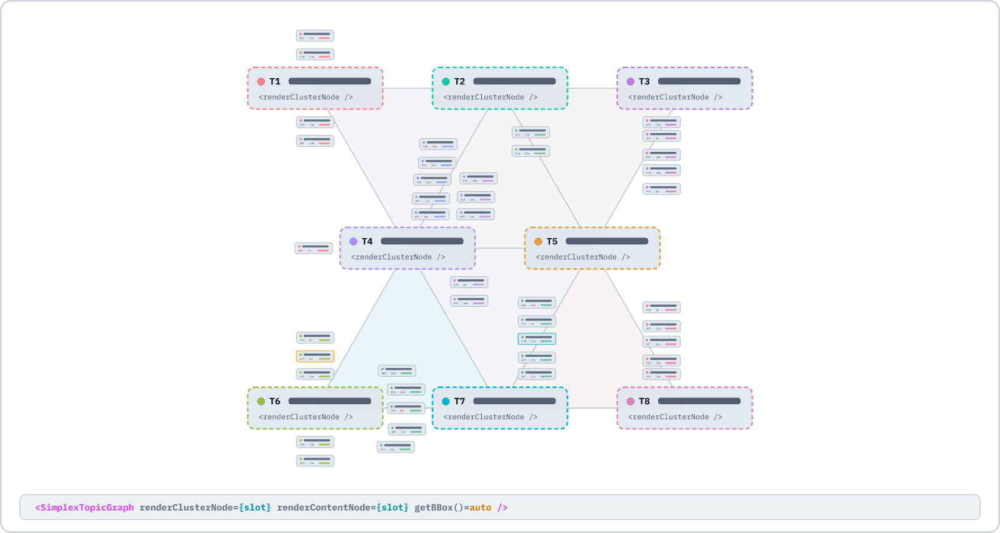

<p align="center">
  
</p>

# @simplex-viz/react

End-to-end type-safe React bindings, declarative JSX node renderers, hierarchical `1:4` zoom/drill-down controls, and imperative controller hooks for `@simplex-viz/core` and `@simplex-viz/svg`.

- **Live Demo:** <https://hackenberg.tech/simplex-viz/>
- **Source & Monorepo:** <https://github.com/ghackenberg/simplex-viz/tree/main/packages/react>
- **Companion Packages:** [`@simplex-viz/core`](https://www.npmjs.com/package/@simplex-viz/core) · [`@simplex-viz/svg`](https://www.npmjs.com/package/@simplex-viz/svg)

## Declarative JSX Slot Architecture

In React, `<SimplexTopicGraph />` lets you drop custom JSX directly into cluster and content slots instead of hand-writing imperative SVG DOM code. The wireframe preview below illustrates how those two component slots populate a single visualization:

<p align="center">
  
</p>

*Figure: Architectural slot layout rendered with `@simplex-viz/react`. Dashed topic cards illustrate the `renderClusterNode` JSX slot positioned on a subtle 60° simplex mesh, while minimalist skeleton content cards represent `renderContentNode` slots complete with color accents, type/time metadata, and interactive selection highlights (amber for pinned, cyan for hovered). Every JSX element is measured automatically via offscreen `getBBox()` so custom React SVG cards remain strictly overlap-free.*

## Features

- **`<SimplexTopicGraph />`**: Responsive, zero-overlap triangulation graph component that observes container resizing, computes cluster layouts, and drives 60 fps spring animations.
- **Two rendering modes** (mix and match or swap live with smooth crossfading):
  1. **Declarative JSX Renderers** (`renderContentNode`, `renderClusterNode`): Write standard React SVG JSX (`<g>`, `<rect>`, `<text>`, `<circle>`). Nodes are automatically measured via offscreen `getBBox()` for collision-free placement.
  2. **Portable `Svg*View` Plugins** (`contentView`, `clusterView`, `triangleView`, `edgeView` from `@simplex-viz/svg`): Direct SVG DOM updates with zero React reconciliation overhead per animation frame.
- **5 Pluggable Strategy Axes (`Mesh`, `Clustering`, `Color`, `Layout`, `Zoom`)**: Swap tag clustering, soft-simplex clustering, multi-modal embeddings, pairwise similarity, composable layout (`Seeder × Relaxer × ScaleController`), and conformal **`1:4` hierarchical drill-down** (`zoomStrategy`) via declarative props.
- **Full generic type inference**: Infers `<TItem, TContentVisual, TClusterVisual, TTagMeta, TClusterMeta>` end-to-end across `items`, `getId`, `getTags`, `deriveClusterMeta`, `visualResolver`, `renderContentNode`, `renderClusterNode`, tooltips, hover events, and click targets.
- **Chronological Timeline Playback, Linked Views, Export & Batched Sync**: Opt-in `timeline` prop with built-in floating Play/Pause/Step/Scrubber HUD, zero-relayout `itemFilter` / `itemFilterMode` (`'dim' | 'hide'`), programmatic search/focus/zoom (`setHighlightedItems`, `focusItem`, `zoomToItem`), client-side `exportSvg()` / `exportPng()` snapshots, unified batched React prop synchronization (`controller.batch(...)` per render commit), built-in WCAG 2.1 AA keyboard navigation & screen-reader announcements (`ariaLabel`, `keyboardNavigation`), and reactive `useSimplexTimeline()` alongside `useSimplexGraphController()`.

## Installation

Install `@simplex-viz/react` (`@simplex-viz/core` and `@simplex-viz/svg` are bundled as dependencies, and all built-in views, strategies, layout building blocks, and TypeScript types are re-exported directly from `@simplex-viz/react`; requires `react >= 18.0.0` and `react-dom >= 18.0.0`):

```bash
npm install @simplex-viz/react
```

## Quickstart (Zero-Config)

Render `<SimplexTopicGraph />` with any array of `{ id, tags }` objects. Drag-to-pan, cursor wheel zoom (`onWheel="zoom-to-cursor"`), cluster & triangle click-focus, and optional hover tooltips (`tooltip`) work immediately without a `VisualResolver` or view plugins:

```tsx
import { SimplexTopicGraph } from '@simplex-viz/react';

const items = [
  { id: '1', label: 'Simplex Mesh', tags: ['geometry', 'triangulation', 'math'] },
  { id: '2', label: 'OKLab Mixing', tags: ['color', 'geometry', 'perception'] },
  { id: '3', label: 'SAT Solver', tags: ['collision', 'geometry'] },
];

export function QuickTopicMap() {
  return (
    <div style={{ width: '100%', height: 560 }}>
      <SimplexTopicGraph items={items} preset="geometric" tooltip />
    </div>
  );
}
```

### Quickstart Default Settings (`<SimplexTopicGraph />`)

| Prop | Default | Out-of-the-Box Behavior |
| --- | --- | --- |
| `getId` / `getTags` | `item.id` / `item.tags` | Auto-extracted (`getTags` becomes optional when passing a non-tag `clusteringStrategy`). |
| `getLabel` | Heuristic (`label \| title \| headline \| name \| id`) | Used by built-in presets and default tooltips. |
| `formatTagLabel` | `undefined` | Optional `(tag: string) => string` mapping canonical tag IDs to human-readable labels across clusters, breadcrumbs, semantic subclusters, and tooltips without altering clustering. |
| `preset` | `'geometric'` | Renders `GeometricShapeSvgView` + `ClusterAnchorSvgView` (`'glyphs'` & `'badges'` with `BadgeClusterSvgView` also built in). |
| `badgeOptions` | `{ showCode: true }` | Formats built-in cluster badges (`showCode`, `maxTitleChars`, `formatTitle`). |
| `getShape` | Auto (by unit cluster count) | Fixed or item-driven content polygon (`'circle' \| 'triangle' \| 'square' \| 'diamond' \| 'pentagon' \| 'hexagon' \| 'heptagon' \| 'octagon' \| 'star'`, side count `>= 3`, `{ sides, rotationRad? }`, or `(item, ctx) => GeometricShapeSpec`). |
| `shapeOptions` | `{}` | Lightweight styling hooks for `GeometricShapeSvgView` (`hoverScale`, `hoverRingColor`, `dimmedOpacity`, `strokeColor`, `strokeWidth`). |
| `theme` | `'dark'` | Dark styling for presets, React tooltip overlay, and breadcrumbs (`'light'` supported). |
| `triangleView` / `edgeView` | `OklabTintTriangleSvgView` / `DashedMeshEdgeSvgView` | Default triangulation face & edge views (edge view also renders internal `1:4` drillable previews). |
| `meshStrategy` | `createAdaptiveHexMeshStrategy()` | Aspect-aligned 60° equilateral lattice (adaptive `innerPadding: 32–48`, `minSideLength: 130`, `maxClusters: 14`). |
| `clusteringStrategy` | `createJaccardAnnealingClusteringStrategy()` | Tag clustering with `'planar-hitting-set'` and `'explaining-away'`. |
| `colorStrategy` | `createOklabContrastColorStrategy()` | Perceptual OKLab edge-contrast colors + barycentric mixing. |
| `layoutStrategy` | `createPbdUniformLayoutStrategy()` | Mesh-inward fan seeding + space-filling PBD dispersion + global uniform scale search (`0.0 px` overlap). |
| `zoomStrategy` | `createFreeCameraZoomStrategy()` | Continuous cursor wheel zoom (`onWheel="zoom-to-cursor"`), 2-finger pinch, and drag-to-pan. |
| `showZoomBreadcrumbs` | `true` | Displays clickable top breadcrumbs whenever drilled into a sub-level (`depth > 0`). |
| `timeline` | `false` | Opt-in chronological frame stepping & playback (`boolean \| TimelinePlayerOptions`) with Play/Pause/Step/Scrubber HUD, `autoFinalSeed`, `autoFinalSeedLayout`, and `emptyClusterBehavior`. |
| `emptyClusterBehavior` | `'normal'` | `'normal' \| 'dim' \| 'hide'` — Controls how clusters with `0` active items render (e.g., future clusters during timeline playback). |
| `itemFilter` / `itemFilterMode` | `null` / `'dim'` | Zero-relayout item filtering (`(item) => boolean`, `'dim' \| 'hide'`) that dims or hides non-matching items without re-clustering or moving SAT nodes. |
| `relayoutOnFontLoad` | `true` | Automatically clears SVG hull caches and re-solves layout once webfonts finish loading. |
| `deferInitialLayout` | `false` | Auto-recovers from `0×0` mounts on first non-zero `ResizeObserver` entry (zero spring jump); set `true` or `{ fallbackTimeoutMs }` to skip provisional `960×620` solving until visible. |
| `touchScrollLockPx` / `clickTolerancePx` | `8` / `12` | Embedded mobile touch direction-locking (`touch-action: pan-y`; `0` disables) and peak-displacement click suppression in CSS px. |
| `ariaLabel` / `keyboardNavigation` | `'Interactive simplex topic graph'` / `true` | WCAG 2.1 AA single-tabstop keyboard traversal (`Arrow` keys, `Home`/`End`, `Enter`/`Space`, `Escape`), high-contrast double-halo SVG focus ring, semantic ARIA labels, and `aria-live="polite"` announcements. |
| `focusOnClusterClick` / `focusOnTriangleClick` | `true` / `true` | Click-to-isolate in `free-camera` mode when `focused*` is uncontrolled and click is not consumed (`return true`). |
| `tooltip` | `false` | Set `tooltip` (`true`) or pass `(target) => ReactNode` to render a floating tooltip overlay. |

---

## Step-by-Step Customization Guide

### Step 1 — Switch Visual Presets, Themes & React JSX Tooltips

```tsx
<SimplexTopicGraph
  items={articles}
  getId={(a) => a.slug}
  getTags={(a) => a.hashtags}
  getLabel={(a) => a.title}
  formatTagLabel={(tag) => tagDisplayNames[tag] ?? tag}
  preset="badges"
  badgeOptions={{ showCode: false, maxTitleChars: 20 }}
  getShape={(a) => (a.readingMinutes > 10 ? 'hexagon' : 'triangle')}
  shapeOptions={{ hoverScale: 1.35, hoverRingColor: '#38bdf8', dimmedOpacity: 0.2 }}
  theme="dark"
  tooltip={(target) => {
    if (target.kind === 'content') {
      return (
        <div>
          <strong>{target.item.title}</strong>
          <div>{`${target.item.readingMinutes} min read`}</div>
        </div>
      );
    }
    if (target.kind === 'cluster') {
      return <strong>{`${target.cluster.defaultLabel} (${target.cluster.members.length})`}</strong>;
    }
    return <strong>{`Triangle #${target.triangle.index + 1} (${target.triangle.coveredItemCount} items)`}</strong>;
  }}
/>
```

### Step 2 — Keyless Declarative JSX Node Renderers (`renderContentNode`, `renderClusterNode`)

Pass `renderContentNode` and/or `renderClusterNode` directly without a `VisualResolver`—`@simplex-viz/react` manages cache keys automatically and measures your JSX via offscreen `getBBox()` for `0.0 px` overlap:

```tsx
import { SimplexTopicGraph } from '@simplex-viz/react';

interface Article {
  readonly slug: string;
  readonly title: string;
  readonly hashtags: readonly string[];
}

export function CardMap({ articles }: { articles: readonly Article[] }) {
  return (
    <SimplexTopicGraph
      items={articles}
      getId={(a) => a.slug}
      getTags={(a) => a.hashtags}
      preset="badges"
      tooltip
      renderContentNode={(article, ctx, state) => (
        <g>
          <rect
            x={-54}
            y={-15}
            width={108}
            height={30}
            rx={6}
            fill="#0f172a"
            stroke={state.interaction.isHovered ? '#f8fafc' : ctx.mixedColorHex}
            strokeWidth={state.interaction.isHovered ? 2 : 1.2}
          />
          <text textAnchor="middle" y={4} fill="#f8fafc" fontSize={9}>
            {article.title.slice(0, 16)}
          </text>
        </g>
      )}
    />
  );
}
```

### Step 3 — Customize Triangle Faces, Mesh Edges & Explicit `sideLength`

```tsx
import { useMemo } from 'react';
import {
  SimplexTopicGraph,
  GradientTriangleSvgView,
  ClusterTintedEdgeSvgView,
} from '@simplex-viz/react';

export function StyledMeshMap({ items }: { items: readonly { id: string; tags: string[] }[] }) {
  const triangleView = useMemo(() => new GradientTriangleSvgView({ baseOpacity: 0.2 }), []);
  const edgeView = useMemo(() => new ClusterTintedEdgeSvgView({ strokeWidth: 1.4 }), []);

  return (
    <SimplexTopicGraph
      items={items}
      triangleView={triangleView}
      edgeView={edgeView}
      meshOptions={{ innerPadding: 52, sideLength: 210, maxClusters: 10 }}
      tooltip
    />
  );
}
```

### Step 4 — Configure Clustering, Colors & Composable Layout (`Seeder × Relaxer × ScaleController`)

Memoize strategy instances with `useMemo`—including untagged multi-modal embeddings (`createSoftSimplexEmbeddingClusteringStrategy` / `createEmbeddingClusteringStrategy`), pairwise similarity (`createSimilarityClusteringStrategy`), soft-simplex tags (`createSoftSimplexTagClusteringStrategy`), and composable layout pipelines:

```tsx
import { useMemo, useState } from 'react';
import {
  SimplexTopicGraph,
  createSoftSimplexEmbeddingClusteringStrategy,
  createThemeAdaptiveOklabColorStrategy,
  createComposedLayoutStrategy,
  createMeshInwardFanSeeder,
  createSpaceFillingPbdRelaxer,
  createCollisionLocalScaleController,
} from '@simplex-viz/react';

interface VoiceClip {
  readonly id: string;
  readonly speaker: string;
  readonly timbreVec: readonly number[];
  readonly prosodyVec: readonly number[];
}

export function VoiceSignatureMap({ clips }: { clips: readonly VoiceClip[] }) {
  const [theme] = useState<'dark' | 'light'>('dark');

  const clusteringStrategy = useMemo(
    () =>
      createSoftSimplexEmbeddingClusteringStrategy<VoiceClip>({
        getEmbedding: [
          { name: 'Timbre', getVector: (c) => c.timbreVec, weight: 0.7 },
          { name: 'Prosody', getVector: (c) => c.prosodyVec, weight: 0.3 },
        ],
        metric: 'cosine',
        triangleSpread: 0.45,
      }),
    [],
  );
  const colorStrategy = useMemo(() => createThemeAdaptiveOklabColorStrategy<VoiceClip>(), []);
  const layoutStrategy = useMemo(
    () =>
      createComposedLayoutStrategy({
        seeder: createMeshInwardFanSeeder(),
        relaxer: createSpaceFillingPbdRelaxer(),
        scaleController: createCollisionLocalScaleController({ minLocalScale: 0.34 }),
        warmStart: true,
      }),
    [],
  );

  return (
    <SimplexTopicGraph
      items={clips}
      getLabel={(c) => c.speaker}
      preset="badges"
      theme={theme}
      clusteringStrategy={clusteringStrategy}
      colorStrategy={colorStrategy}
      layoutStrategy={layoutStrategy}
      tooltip
    />
  );
}
```

### Step 5 — Enable Conformal `1:4` Hierarchical Zoom / Drill-Down (`zoomStrategy`)

Pass `createBarycentricZoomStrategy`, `createSemanticZoomStrategy`, or `createSubspaceZoomStrategy` to enable hierarchical `1:4` triangle & cluster drill-down. Subdividable triangles display their internal `1:4` subdivision lines in the active `edgeView` style and forward clicks through content nodes, while non-subdividable leaf triangles remain focusable via their free background (`'triangle-focus'`) with directly clickable content nodes:

```tsx
import { useMemo } from 'react';
import {
  SimplexTopicGraph,
  createBarycentricZoomStrategy,
} from '@simplex-viz/react';

export function DrillableTopicMap({ items }: { items: readonly { id: string; tags: string[] }[] }) {
  const zoomStrategy = useMemo(
    () =>
      createBarycentricZoomStrategy({
        clusterZoomMode: 'incident-star', // 'incident-star' | 'spotlight' | 'none'
        adaptiveContrastStretch: true,
      }),
    [],
  );

  return (
    <SimplexTopicGraph
      items={items}
      zoomStrategy={zoomStrategy}
      showZoomBreadcrumbs
      tooltip
      onZoomStateChange={(zoom) => {
        console.log('Zoom depth:', zoom.depth, 'Breadcrumbs:', zoom.breadcrumbs);
      }}
    />
  );
}
```

### Step 6 — Full Custom `VisualResolver`, Portable `SvgNodeView` Plugins & Imperative Hook

For maximum performance without per-frame JSX reconciliation, or to drive camera/drill-down controls from external toolbars, pair `<SimplexTopicGraph />` with `useSimplexGraphController()` and `GeometricShapeSvgView` / `ClusterAnchorSvgView`:

```tsx
import {
  SimplexTopicGraph,
  useSimplexGraphController,
  GeometricShapeSvgView,
  ClusterAnchorSvgView,
  type GeometricShapeVisual,
  type ClusterAnchorVisual,
  type VisualResolver,
  type DefaultTaggedItem,
} from '@simplex-viz/react';

const contentView = new GeometricShapeSvgView();
const clusterView = new ClusterAnchorSvgView();

export function FastControlledGraph({
  items,
  visualResolver,
}: {
  items: readonly DefaultTaggedItem[];
  visualResolver: VisualResolver<DefaultTaggedItem, GeometricShapeVisual, ClusterAnchorVisual>;
}) {
  const { controllerRef, handle } = useSimplexGraphController<
    DefaultTaggedItem,
    GeometricShapeVisual,
    ClusterAnchorVisual
  >();

  return (
    <div style={{ width: '100%', height: 640, position: 'relative' }}>
      <div style={{ position: 'absolute', top: 12, left: 12, zIndex: 10 }}>
        <button onClick={() => handle.drillUp()}>Drill Up</button>
        <button onClick={() => handle.drillToRoot()}>Overview</button>
        <button onClick={() => handle.resetCamera()}>Reset Camera</button>
      </div>
      <SimplexTopicGraph
        controllerRef={controllerRef}
        items={items}
        visualResolver={visualResolver}
        contentView={contentView}
        clusterView={clusterView}
      />
    </div>
  );
}
```

### Step 7 — Chronological Timeline Playback & `useSimplexTimeline()`

Pass `timeline` to step or play through timestamped datasets with pinned full-corpus clusters (`autoFinalSeed: true`), optional final-seeded item coordinates (`autoFinalSeedLayout: 'pinned' | 'adaptive'`), and dimmed or hidden future clusters (`emptyClusterBehavior: 'normal' | 'dim' | 'hide'`). Pair with `useSimplexTimeline(controllerRef)` to drive custom React playback UI:

```tsx
import {
  SimplexTopicGraph,
  useSimplexGraphController,
  useSimplexTimeline,
} from '@simplex-viz/react';

export function TimelineAtlas({ items }: { items: readonly { id: string; tags: string[]; year: number }[] }) {
  const { controllerRef } = useSimplexGraphController();
  const timeline = useSimplexTimeline(controllerRef);

  return (
    <div style={{ width: '100%', height: 600 }}>
      <SimplexTopicGraph
        controllerRef={controllerRef}
        items={items}
        timeline={{
          getTimestamp: (item) => item.year,
          stepIntervalMs: 850,
          autoFinalSeed: true,
          autoFinalSeedLayout: 'adaptive',
          emptyClusterBehavior: 'dim',
        }}
        tooltip
      />
      <button onClick={() => timeline.toggle()}>
        {timeline.state?.playing ? 'Pause' : 'Play'} ({timeline.state?.activeLabel ?? '—'})
      </button>
    </div>
  );
}
```

### Step 8 — Zero-Relayout Filtering, Linked-View Search, SVG/PNG Export & Accessibility

Filter items visually without re-clustering or shifting any SAT positions (`itemFilter`, `itemFilterMode`), drive external search/table linked views (`highlightedIds`, `handle.focusItem`, `handle.zoomToItem`), export standalone SVG or HiDPI PNG snapshots (`handle.exportSvg`, `handle.exportPng`), and rely on automatic single-batch prop synchronization and WCAG 2.1 AA keyboard navigation:

```tsx
<SimplexTopicGraph
  controllerRef={controllerRef}
  items={items}
  itemFilter={(item) => item.year >= minYear}
  itemFilterMode="dim" // 'dim' | 'hide' — zero relayout
  highlightedIds={matchingIds}
  ariaLabel="Interactive publication topic graph"
  keyboardNavigation
  tooltip
/>

// From a search bar or export toolbar:
// handle.zoomToItem('paper-42', { zoom: 2.2 });
// const pngBlob = await handle.exportPng({ scale: 2, padding: 24 });
```

---

## `<SimplexTopicGraph />` Props Reference

### Data, Typing & Metadata
| Prop | Required | Description |
| --- | --- | --- |
| `items` | Yes | `readonly TItem[]` — Domain items to cluster and lay out. |
| `getId` | If `TItem` lacks `id` | `(item: TItem) => string` — Extracts a unique ID per item. |
| `getTags` | If `TItem` lacks `tags` and no `clusteringStrategy` is passed | `(item: TItem) => readonly string[]` — Extracts raw tag strings per item (optional when using non-tag clustering strategies). |
| `getLabel` | No | `(item: TItem) => string` — Optional label extractor used by presets and default hover tooltips. |
| `normalizeTag` | No | `(rawTag: string) => string` — Custom tag normalizer (defaults to lowercase trim + `#` strip). |
| `formatTagLabel` | No | `(tag: string) => string` — Maps canonical normalized tag IDs to human-readable labels for cluster titles, breadcrumbs, semantic zoom subclusters, and tooltips without changing clustering. |
| `resolveTagMeta` | No | `(normalizedTag: string) => TTagMeta \| undefined` — Attaches domain metadata to each tag. |
| `deriveClusterMeta` | If `TClusterMeta` is defined | `(ctx) => TClusterMeta` — Derives aggregate metadata once per cluster update (`members`, `representativeItems`, `centroid`, `cohesion`, `featureSummary`, `role`, `mixWeights`). |

### Visuals, Presets & Renderers
| Prop | Default | Description |
| --- | --- | --- |
| `preset` | `'geometric'` | Built-in visual preset (`'geometric' \| 'glyphs' \| 'badges'`) used when custom views or `visualResolver` are omitted. |
| `badgeOptions` | `{ showCode: true }` | `{ showCode?, maxTitleChars?, formatTitle? }` — Customizes built-in `BadgeClusterSvgView` cluster badges (hide `T1`/`T2` prefix codes, truncate cleanly with `…`, or format titles). |
| `getShape` | Auto | `GeometricShapeSpec \| ((item, ctx) => GeometricShapeSpec)` — Binds a fixed or category-driven shape (`'triangle'`, `'square'`, `'pentagon'`, `'hexagon'`, `'heptagon'`, `'octagon'`, or `{ sides: N, rotationRad? }`) with exact convex SAT hulls. |
| `shapeOptions` | `{}` | `GeometricShapeSvgViewOptions` — Lightweight hover, dimming, and stroke styling hooks (`hoverScale`, `hoverRingColor`, `dimmedOpacity`, `strokeColor`, `strokeWidth`) applied to `GeometricShapeSvgView` without altering SAT hulls or double-dimming. |
| `theme` | `'dark'` | Color theme (`'dark' \| 'light'`) applied to presets, tooltips, breadcrumbs, and theme-adaptive color strategies. |
| `visualResolver` | Built-in preset resolver | Optional `VisualResolver` mapping items and clusters to custom descriptors and cache keys. |
| `renderContentNode` | — | Declarative React JSX renderer `(item, ctx, state) => ReactNode` (auto-measured via `getBBox()`). |
| `renderClusterNode` | — | Declarative React JSX renderer `(cluster, state) => ReactNode` (auto-measured via `getBBox()`). |
| `getContentCacheKey` / `getClusterCacheKey` | Auto-generated | Optional cache key overrides for keyless JSX renderers. |
| `contentView` / `clusterView` | Preset views | Portable `SvgNodeView` plugins (used when JSX renderers are omitted). |
| `triangleView` | `OklabTintTriangleSvgView` | Portable `SvgTriangleView` plugin for triangulation faces. |
| `edgeView` | `DashedMeshEdgeSvgView` | Portable `SvgEdgeView` plugin for mesh edges and internal `1:4` drillable previews. |

### Mesh, Solver, 5-Stage Strategies & Visual Emphasis
| Prop | Default | Description |
| --- | --- | --- |
| `meshOptions` | — | `{ innerPadding, sideLength, minSideLength, maxSideLength, maxClusters }`. |
| `layoutOptions` | — | `{ clusterGapPx, itemGapPx, minContentScale, relaxationIterations, sizeMultiplier, seed }`. |
| `meshStrategy` | `createAdaptiveHexMeshStrategy()` | Pluggable `SimplexMeshStrategy<TItem>`. |
| `clusteringStrategy` | `createJaccardAnnealingClusteringStrategy()` | Pluggable `SimplexClusteringStrategy<TItem, TTagMeta>` (Jaccard, Soft-Simplex Tags/Embeddings, Embeddings, Similarity, Incremental, `createFinalSeededClusteringStrategy`, or custom). |
| `colorStrategy` | `createOklabContrastColorStrategy()` | Pluggable `SimplexColorStrategy<TItem, TTagMeta>`. |
| `layoutStrategy` | `createPbdUniformLayoutStrategy()` | Pluggable `SimplexLayoutStrategy` (`pbd-uniform`, `pbd-warm-start`, `local-adaptive`, `collision-driven`, `createFinalSeededLayoutStrategy`, `createComposedLayoutStrategy`, or custom). |
| `zoomStrategy` | `createFreeCameraZoomStrategy()` | Pluggable `SimplexZoomStrategy<TItem, TTagMeta, TClusterMeta>` (`createFreeCameraZoomStrategy`, `createBarycentricZoomStrategy`, `createSemanticZoomStrategy`, `createSubspaceZoomStrategy`, or custom). |
| `showZoomBreadcrumbs` | `true` | Renders clickable top breadcrumb navigation in drill-down mode when `depth > 0`. |
| `timeline` | `false` | `boolean \| TimelinePlayerOptions<TItem>` — Opt-in chronological frame stepping & playback (`getTimestamp`, `getFrameKey`, `stepIntervalMs`, `showControls`, `position`, `autoFinalSeed`, `autoFinalSeedLayout`, `emptyClusterBehavior`). |
| `relayoutOnFontLoad` | `true` | Automatically re-measures SVG hulls and re-solves layout after `document.fonts.ready` / `loadingdone`. |
| `deferInitialLayout` | `false` | `boolean \| DeferInitialLayoutOptions` — Skips provisional `960×620` layout when mounted at `0×0` until the first non-zero `ResizeObserver` entry (automatic `0×0` mount recovery always runs when `false`). |
| `sizeMultiplier` | `1.0` | Uniform node size multiplier (`0.35` – `3.0`). |
| `showHulls` | `false` | Renders convex bounding hull wireframes over nodes. |
| `emptyClusterBehavior` | `'normal'` | `'normal' \| 'dim' \| 'hide'` — Controls how clusters with `0` active member items render (e.g. future clusters during timeline playback). |
| `itemFilter` | `null` | `((item: TItem) => boolean) \| null` — Zero-relayout visual item filter predicate preserving exact SAT node positions. |
| `itemFilterMode` | `'dim'` | `'dim' \| 'hide'` — Controls whether filtered-out items dim in place or hide completely (suppressing hit-testing and keyboard traversal). |
| `pinnedIds` / `highlightedIds` | — | `ReadonlySet<string> \| readonly string[]` (`pinnedIds`) or `Iterable<string> \| null` (`highlightedIds`) of pinned or highlighted item IDs. |
| `focusedClusterUid` / `focusedTriangleIndex` | `null` | Controlled cluster UID or triangle index isolation in `free-camera` mode. |
| `className` / `style` | — | Styling forwarded to the outer container `<div>` (`width: 100%; height: 100%`). |

### Interactions, Tooltips, Telemetry & Controller
| Prop | Default / Signature | Description |
| --- | --- | --- |
| `tooltip` | `false` | `boolean \| ((target: SimplexReactTooltipTarget) => ReactNode)` — Floating React `role="tooltip"` overlay for `'content'`, `'cluster'`, and `'triangle'`. |
| `focusOnClusterClick` / `focusOnTriangleClick` | `true` / `true` | Automatically toggles cluster or triangle focus on click in `free-camera` mode when uncontrolled. |
| `onContentHover` / `onClusterHover` / `onTriangleHover` | — | Hover callbacks returning `boolean \| void` (`true` suppresses the built-in tooltip for that hover target). |
| `onContentClick` / `onClusterClick` / `onTriangleClick` / `onBackgroundClick` | — | Target-specific left-click callbacks returning `boolean \| void` (`true` consumes the click and skips `onLeftClick` and built-in defaults). |
| `onLeftClick` / `onRightClick` | — | General pointer click callbacks returning `boolean \| void` (`true` consumes built-in drill-down/focus or suppresses the browser context menu; `void`/`false` composes). |
| `touchScrollLockPx` / `clickTolerancePx` | `8` / `12` | Mobile touch direction-locking threshold (`touch-action: pan-y`; set `0` for `touch-action: none`) and peak-displacement drag-vs-click suppression tolerance in CSS px. |
| `ariaLabel` / `keyboardNavigation` | `'Interactive simplex topic graph'` / `true` | WCAG 2.1 AA accessible `<svg>` label and built-in single-tabstop keyboard traversal (`Arrow` keys, `Home`/`End`, `Enter`/`Space`, `Escape`), high-contrast focus ring, and `aria-live="polite"` announcements. |
| `onWheel` | `'zoom-to-cursor'` | `'zoom-to-cursor' \| 'pan-vertical' \| 'none' \| ((event, camera) => boolean \| void)` (`true` consumes built-in cursor zoom; automatically inactive in `drill-down` mode). |
| `onMetricsChange` | — | `(metrics: LayoutMetrics) => void` |
| `onClustersChange` | — | `(clusters: readonly ClusterDescriptor[]) => void` |
| `onZoomStateChange` | — | `(state: SimplexZoomState) => void` — Emits `depth`, `activeFrameKind`, `breadcrumbs`, `drillableTriangleIndices`, `focusableTriangleIndices`, `drillableClusterUids`, `isLeafReached`. |
| `onTimelineStateChange` | — | `(state: SimplexTimelineState<TItem>) => void` — Emits chronological playback state (`step`, `totalSteps`, `playing`, `speed`, `atEnd`, `activeLabel`, `activeItemCount`, `frames`). |
| `onFpsUpdate` | — | `(fps: number) => void` |
| `controllerRef` | — | Ref populated with the underlying `SimplexSvgController` instance. |

## `useSimplexGraphController()` & `useSimplexTimeline()` Hooks

`useSimplexGraphController()` returns `{ controllerRef, handle }`:

- `handle.addItems(items)` / `handle.removeItems(ids)` / `handle.setItems(items)` — Live dataset mutations.
- `handle.setItemFilter(predicate, options?)` / `handle.getItemFilter()` — Zero-relayout item filtering (`'dim' | 'hide'`).
- `handle.setHighlightedIds(ids)` / `handle.setHighlightedItems(ids)` / `handle.getHighlightedIds()` / `handle.getHighlightedItems()` — Programmatic multi-item search & linked-view highlighting (`Iterable<string> | null`).
- `handle.focusItem(itemId | null, options?)` / `handle.getFocusedItemId()` / `handle.zoomToItem(itemId, options?)` — Programmatic item focus (with synchronized tooltip & screen-reader announcements) and camera framing / multi-step drill-down navigation.
- `handle.exportSvg(options?)` / `handle.exportPng(options?)` — Client-side standalone `<svg>` serialization and HiDPI PNG (`Blob` or `dataUrl`) rasterization.
- `handle.batch(fn)` / `handle.setOptions(options)` — Coalesces multiple imperative updates into a single minimal pipeline recomputation.
- `handle.setMeshStrategy(s)` / `handle.setClusteringStrategy(s)` / `handle.setColorStrategy(s)` / `handle.setLayoutStrategy(s)` / `handle.setZoomStrategy(s)` — Hot-swaps any of the 5 pipeline stages imperatively.
- `handle.drillDownTriangle(index)` / `handle.drillDownCluster(uid)` / `handle.drillToNeighbor(neighborId)` / `handle.drillUp()` / `handle.drillToDepth(depth)` / `handle.drillToRoot()` / `handle.getZoomState()` — Programmatic drill-down navigation and state inspection.
- `handle.setTriangleView(view)` / `handle.setEdgeView(view)` / `handle.setFocusedTriangleIndex(index)` — Hot-swaps mesh triangle/edge renderers or updates triangle focus.
- `handle.getKeyboardFocusTarget()` / `handle.clearKeyboardFocus()` — Inspects or clears the active keyboard focus target.
- `handle.zoomBy(factor)` / `handle.resetCamera()` / `handle.relayout()` — Camera zoom/reset and manual hull re-measurement + relayout.
- `handle.getMetrics()` / `handle.getClusters()` / `handle.getTimeline()` / `handle.getRawController()` — Live solver telemetry, active timeline controller, and raw controller access.

`useSimplexTimeline(controllerRef | timelineController)` returns reactive `{ state, isReady, play, pause, toggle, stepBy, seek, resetToEnd, setSpeed, setStepIntervalMs, setLoop, getController }` for building custom declarative React playback toolbars. Server-side rendering helpers (`renderSimplexSvgString`, `estimateSsrTextWidth`, `createSsrPresetHullMeasurers`) are also re-exported directly from `@simplex-viz/react` (or import `@simplex-viz/svg/ssr` for minimal server bundles).

## License

MIT — see [LICENSE](https://github.com/ghackenberg/simplex-viz/blob/main/LICENSE).
