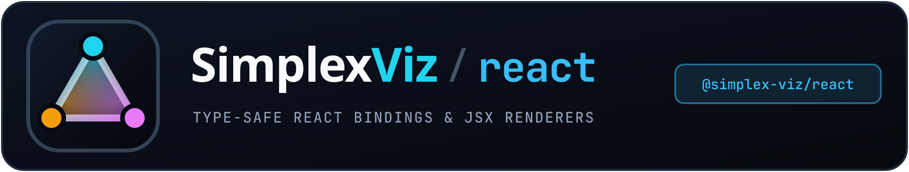
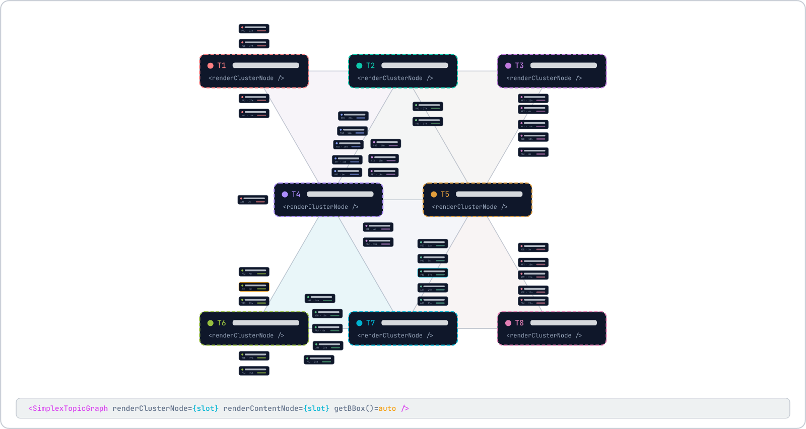

<p align="center">
  
</p>

# @simplex-viz/react

End-to-end type-safe React bindings, declarative JSX node renderers, and imperative controller hooks for `@simplex-viz/core` and `@simplex-viz/svg`.

- **Live Demo:** <https://hackenberg.tech/simplex-viz/>
- **Source & Monorepo:** <https://github.com/ghackenberg/simplex-viz/tree/main/packages/react>
- **Companion Packages:** [`@simplex-viz/core`](https://www.npmjs.com/package/@simplex-viz/core) · [`@simplex-viz/svg`](https://www.npmjs.com/package/@simplex-viz/svg)

<p align="center">
  
</p>

*Figure: Architectural slot layout rendered with `@simplex-viz/react`. Dashed topic cards illustrate the `renderClusterNode` JSX slot positioned on a subtle 60° simplex mesh, while minimalist skeleton content cards represent `renderContentNode` slots complete with color accents, type/time metadata, and interactive selection highlights (amber for pinned, cyan for hovered). Every JSX element is measured automatically via offscreen `getBBox()` so custom React SVG cards remain strictly overlap-free.*

## Features

- **`<SimplexTopicGraph />`**: Responsive, zero-overlap triangulation graph component that automatically observes container resizing, computes cluster layouts, and drives 60 fps spring animations.
- **Two rendering modes** (mix and match or swap live with smooth crossfading):
  1. **Declarative JSX Renderers** (`renderContentNode`, `renderClusterNode`): Write standard React SVG JSX (`<g>`, `<rect>`, `<text>`, `<circle>`). Nodes are automatically measured via offscreen `getBBox()` for collision-free placement.
  2. **Portable `SvgNodeView` Plugins** (`contentView`, `clusterView` from `@simplex-viz/svg`): Direct SVG DOM updates with zero React reconciliation overhead per animation frame.
- **Full generic type inference**: Infers `<TItem, TContentVisual, TClusterVisual, TTagMeta, TClusterMeta>` end-to-end across `items`, `getId`, `getTags`, `deriveClusterMeta`, `visualResolver`, `renderContentNode`, `renderClusterNode`, hover events, and click targets.
- **`useSimplexGraphController`**: Imperative hook for live item mutations (`addItems`, `removeItems`, `setItems`), camera controls (`zoomBy`, `resetCamera`), and telemetry getters.

## Installation

Install the React wrapper together with its core engine and SVG scene-graph peer packages (`react >= 18.0.0` and `react-dom >= 18.0.0`):

```bash
npm install @simplex-viz/core @simplex-viz/svg @simplex-viz/react
```

## Quickstart: Declarative JSX Node Renderers

The component below showcases declarative JSX node rendering combined with imperative camera buttons. `useSimplexGraphController` provides a typed `controllerRef` and `handle` for zoom/reset actions, `useMemo` stabilizes `visualResolver` across renders, `renderContentNode` and `renderClusterNode` return SVG `<g>` elements centered at `(0, 0)` (automatically measured via `getBBox()`), and `onLeftClick` toggles item pinning or isolates a clicked topic cluster:

```tsx
import { useMemo, useState } from 'react';
import {
  SimplexTopicGraph,
  useSimplexGraphController,
} from '@simplex-viz/react';
import type { VisualResolver } from '@simplex-viz/core';

interface Article {
  readonly slug: string;
  readonly title: string;
  readonly hashtags: readonly string[];
  readonly readingMinutes: number;
}

interface ArticleVisual {
  readonly key: string;
  readonly title: string;
  readonly colorHex: string;
}

interface ClusterVisual {
  readonly key: string;
  readonly code: string;
  readonly label: string;
  readonly colorHex: string;
  readonly count: number;
}

interface ClusterStats {
  readonly count: number;
  readonly avgMinutes: number;
}

export function KnowledgeAtlas({ articles }: { articles: readonly Article[] }) {
  const [focusedClusterUid, setFocusedClusterUid] = useState<string | null>(null);
  const [pinnedIds, setPinnedIds] = useState<Set<string>>(() => new Set());

  const { controllerRef, handle } = useSimplexGraphController<
    Article,
    ArticleVisual,
    ClusterVisual,
    undefined,
    ClusterStats
  >();

  const visualResolver = useMemo<
    VisualResolver<Article, ArticleVisual, ClusterVisual, undefined, ClusterStats>
  >(
    () => ({
      resolveContentVisual: (article, ctx) => ({
        key: `${article.slug}:${ctx.mixedColorHex}`,
        title: article.title,
        colorHex: ctx.mixedColorHex,
      }),
      resolveClusterVisual: (cluster) => ({
        key: `${cluster.clusterUid}:${cluster.meta.count}`,
        code: cluster.code,
        label: cluster.defaultLabel,
        colorHex: cluster.colorHex,
        count: cluster.meta.count,
      }),
      getVisualCacheKey: (visual) => visual.key,
    }),
    [],
  );

  return (
    <div style={{ width: '100%', height: '640px', position: 'relative' }}>
      <div style={{ position: 'absolute', top: 12, left: 12, zIndex: 10 }}>
        <button onClick={() => handle.zoomBy(1.2)}>Zoom In</button>
        <button onClick={() => handle.zoomBy(0.8)}>Zoom Out</button>
        <button onClick={() => handle.resetCamera()}>Reset Camera</button>
      </div>

      <SimplexTopicGraph
        controllerRef={controllerRef}
        items={articles}
        getId={(a) => a.slug}
        getTags={(a) => a.hashtags}
        deriveClusterMeta={(ctx) => ({
          count: ctx.members.length,
          avgMinutes:
            ctx.members.reduce((sum, m) => sum + m.item.readingMinutes, 0) /
            Math.max(1, ctx.members.length),
        })}
        visualResolver={visualResolver}
        pinnedIds={pinnedIds}
        focusedClusterUid={focusedClusterUid}
        renderContentNode={(article, ctx, state) => (
          <g>
            <rect
              x={-54}
              y={-15}
              width={108}
              height={30}
              rx={6}
              fill="#0f172a"
              stroke={state.interaction.isPinned ? '#f59e0b' : ctx.mixedColorHex}
              strokeWidth={state.interaction.isHovered ? 2 : 1.2}
            />
            <text
              textAnchor="middle"
              y={4}
              fill="#f8fafc"
              fontSize={9}
            >
              {article.title.slice(0, 16)}
            </text>
          </g>
        )}
        renderClusterNode={(cluster, state) => (
          <g>
            <rect
              x={-68}
              y={-20}
              width={136}
              height={40}
              rx={8}
              fill="#090d16"
              stroke={state.interaction.isHovered ? '#f8fafc' : cluster.colorHex}
              strokeWidth={1.6}
            />
            <text textAnchor="middle" y={-2} fill="#f8fafc" fontSize={10} fontWeight={600}>
              {`${cluster.code} · ${cluster.defaultLabel}`}
            </text>
            <text textAnchor="middle" y={12} fill="#94a3b8" fontSize={8.5}>
              {`${cluster.meta.count} items · avg ${cluster.meta.avgMinutes.toFixed(0)}m`}
            </text>
          </g>
        )}
        onLeftClick={(target) => {
          if (target.kind === 'content') {
            setPinnedIds((prev) => {
              const next = new Set(prev);
              if (next.has(target.item.slug)) next.delete(target.item.slug);
              else next.add(target.item.slug);
              return next;
            });
          } else if (target.kind === 'cluster') {
            setFocusedClusterUid((cur) =>
              cur === target.cluster.clusterUid ? null : target.cluster.clusterUid,
            );
          } else {
            setFocusedClusterUid(null);
          }
        }}
      />
    </div>
  );
}
```

## Using Portable `SvgNodeView` Plugins (60 fps Without JSX Re-Renders)

For larger graphs or built-in shape morphing without per-frame JSX overhead, instantiate `GeometricShapeSvgView` and `ClusterAnchorSvgView` once outside the component and pass them via `contentView` and `clusterView` instead of `renderContentNode` / `renderClusterNode`:

```tsx
import { SimplexTopicGraph } from '@simplex-viz/react';
import {
  GeometricShapeSvgView,
  ClusterAnchorSvgView,
  type GeometricShapeVisual,
  type ClusterAnchorVisual,
} from '@simplex-viz/svg';

const contentView = new GeometricShapeSvgView();
const clusterView = new ClusterAnchorSvgView();

export function FastGraph({ items, visualResolver }) {
  return (
    <SimplexTopicGraph<MyItem, GeometricShapeVisual, ClusterAnchorVisual>
      items={items}
      visualResolver={visualResolver}
      contentView={contentView}
      clusterView={clusterView}
    />
  );
}
```

> **Tip:** Memoize `visualResolver` (e.g., via `useMemo`) and keep `contentView` / `clusterView` instances stable outside render to avoid unnecessary crossfades. Changing `visualResolver` or switching view props intentionally triggers a smooth crossfade/morph transition.

## `<SimplexTopicGraph />` Props Reference

### Data, Typing & Metadata
| Prop | Required | Description |
| --- | --- | --- |
| `items` | Yes | `readonly TItem[]` — Domain items to cluster and lay out. |
| `getId` | If `TItem` lacks `id` | `(item: TItem) => string` — Extracts a unique ID per item. |
| `getTags` | If `TItem` lacks `tags` | `(item: TItem) => readonly string[]` — Extracts raw tag strings per item. |
| `normalizeTag` | No | `(rawTag: string) => string` — Custom tag normalizer (defaults to lowercase trim + `#` strip). |
| `resolveTagMeta` | No | `(normalizedTag: string) => TTagMeta \| undefined` — Attaches domain metadata to each tag. |
| `deriveClusterMeta` | If `TClusterMeta` is defined | `(ctx) => TClusterMeta` — Derives aggregate metadata once per cluster update. |

### Visuals & Renderers
| Prop | Description |
| --- | --- |
| `visualResolver` | Required `VisualResolver` mapping domain items and clusters to pure visual descriptors and cache keys. |
| `renderContentNode` | Declarative React JSX renderer `(item, ctx, state) => ReactNode` (auto-measured via `getBBox()`). |
| `renderClusterNode` | Declarative React JSX renderer `(cluster, state) => ReactNode` (auto-measured via `getBBox()`). |
| `contentView` | Portable `SvgNodeView<TContentVisual>` plugin from `@simplex-viz/svg` (used when `renderContentNode` is omitted). |
| `clusterView` | Portable `SvgNodeView<TClusterVisual>` plugin from `@simplex-viz/svg` (used when `renderClusterNode` is omitted). |

### Mesh, Solver & Visual Emphasis
| Prop | Default | Description |
| --- | --- | --- |
| `meshOptions` | — | `{ innerPadding, minSideLength, maxSideLength, maxClusters }`. |
| `layoutOptions` | — | `{ clusterGapPx, itemGapPx, minContentScale, relaxationIterations, seed }`. |
| `sizeMultiplier` | `1.0` | Uniform node size multiplier (`0.35` – `3.0`). |
| `showHulls` | `false` | Renders convex bounding hull wireframes over nodes. |
| `pinnedIds` | — | `ReadonlySet<string> \| readonly string[]` of pinned item IDs. |
| `highlightedIds` | — | `ReadonlySet<string> \| readonly string[]` of highlighted item IDs (dims others). |
| `focusedClusterUid` | `null` | Isolates a cluster and its members, dimming unrelated nodes. |
| `className` / `style` | — | Styling forwarded to the outer container `<div>` (defaults to `width: 100%; height: 100%`). |

### Interactions, Telemetry & Controller
| Prop | Description |
| --- | --- |
| `onContentHover` | `(event: ContentHoverEvent \| null) => void` |
| `onClusterHover` | `(event: ClusterHoverEvent \| null) => void` |
| `onLeftClick` | `(target: HitTarget, rawEvent: NormalizedPointerEvent) => void` |
| `onRightClick` | `(target: HitTarget, rawEvent: NormalizedPointerEvent) => boolean \| void` (return `true` to suppress browser menu) |
| `onWheel` | `'zoom-to-cursor' \| 'pan-vertical' \| 'none' \| ((event, camera) => void)` |
| `onMetricsChange` | `(metrics: LayoutMetrics) => void` — Reports cluster count, scales `α`, `overlapCount`, `meshSideLength`, `areaEfficiency`. |
| `onClustersChange` | `(clusters: readonly ClusterDescriptor[]) => void` |
| `onFpsUpdate` | `(fps: number) => void` |
| `controllerRef` | Ref populated with the underlying `SimplexSvgController` instance. |

## `useSimplexGraphController()` Hook

Returns `{ controllerRef, handle }`:

- `handle.addItems(items)` — Appends items without resetting existing camera or springs.
- `handle.removeItems(ids)` — Removes items by ID with smooth fade-out.
- `handle.setItems(items)` — Replaces the active dataset.
- `handle.zoomBy(factor)` — Zooms relative to viewport center.
- `handle.resetCamera()` — Resets zoom & pan smoothly to `(1, 0, 0)`.
- `handle.getMetrics()` — Returns the latest `LayoutMetrics | null`.
- `handle.getClusters()` — Returns current `ClusterDescriptor[]`.
- `handle.getRawController()` — Returns the underlying `SimplexSvgController | null`.

## License

MIT — see [LICENSE](https://github.com/ghackenberg/simplex-viz/blob/main/LICENSE).
