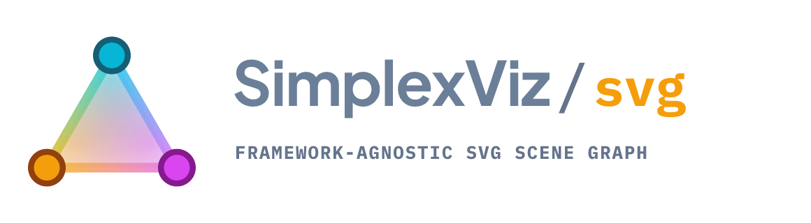

<p align="center">
  
</p>

# @simplex-viz/svg

Framework-agnostic SVG rendering engine, hierarchical `1:4` zoom/drill-down controller, and pluggable `SvgNodeView` / `SvgTriangleView` / `SvgEdgeView` architecture for `@simplex-viz/core`. Zero dependency on React—embeds cleanly into Vanilla TypeScript, Vue, Angular, Svelte, Solid, and Web Components.

- **Live Demo:** <https://hackenberg.tech/simplex-viz/>
- **Source & Monorepo:** <https://github.com/ghackenberg/simplex-viz/tree/main/packages/svg>
- **Companion Packages:** [`@simplex-viz/core`](https://www.npmjs.com/package/@simplex-viz/core) · [`@simplex-viz/canvas`](https://www.npmjs.com/package/@simplex-viz/canvas) · [`@simplex-viz/react`](https://www.npmjs.com/package/@simplex-viz/react) · [`@simplex-viz/wc`](https://www.npmjs.com/package/@simplex-viz/wc)

## Visual Rendering Showcase

While `@simplex-viz/core` computes pure spatial coordinates, `@simplex-viz/svg` turns each frame into live DOM `<svg>` elements inside any browser container or UI framework. The preview below renders its built-in views together in a single viewport:

<p align="center">
  
</p>

*Figure: Visual showcase of the four built-in `SvgNodeView` plugins rendered on an OKLab-tinted 60° simplex mesh. Content items mix `GeometricShapeSvgView` (circles, diamonds, hexagons, and stars that morph smoothly via 64-point paths) with `MultiSectorGlyphSvgView` (proportional donut glyphs whose sector arcs encode barycentric topic weights). Topic clusters alternate between compact `ClusterAnchorSvgView` vertex rings and auto-measured `BadgeClusterSvgView` cards sized via offscreen `getBBox()`.*

## Features

- **Framework-agnostic SVG scene graph**: Keyed DOM reconciliation for dimmed neighborhood context layers, active mesh triangles, internal `1:4` drillable subdivision edges (`g.sv-drill-edges`), mesh edges, convex hull debug wireframes, cluster nodes, and content nodes.
- **Hierarchical `1:4` Zoom / Drill-Down & Free Camera**: Supports both continuous camera navigation (`createFreeCameraZoomStrategy`, default) and discrete conformal `1:4` drill-down (`createBarycentricZoomStrategy`, `createSemanticZoomStrategy`, `createSubspaceZoomStrategy`) with built-in breadcrumbs (`showZoomBreadcrumbs`), discrete 2-finger pinch-out/in gestures, single-triangle leaf focus (`'triangle-focus'`), uniform 1-ring cluster/subcluster stars with simplex-distance dimming, dimmed clickable neighbors, and direct internal `1:4` subdivision previews rendered 1:1 through the active `SvgEdgeView`.
- **Pluggable triangle face & mesh edge views**: Swap `SvgTriangleView` (`OklabTintTriangleSvgView`, `GradientTriangleSvgView`, `BarycentricSectorTriangleSvgView`, `BlueprintInsetTriangleSvgView`, `DensityHeatmapTriangleSvgView`) and `SvgEdgeView` (`DashedMeshEdgeSvgView`, `ClusterTintedEdgeSvgView`, `PrecisionRailEdgeSvgView`, `MinimalHighlightEdgeSvgView`) live via `setTriangleView` / `setEdgeView` / `setViews`.
- **Automatic offscreen `getBBox()` hull measurement**: Omit `measureConvexHull` on any `SvgNodeView` and `@simplex-viz/svg` automatically renders it in a hidden measurement bin, reads `getBBox()`, and caches a tight convex polygon for `0.0 px` overlap layout.
- **Smooth 60 fps transitions**: Critically damped spring motion + specialized parametric `morph()` or automatic dual-layer crossfade when switching visual presets, drilling into sub-levels, or mutating items.
- **Primary & `'intermediate'` bridge cluster styling**: `BadgeClusterSvgView` and `ClusterAnchorSvgView` automatically render compact chamfered bridge badges/anchors for synthesized zoom midpoints (`cluster.role === 'intermediate'`).
- **Zero-relayout filtering, atomic `batch()`/`setOptions()`, multi-selection, deep-linking, linked views & WCAG 2.1 AA accessibility**: Dim or hide non-matching items without moving any SAT node (`itemFilter`, `itemFilterMode`, `setItemFilter()`), select cohorts via `Shift+Click` or `Shift+Drag` marquee (`selectedIds`, `marqueeSelection`, `onSelectionChange`), respect `prefers-reduced-motion` automatically (`reducedMotion: 'auto'`), serialize/restore complete view snapshots (`getViewState()` / `restoreViewState()`), synchronize external search/table UIs (`setHighlightedItems()`, `focusItem()`, `zoomToItem()`), coalesce multi-property updates into a single recomputation (`batch()`, `setOptions()`), and navigate clusters, items, and triangles via single-tabstop keyboard traversal (`role="application"`, `aria-activedescendant`, zoom-adaptive double-halo SVG focus ring, semantic ARIA labels, and polite `aria-live` announcements).
- **Client-side SVG/PNG export & zero-DOM SSR string rendering**: Export standalone `<svg>` strings (`exportSvg()`) or HiDPI PNG `Blob` / `dataUrl` snapshots (`exportPng()`) directly from a live controller, or render complete SVG strings server-side in pure Node.js without Puppeteer via `@simplex-viz/svg/ssr` (`renderSimplexSvgString()`).

## Installation

Install `@simplex-viz/svg` alone (`@simplex-viz/core` is installed automatically and all strategies, helpers, and types are re-exported directly from `@simplex-viz/svg`):

```bash
npm install @simplex-viz/svg
```

## Quickstart (Zero-Config)

### One-Liner Mount (`createSimplexSvg`)

Pass a container `HTMLElement` or CSS selector together with an array of `{ id, tags }` items to `createSimplexSvg`. Built-in `'geometric'` preset visuals, drag-to-pan, cursor wheel zoom, cluster & triangle click-focus, and floating hover tooltips start immediately:

```ts
import { createSimplexSvg } from '@simplex-viz/svg';

const items = [
  { id: '1', label: 'Simplex Mesh', tags: ['geometry', 'triangulation', 'math'] },
  { id: '2', label: 'OKLab Mixing', tags: ['color', 'geometry', 'perception'] },
  { id: '3', label: 'SAT Solver', tags: ['collision', 'geometry'] },
];

const controller = createSimplexSvg('#graph', items);
```

### Quickstart Default Settings (`createSimplexSvg` & `SimplexSvgController`)

| Option | Default | Description |
| --- | --- | --- |
| `getId` / `getTags` | `item.id` / `item.tags` | Auto-extracted when `TItem` has `id` / `tags` (`getTags` is optional for embedding/similarity strategies). |
| `getLabel` | Heuristic (`label \| title \| headline \| name \| id`) | Fallback label used by presets and hover tooltips. |
| `formatTagLabel` | `undefined` | Optional `(tag: string) => string` mapping canonical tag IDs to display labels across clusters, breadcrumbs, semantic zoom subclusters, and tooltips without affecting clustering. |
| `preset` | `'geometric'` | Built-in preset (`'geometric' \| 'glyphs' \| 'badges'`). |
| `badgeOptions` | `{ showCode: true }` | Built-in cluster badge formatting: `{ showCode?, maxTitleChars?, formatTitle? }` (also accepted directly by `new BadgeClusterSvgView(options)`). |
| `getShape` | Auto (by unit cluster count) | Fixed or per-item shape (`'circle' \| 'triangle' \| 'square' \| 'diamond' \| 'pentagon' \| 'hexagon' \| 'heptagon' \| 'octagon' \| 'star'`, side count `>= 3`, `{ sides, rotationRad? }`, or `(item, ctx) => GeometricShapeSpec`). |
| `shapeOptions` | `{}` | Lightweight styling hooks for `GeometricShapeSvgView`: `{ hoverScale?, hoverRingColor?, dimmedOpacity?, strokeColor?, strokeWidth?, shape?, sides?, rotationRad? }`. |
| `theme` | `'dark'` | Color theme (`'dark' \| 'light'`) for presets, tooltips, and breadcrumbs. |
| `triangleView` | `OklabTintTriangleSvgView` | Default triangulation face renderer. |
| `edgeView` | `DashedMeshEdgeSvgView` | Default mesh edge renderer (also renders internal `1:4` subdivision edges on drillable triangles). |
| `meshStrategy` | `createAdaptiveHexMeshStrategy()` | Aspect-aligned 60° equilateral lattice (adaptive `innerPadding: 32–48`, `minSideLength: 130`, `maxClusters: 14`). |
| `clusteringStrategy` | `createJaccardAnnealingClusteringStrategy()` | Tag clustering with `'planar-hitting-set'` and `'explaining-away'`. |
| `colorStrategy` | `createOklabContrastColorStrategy()` | Perceptual OKLab edge-contrast colors + barycentric mixing. |
| `layoutStrategy` | `createPbdUniformLayoutStrategy()` | Mesh-inward fan seeding + space-filling PBD dispersion + global uniform scale search (`0.0 px` overlap). |
| `zoomStrategy` | `createFreeCameraZoomStrategy()` | Continuous cursor wheel zoom (`onWheel: 'zoom-to-cursor'`), 2-finger pinch, and drag-to-pan. |
| `showZoomBreadcrumbs` | `true` | Displays clickable navigation breadcrumbs automatically when `depth > 0` in drill-down mode. |
| `timeline` | `false` | Opt-in chronological frame stepping & playback (`true` or `TimelinePlayerOptions`) with floating Play/Pause/Step/Scrubber HUD, `autoFinalSeed`, `autoFinalSeedLayout` (`false \| 'pinned' \| 'adaptive'`), and `emptyClusterBehavior`. |
| `emptyClusterBehavior` | `'normal'` | `'normal' \| 'dim' \| 'hide'` — Controls how clusters with `0` active items render (e.g., future clusters during timeline replay). |
| `itemFilter` / `itemFilterMode` | `null` / `'dim'` | Zero-relayout item filtering (`(item) => boolean`, `'dim' \| 'hide'`) that dims or hides non-matching items without re-clustering or moving SAT coordinates. |
| `relayoutOnFontLoad` | `true` | Automatically clears SVG hull caches and re-solves layout after `document.fonts.ready` / `loadingdone`. |
| `deferInitialLayout` | `false` | Auto-recovers from `0×0` mounts on first non-zero `ResizeObserver` entry (zero spring jump); set `true` or `{ fallbackTimeoutMs }` to skip provisional `960×620` solving until visible. |
| `touchScrollLockPx` / `clickTolerancePx` | `8` / `12` | Mobile touch direction-locking (`touch-action: pan-y`; set `0` for `touch-action: none`) and peak-displacement drag-vs-click tolerance in CSS px. |
| `ariaLabel` / `keyboardNavigation` | `'Interactive simplex topic graph'` / `true` | WCAG 2.1 AA root `<svg>` label and built-in single-tabstop keyboard traversal (`Arrow` keys, `Home`/`End`, `Enter`/`Space`, `Shift+Enter`/`Shift+Space`, `Escape`), focus ring, and `aria-live="polite"` announcements. |
| `reducedMotion` | `'auto'` | `'auto' \| boolean` — Subscribes live to `(prefers-reduced-motion: reduce)`, sets `data-reduced-motion="true"`, and snaps springs, camera flights, zoom transitions, and morphs immediately when active. |
| `selectedIds` / `shiftClickSelects` / `marqueeSelection` | `[]` / `true` / `true` | Independent multi-selection state supporting `Shift+Click` (handled before consuming `onContentClick` unless `shiftClickSelects: false`), `Shift+Drag` marquee overlay (excluded from `exportSvg()`), violet selection rings, and `onSelectionChange`. |
| `onLegendChange` | `undefined` | Diff-gated callback receiving structured `SimplexLegendModel` snapshots (also queryable via `controller.getLegendModel(options?)`), synced with zoom depth, `itemFilter`, `emptyClusterBehavior`, focus, and active `timelineStep`. |
| `focusOnClusterClick` / `focusOnTriangleClick` | `true` / `true` | Click-to-isolate in `free-camera` mode unless consumed (`return true`) by a click handler. |
| `tooltip` | `true` for `createSimplexSvg(el, items)`, `false` in options | Floating DOM hover tooltip: `boolean`, nullable string formatter `(target) => string \| null \| undefined`, or custom `SimplexDomTooltipRenderer` (`{ render(target, container), onHide?, className?, unstyled?, pointerEvents? }`) reusing built-in positioning and dynamic viewport edge-flipping. |

---

## Step-by-Step Customization Guide

### Step 1 — Presets, Custom Domain Records & Tooltip Formatting

```ts
import { SimplexSvgController } from '@simplex-viz/svg';

interface Article {
  readonly slug: string;
  readonly headline: string;
  readonly topics: readonly string[];
}

const controller = new SimplexSvgController('#graph', {
  items: articles,
  getId: (a) => a.slug,
  getTags: (a) => a.topics,
  getLabel: (a) => a.headline,
  formatTagLabel: (tag) => tagDisplayNames[tag] ?? tag,
  preset: 'badges',    // 'geometric' | 'glyphs' | 'badges'
  badgeOptions: {
    showCode: false,
    maxTitleChars: 20,
    formatTitle: (title) => title,
  },
  getShape: (a) => (a.topics.includes('tutorial') ? 'pentagon' : { sides: 3 }),
  shapeOptions: {
    hoverScale: 1.35,
    hoverRingColor: '#38bdf8',
    dimmedOpacity: 0.2,
    strokeColor: '#0f172a',
    strokeWidth: 1.6,
  },
  theme: 'dark',       // 'dark' | 'light'
  tooltip: (target) => {
    if (target.kind === 'content') {
      return `${target.item.headline} (${target.layoutContext.tags.length} tags)`;
    }
    if (target.kind === 'cluster') {
      return `${target.cluster.defaultLabel}: ${target.cluster.members.length} articles`;
    }
    return `Triangle #${target.triangle.index + 1} (${target.triangle.coveredItemCount} items)`;
  },
});
```

### Step 2 — Swap Core Pipeline Strategies (Embeddings, Soft-Simplex & Composable Layout)

`@simplex-viz/svg` re-exports every `@simplex-viz/core` strategy factory—including `createSoftSimplexTagClusteringStrategy`, `createSoftSimplexEmbeddingClusteringStrategy`, `createEmbeddingClusteringStrategy`, `createSimilarityClusteringStrategy`, `createCollisionDrivenLayoutStrategy`, and `createComposedLayoutStrategy`:

```ts
import {
  SimplexSvgController,
  createSoftSimplexEmbeddingClusteringStrategy,
  createThemeAdaptiveOklabColorStrategy,
  createCollisionDrivenLayoutStrategy,
} from '@simplex-viz/svg';

interface ImageAsset {
  readonly id: string;
  readonly caption: string;
  readonly clipVec: readonly number[];
  readonly colorVec: readonly number[];
}

const controller = new SimplexSvgController('#graph', {
  items: imageAssets,
  getLabel: (img) => img.caption,
  preset: 'glyphs',
  tooltip: true,
  meshOptions: { sideLength: 210, maxClusters: 9 },
  clusteringStrategy: createSoftSimplexEmbeddingClusteringStrategy<ImageAsset>({
    getEmbedding: [
      { name: 'Semantic', getVector: (i) => i.clipVec, weight: 0.7 },
      { name: 'Palette', getVector: (i) => i.colorVec, weight: 0.3 },
    ],
    metric: 'cosine',
    triangleSpread: 0.45,
  }),
  colorStrategy: createThemeAdaptiveOklabColorStrategy(),
  layoutStrategy: createCollisionDrivenLayoutStrategy({ warmStart: true }),
});
```

### Step 3 — Enable Hierarchical `1:4` Zoom / Drill-Down (`zoomStrategy`)

Pass `createBarycentricZoomStrategy()`, `createSemanticZoomStrategy()`, or `createSubspaceZoomStrategy()` to switch from continuous camera panning to conformal `1:4` drill-down. Subdividable triangles preview their internal `1:4` subdivision edges in the active `edgeView` style and pass clicks through content items, while non-subdividable leaf triangles remain focusable via their free background (`'triangle-focus'`) with directly clickable content items:

```ts
import {
  SimplexSvgController,
  createBarycentricZoomStrategy,
} from '@simplex-viz/svg';

const controller = new SimplexSvgController('#graph', {
  items: articles,
  getId: (a) => a.slug,
  getTags: (a) => a.topics,
  zoomStrategy: createBarycentricZoomStrategy({
    clusterZoomMode: 'incident-star', // 'incident-star' | 'spotlight' | 'none'
    adaptiveContrastStretch: true,
  }),
  showZoomBreadcrumbs: true,
  onZoomStateChange: (state) => {
    console.log('Depth:', state.depth, 'Can drill up:', state.canDrillUp);
  },
});

// Programmatic drill-down navigation at any time:
controller.drillDownTriangle(0);
controller.drillUp();
controller.drillToRoot();
```

### Step 4 — Customize Triangle Faces & Mesh Edges (`SvgTriangleView` & `SvgEdgeView`)

```ts
import {
  BarycentricSectorTriangleSvgView,
  ClusterTintedEdgeSvgView,
  DensityHeatmapTriangleSvgView,
  GradientTriangleSvgView,
  PrecisionRailEdgeSvgView,
} from '@simplex-viz/svg';

// Hot-swap triangle face and edge renderers at runtime without re-running layout:
controller.setTriangleView(new GradientTriangleSvgView({ baseOpacity: 0.2 }));
controller.setEdgeView(new ClusterTintedEdgeSvgView({ strokeWidth: 1.4 }));
```

Built-in `SvgTriangleView` plugins:
- `OklabTintTriangleSvgView` *(default)* — Perceptual OKLab-blended face fill with hover/focus border emphasis and vertex markers.
- `GradientTriangleSvgView` — Continuous barycentric gradient shading using three isolated `plus-lighter` `<linearGradient>` passes.
- `BarycentricSectorTriangleSvgView` — Splits each triangle around its centroid into three cluster-colored corner sectors.
- `BlueprintInsetTriangleSvgView` — Architectural double-frame triangle with centroid cross reticle on hover/focus.
- `DensityHeatmapTriangleSvgView` — Scales face saturation by `coveredItemCount` and displays an item count pill.

Built-in `SvgEdgeView` plugins (used for both outer mesh edges and internal `1:4` drillable subdivision previews):
- `DashedMeshEdgeSvgView` *(default)* — Crisp dashed lattice edges that illuminate on adjacent hover/focus.
- `ClusterTintedEdgeSvgView` — Tri-segment gradient transitioning between endpoint cluster hues and their OKLab midpoint mix.
- `PrecisionRailEdgeSvgView` — Parallel double-rail lines with a midpoint diamond marker.
- `MinimalHighlightEdgeSvgView` — Faint structural guides at rest that brighten cleanly on adjacent hover or focus.

### Step 5 — Custom `VisualResolver` & Custom `SvgNodeView` Plugins

Map domain items and clusters into descriptors for built-in node views (`GeometricShapeSvgView`, `MultiSectorGlyphSvgView`, `BadgeClusterSvgView`, `ClusterAnchorSvgView`) or your own `SvgNodeView<TVisual>` centered around `(0, 0)`:

```ts
import {
  SimplexSvgController,
  rectToConvexPolygon,
  ClusterAnchorSvgView,
  type ClusterAnchorVisual,
  type SvgNodeView,
  type VisualResolver,
} from '@simplex-viz/svg';

interface CardVisual {
  readonly title: string;
  readonly colorHex: string;
}

const SVG_NS = 'http://www.w3.org/2000/svg';
const getCardWidth = (title: string) => Math.max(80, title.length * 7 + 20);

export const CustomCardSvgView: SvgNodeView<CardVisual> = {
  // Optional: omit measureConvexHull to measure automatically via offscreen getBBox()
  measureConvexHull: (visual) => rectToConvexPolygon(getCardWidth(visual.title), 28, 6),
  mountOrUpdate: (groupEl, visual, state) => {
    const doc = groupEl.ownerDocument;
    while (groupEl.firstChild) groupEl.removeChild(groupEl.firstChild);

    const width = getCardWidth(visual.title);
    const rect = doc.createElementNS(SVG_NS, 'rect');
    rect.setAttribute('x', String(-width / 2));
    rect.setAttribute('y', '-14');
    rect.setAttribute('width', String(width));
    rect.setAttribute('height', '28');
    rect.setAttribute('rx', '6');
    rect.setAttribute('fill', '#0d1320');
    rect.setAttribute('stroke', state.interaction.isHovered ? '#f8fafc' : visual.colorHex);
    rect.setAttribute('stroke-width', state.interaction.isHovered ? '2' : '1.2');

    const text = doc.createElementNS(SVG_NS, 'text');
    text.setAttribute('text-anchor', 'middle');
    text.setAttribute('y', '4');
    text.setAttribute('fill', '#f8fafc');
    text.setAttribute('font-size', '11');
    text.textContent = visual.title;

    groupEl.appendChild(rect);
    groupEl.appendChild(text);
  },
};
```

### Step 6 — Composable Hover, Click & Wheel Interactions

Every interaction callback follows one consistent convention: return `void` / `false` to compose with built-in behavior (drill-down, focus toggles, tooltips, cursor zoom), or return `true` to consume the event and suppress the built-in default:

```ts
controller.setInteractions({
  onContentHover: (ev) => {
    if (ev) console.log('Hovered item:', ev.item, ev.screenPosition);
    // Return true to suppress the built-in tooltip for this hover target
  },
  onContentClick: (target) => {
    console.log('Clicked item:', target.item);
    // Built-in triangle/cluster drill-down and focus toggles keep working
  },
  onLeftClick: (target) => {
    if (target.kind === 'cluster') {
      console.log('Intercepted cluster click:', target.cluster.clusterUid);
      return true; // Consume click and suppress built-in cluster drill/focus
    }
  },
  onRightClick: (target) => {
    console.log('Context menu target:', target.kind);
    return true; // Suppress browser default context menu
  },
  onWheel: 'zoom-to-cursor', // 'zoom-to-cursor' | 'pan-vertical' | 'none' | custom fn
});
```

### Step 7 — Chronological Timeline Playback, Final-Seeded Layout & Empty-Cluster Dimming

Enable chronological frame stepping and playback via `timeline`. By default, `autoFinalSeed: true` pins canonical full-corpus clusters (`createFinalSeededClusteringStrategy`), while `autoFinalSeedLayout` (`false | 'pinned' | 'adaptive'`) pins item positions (`createFinalSeededLayoutStrategy`) and `emptyClusterBehavior` (`'normal' | 'dim' | 'hide'`) controls how future `0`-item clusters appear:

```ts
import { SimplexSvgController } from '@simplex-viz/svg';

const controller = new SimplexSvgController('#graph', {
  items: releaseHistory,
  getId: (r) => r.id,
  getTags: (r) => r.tags,
  timeline: {
    getTimestamp: (r) => r.releaseYear,
    formatStepLabel: (frame) => `${frame.timestamp} (${frame.cumulativeItems.length} items)`,
    stepIntervalMs: 850,
    showControls: true,              // set false when binding an external host scrubber
    position: 'bottom',              // 'bottom' | 'top'
    autoFinalSeed: true,             // pin full-corpus clusters & OKLab hues
    autoFinalSeedLayout: 'adaptive', // false | 'pinned' | 'adaptive'
    emptyClusterBehavior: 'dim',     // 'normal' | 'dim' | 'hide'
  },
  onTimelineStateChange: (state) => {
    console.log(`Frame ${state.step}/${state.totalSteps}: ${state.activeLabel}`);
  },
});

// Headless host-UI binding (with showControls: false):
const unsubscribe = controller.subscribeTimeline((state) => {
  if (!state) return;
  scrubber.max = String(state.totalSteps);
  scrubber.value = String(state.step);
  labelEl.textContent = state.activeLabel;
});
controller.timeline?.play();
controller.timeline?.stepBy(1);
controller.timeline?.seek(0);
controller.timeline?.resetToEnd();
```

### Step 8 — Zero-Relayout Filtering, Atomic `batch()` / `setOptions()` & Keyboard Accessibility

Filter items in place without re-clustering or moving coordinates (`setItemFilter`), batch multiple runtime updates into one pipeline solve (`batch()` / `setOptions()`), and configure WCAG 2.1 AA keyboard navigation & screen-reader announcements (`ariaLabel`, `keyboardNavigation`):

```ts
// Zero-relayout item filtering ('dim' or 'hide'):
controller.setItemFilter((article) => article.topics.includes('geometry'), { mode: 'dim' });

// Coalesce multiple runtime changes into a single minimal recomputation:
controller.setOptions({
  theme: 'light',
  preset: 'badges',
  itemFilter: (article) => article.topics.includes('geometry'),
  itemFilterMode: 'hide',
  ariaLabel: 'Geometry articles topic map',
});

// Or batch arbitrary imperative calls:
controller.batch(() => {
  controller.setMeshOptions({ sideLength: 200 });
  controller.setLayoutOptions({ itemGapPx: 6 });
  controller.setKeyboardNavigation(true);
});
```

### Step 9 — Linked-View Navigation, Client-Side SVG/PNG Export & Headless SSR (`@simplex-viz/svg/ssr`)

Drive external search/table synchronization, export crisp standalone SVG or HiDPI PNG snapshots from the browser, or render zero-DOM `<svg>` strings on the server:

```ts
// Programmatic search & linked-view navigation:
controller.setHighlightedItems(['article-1', 'article-4']);
controller.focusItem('article-1', { highlight: true, hover: true, announce: true });
controller.zoomToItem('article-1', { zoom: 2.2, maxDrillSteps: 4 });

// Client-side standalone SVG & 2x HiDPI PNG snapshot export:
const standaloneSvg = controller.exportSvg({ padding: 24, title: 'Topic Atlas' });
const pngBlob = await controller.exportPng({ scale: 2, padding: 24 });
const pngDataUrl = await controller.exportPng({ format: 'dataUrl', scale: 2 });
```

```ts
// Pure Node.js / SSR rendering without DOM or Puppeteer (pairs directly with @resvg/resvg-js):
import { renderSimplexSvgString } from '@simplex-viz/svg/ssr';

const svgString = renderSimplexSvgString(articles, {
  getId: (a) => a.slug,
  getTags: (a) => a.topics,
  getLabel: (a) => a.headline,
  width: 1200,
  height: 720,
  preset: 'badges',
  theme: 'dark',
  padding: 24,
});
```

### Step 10 — Multi-Selection (`Shift+Click` / `Shift+Drag`), Reduced Motion & Deep-Link View State

```ts
// Interactive multi-selection (Shift+Click, Shift+Drag marquee, or programmatic):
controller.setSelectedIds(['article-1', 'article-4']);
controller.toggleSelectedId('article-2');
const selected = controller.getSelectedIds();

// Reduced motion ('auto' tracks OS prefers-reduced-motion live):
controller.setReducedMotion('auto');

// Deep-link serialization (camera, zoomPath, focus, selection, highlights, pins, timelineStep):
const snapshot = controller.getViewState();
localStorage.setItem('atlas-view', JSON.stringify(snapshot));
controller.restoreViewState(JSON.parse(localStorage.getItem('atlas-view')!));
```

---

## API Reference (`createSimplexSvg` & `SimplexSvgController`)

| Method / Option | Description |
| --- | --- |
| `preset` / `setPreset(preset, getLabel?)` | Switches between `'geometric'`, `'glyphs'`, and `'badges'` with smooth transitions (preserving `formatTagLabel`, `badgeOptions`, and `getShape`). |
| `formatTagLabel` | Decouples canonical tag IDs from display labels across cluster badges, breadcrumbs, semantic zoom subclusters, and default tooltips. |
| `badgeOptions` | Configures built-in `BadgeClusterSvgView` capsules (`showCode`, `maxTitleChars`, `formatTitle`). |
| `getShape` | Fixes content item polygons globally or per-item (`GeometricShapeSpec` or `(item, ctx) => GeometricShapeSpec`, including arbitrary regular N-gons `sides >= 3` with exact convex SAT hulls). |
| `shapeOptions` / `setShapeOptions(opts)` | Configures lightweight hover, dimming, and stroke styling hooks (`hoverScale`, `hoverRingColor`, `dimmedOpacity`, `strokeColor`, `strokeWidth`) on `GeometricShapeSvgView` without altering SAT hulls or double-dimming. |
| `theme` / `setTheme(theme)` | Switches `'dark'` / `'light'` presets and notifies theme-aware color strategies. |
| `meshStrategy` / `setMeshStrategy(strategy)` | Swaps `SimplexMeshStrategy` (`createAdaptiveHexMeshStrategy`, `createFixedLatticeMeshStrategy`, or custom). |
| `clusteringStrategy` / `setClusteringStrategy(strategy)` | Swaps `SimplexClusteringStrategy` (Jaccard, Soft-Simplex Tags/Embeddings, Embeddings, Pairwise Similarity, Incremental, `createFinalSeededClusteringStrategy`, or custom). |
| `colorStrategy` / `setColorStrategy(strategy)` | Swaps `SimplexColorStrategy` (`createOklabContrastColorStrategy`, `createThemeAdaptiveOklabColorStrategy`, `createPaletteColorStrategy`, or custom). |
| `layoutStrategy` / `setLayoutStrategy(strategy)` | Swaps `SimplexLayoutStrategy` (`createPbdUniformLayoutStrategy`, `createWarmStartPbdLayoutStrategy`, `createLocalAdaptiveLayoutStrategy`, `createCollisionDrivenLayoutStrategy`, `createFinalSeededLayoutStrategy`, `createComposedLayoutStrategy`, or custom). |
| `zoomStrategy` / `setZoomStrategy(strategy)` | Swaps `SimplexZoomStrategy` (`createFreeCameraZoomStrategy`, `createBarycentricZoomStrategy`, `createSemanticZoomStrategy`, `createSubspaceZoomStrategy`, or custom). |
| `emptyClusterBehavior` / `setEmptyClusterBehavior(mode)` | Controls how clusters with `0` active items render (`'normal'`, `'dim'`, or `'hide'`; default `'normal'`). |
| `timeline` / `controller.timeline` / `setTimelineOptions(opts)` | Opt-in chronological frame-stepping and playback (`true` or `TimelinePlayerOptions<TItem>`). Renders a compact theme-adaptive Play/Pause/Step/Scrubber HUD bar (`showControls`, `position`), automatically wraps clustering in `createFinalSeededClusteringStrategy` (`autoFinalSeed: true`), optionally pins item positions via `autoFinalSeedLayout` (`false \| 'pinned' \| 'adaptive'`), supports `emptyClusterBehavior` (`'normal' \| 'dim' \| 'hide'`), and exposes the headless `SimplexTimelineController` via `controller.timeline` / `getTimeline()` / `subscribeTimeline()`. |
| `showZoomBreadcrumbs` / `setZoomUiOptions(opts)` | Toggles the built-in top breadcrumb bar when drilled into sub-levels (`default: true`). |
| `drillDownTriangle(index)` / `drillDownCluster(uid)` | Drills into a triangle (`1:4` subdivision or `'triangle-focus'` leaf focus) or cluster (`1`-ring `'incident-star'` / `'spotlight'`). |
| `drillToNeighbor(neighborId)` | Navigates laterally (or auto-zooms out when targeting a neighbor region). |
| `drillUp()` / `drillToDepth(depth)` / `drillToRoot()` | Navigates up one zoom level, to a specific breadcrumb depth, or back to Overview. |
| `getZoomState()` / `getZoomStrategy()` | Inspects active `SimplexZoomState` (`depth`, `activeFrameKind`, `breadcrumbs`, `drillableTriangleIndices`, `focusableTriangleIndices`, `isLeafReached`) and strategy. |
| `setMeshOptions(opts)` / `setLayoutOptions(opts)` | Updates `MeshOptions` (incl. `sideLength`) or `LayoutSolverOptions` at runtime. |
| `triangleView` / `setTriangleView(view)` | Swaps the `SvgTriangleView` plugin rendering triangulation faces. |
| `edgeView` / `setEdgeView(view)` | Swaps the `SvgEdgeView` plugin rendering mesh edges and internal `1:4` drillable previews. |
| `setViews({ contentView, clusterView, triangleView, edgeView })` | Hot-swaps node, triangle face, and mesh edge view plugins at runtime. |
| `tooltip` / `setTooltip(tooltip)` | Enables a floating DOM hover tooltip (`boolean` or `(target) => string`). |
| `addItems(items)` / `removeItems(ids)` / `setItems(items)` | Mutates the dataset live with interruptible spring transitions. |
| `setSizeMultiplier(multiplier)` / `setShowHulls(show)` | Uniformly scales node sizes or toggles convex hull wireframes. |
| `setPinnedIds(ids)` / `setHighlightedIds(ids)` / `setHighlightedItems(ids)` | Controls pinned and highlighted visual emphasis states (`highlightedIds` accepts `Iterable<string> \| null`; read via `getPinnedIds()` / `getHighlightedIds()` / `getHighlightedItems()`). |
| `selectedIds` / `marqueeSelection` / `setSelectedIds(ids)` / `toggleSelectedId(id)` / `clearSelection()` / `getSelectedIds()` / `selectItemsInScreenRect(rect, options?)` | Independent interactive multi-selection state supporting `Shift+Click`, `Shift+Drag` marquee overlay (excluded from `exportSvg()`), keyboard `Shift+Enter`/`Shift+Space` & `Escape`, violet selection rings, and `onSelectionChange`. |
| `getViewState()` / `restoreViewState(state, options?)` | Serializes and restores a JSON-safe `SimplexViewState` (`version: 1`, camera, `zoomPath`, cluster/triangle/item focus, `highlightedIds`, `selectedIds`, `pinnedIds`, `timelineStep`), snapping immediately by default and ignoring stale IDs gracefully. |
| `reducedMotion` / `setReducedMotion(pref)` / `getReducedMotion()` / `isReducedMotionActive()` | `'auto' \| boolean` — Subscribes live to `(prefers-reduced-motion: reduce)`, sets `data-reduced-motion="true"`, and snaps springs, camera flights, zoom transitions, and morphs immediately when active. |
| `focusItem(itemId \| null, options?)` / `getFocusedItemId()` | Programmatically focuses an item (`{ highlight?, hover?, announce? }`) with synchronized hover tooltip, SVG focus ring, and polite screen-reader announcement. |
| `zoomToItem(itemId, options?)` | Smoothly centers & zooms onto an item in `free-camera` mode (`zoom`) or automatically drills down across covering triangles (`maxDrillSteps`) in `drill-down` mode. |
| `exportSvg(options?)` / `exportPng(options?)` | Exports a standalone `<svg>` string (`includeBackground`, `backgroundColor`, `padding`, `width`, `height`, `inlineStyles`, `includeFocusRing`, `title`, `xmlDeclaration`) or rasterized HiDPI PNG `Blob` / `dataUrl` (`scale`, `format`, `mimeType`, `quality`). |
| `renderSimplexSvgString(itemsOrSnapshot, options?)` | Zero-DOM SSR SVG string renderer exported from `@simplex-viz/svg/ssr` (and `@simplex-viz/svg`) supporting raw items or `SimplexLayoutSnapshot`, deterministic font metrics (`estimateSsrTextWidth`, `createSsrPresetHullMeasurers`, pluggable `measureText`), all presets/themes/filters/highlights/selectedIds, and custom SVG string render hooks. |
| `itemFilter` / `itemFilterMode` / `setItemFilter(predicate, options?)` / `getItemFilter()` | Zero-relayout item filtering (`'dim' \| 'hide'`); `'hide'` suppresses visuals, hit-testing, and keyboard traversal while preserving exact SAT node positions. |
| `batch(fn)` / `setOptions(opts)` | Coalesces multiple runtime option or strategy updates (`SimplexSvgUpdateOptions`, including `highlightedIds`, `selectedIds`, `focusedItemId`, `reducedMotion`, `marqueeSelection`) into a single minimal pipeline recomputation (re-entrant). |
| `ariaLabel` / `setAriaLabel(label)` | Sets the accessible `aria-label` on the root `<svg role="application">` element. |
| `keyboardNavigation` / `setKeyboardNavigation(enabled)` | Enables/disables single-tabstop keyboard traversal (`Arrow` keys, `Home`/`End`, `Enter`/`Space`, `Shift+Enter`/`Shift+Space`, `Escape`), high-contrast double-halo SVG focus ring, and `aria-live="polite"` announcements (`default: true`). |
| `getKeyboardFocusTarget()` / `clearKeyboardFocus()` / `getInteractiveTargets()` | Inspects or clears the active keyboard focus target (`SimplexKeyboardFocusTarget`) or lists deterministic navigable targets. |
| `setFocusedClusterUid(uid \| null)` / `setFocusedTriangleIndex(i \| null)` | Isolates a cluster or triangle face in `free-camera` mode. |
| `deferInitialLayout` | `boolean \| { fallbackTimeoutMs?: number }` — Skips provisional `960×620` layout when mounted at `0×0` until the first non-zero `ResizeObserver` entry (auto-recovery on `0×0` mount is always active even when `false`). |
| `touchScrollLockPx` / `setTouchScrollLockPx(px)` | Touch direction-locking threshold in CSS px (`8` default; `touch-action: pan-y`, vertical swipes scroll the page, horizontal/pinch lock onto canvas; `0` restores `touch-action: none`). |
| `clickTolerancePx` / `setClickTolerancePx(px)` | Peak pointer displacement tolerance in CSS px (`12` default) above which trailing clicks are suppressed in both `free-camera` and `drill-down` modes. |
| `relayout()` | Clears cached SVG hull measurements and re-solves the current layout frame cleanly (called automatically when `relayoutOnFontLoad` is `true`). |
| `camera` | Exposes `CameraController` (`zoomToCursor`, `panBy`, `reset`, `getState`, `setState`). |
| `getMetrics()` / `getClusters()` / `getItems()` | Reads live solver telemetry, clusters, and items. |
| `destroy()` | Cancels `requestAnimationFrame`, disconnects `ResizeObserver` & font listeners, and removes DOM overlays & `<svg>`. |

## License

MIT — see [LICENSE](https://github.com/ghackenberg/simplex-viz/blob/main/LICENSE).
