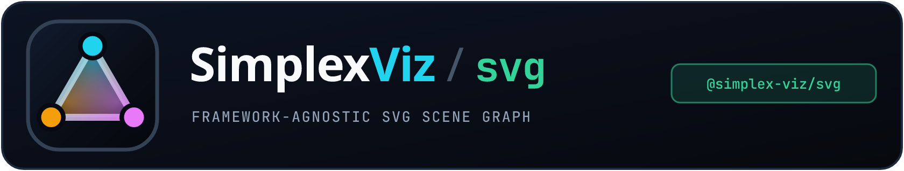
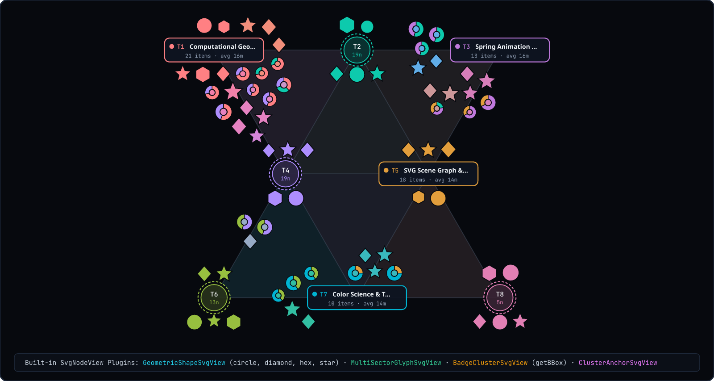

<p align="center">
  
</p>

# @simplex-viz/svg

Framework-agnostic SVG rendering engine and pluggable `SvgNodeView` architecture for `@simplex-viz/core`. Zero dependency on React—embeds cleanly into Vanilla TypeScript, Vue, Angular, Svelte, Solid, and Web Components.

- **Live Demo:** <https://hackenberg.tech/simplex-viz/>
- **Source & Monorepo:** <https://github.com/ghackenberg/simplex-viz/tree/main/packages/svg>
- **Companion Packages:** [`@simplex-viz/core`](https://www.npmjs.com/package/@simplex-viz/core) · [`@simplex-viz/react`](https://www.npmjs.com/package/@simplex-viz/react)

<p align="center">
  
</p>

*Figure: Visual showcase of the four built-in `SvgNodeView` plugins rendered on an OKLab-tinted 60° simplex mesh. Content items mix `GeometricShapeSvgView` (circles, diamonds, hexagons, and stars that morph smoothly via 64-point paths) with `MultiSectorGlyphSvgView` (proportional donut glyphs whose sector arcs encode barycentric topic weights). Topic clusters alternate between compact `ClusterAnchorSvgView` vertex rings and auto-measured `BadgeClusterSvgView` cards sized via offscreen `getBBox()`.*

## Features

- **Framework-agnostic SVG scene graph**: Keyed DOM reconciliation for background mesh triangles, highlighted edges, convex hull debug wireframes, cluster nodes, and content nodes.
- **Automatic offscreen `getBBox()` hull measurement**: Omit `measureConvexHull` on any `SvgNodeView` and `@simplex-viz/svg` automatically renders it in a hidden measurement bin, reads `getBBox()`, and caches a tight convex polygon for overlap-free layout.
- **Smooth 60 fps transitions**: Critically damped spring motion + specialized parametric `morph()` or automatic dual-layer crossfade when switching visual presets or mutating items.
- **Centralized root-SVG interactions**: Attaches pointer, click, right-click, wheel, drag-to-pan, and `ResizeObserver` listeners solely on the root `<svg>` element and delegates hit-testing to `@simplex-viz/core`'s exact convex geometry solver.
- **Four built-in view plugins**: Ready-to-use views for geometric shape morphing, multi-sector topic glyphs, vertex anchors, and dynamic text badges.

## Installation

Install `@simplex-viz/core` alongside `@simplex-viz/svg` in any browser or TypeScript project:

```bash
npm install @simplex-viz/core @simplex-viz/svg
```

## Quickstart (Vanilla TypeScript)

This setup mounts `SimplexSvgController` into a DOM container using custom `Bookmark` records mapped via `getId` and `getTags`. `visualResolver` emits descriptors for `GeometricShapeSvgView` and `ClusterAnchorSvgView`, `interactions` wires hover tooltips, cluster focusing on left-click, custom context menus, and cursor-centered wheel zoom, and the final lines show live dataset mutations and camera reset:

```ts
import {
  SimplexSvgController,
  GeometricShapeSvgView,
  ClusterAnchorSvgView,
  type GeometricShapeVisual,
  type ClusterAnchorVisual,
} from '@simplex-viz/svg';
import type { VisualResolver } from '@simplex-viz/core';

interface Bookmark {
  readonly url: string;
  readonly title: string;
  readonly topics: readonly string[];
  readonly minutes: number;
}

const visualResolver: VisualResolver<
  Bookmark,
  GeometricShapeVisual,
  ClusterAnchorVisual
> = {
  resolveContentVisual: (bookmark, ctx) => ({
    shape: bookmark.minutes > 10 ? 'star' : 'circle',
    radius: 10,
    fillHex: ctx.mixedColorHex,
    strokeHex: '#07090E',
    strokeWidth: 1.4,
  }),
  resolveClusterVisual: (cluster) => ({
    code: cluster.code,
    label: cluster.defaultLabel,
    memberCount: cluster.members.length,
    colorHex: cluster.colorHex,
    radius: 22,
  }),
  getVisualCacheKey: (visual) =>
    'shape' in visual
      ? `${visual.shape}:${visual.radius}:${visual.fillHex}`
      : `${visual.code}:${visual.memberCount}:${visual.colorHex}`,
};

const container = document.getElementById('graph')!;

const controller = new SimplexSvgController(container, {
  items: myBookmarks,
  getId: (b) => b.url,
  getTags: (b) => b.topics,
  visualResolver,
  contentView: new GeometricShapeSvgView(),
  clusterView: new ClusterAnchorSvgView(),
  meshOptions: {
    innerPadding: 48,
    minSideLength: 140,
    maxSideLength: 280,
    maxClusters: 10,
  },
  layoutOptions: {
    clusterGapPx: 14,
    itemGapPx: 5,
  },
  interactions: {
    onContentHover: (ev) => {
      if (ev) console.log('Hovered item:', ev.item.title, ev.screenPosition);
    },
    onLeftClick: (target) => {
      if (target.kind === 'content') {
        console.log('Clicked:', target.item.title);
      } else if (target.kind === 'cluster') {
        controller.setFocusedClusterUid(target.cluster.clusterUid);
      } else {
        controller.setFocusedClusterUid(null);
      }
    },
    onRightClick: (target) => {
      console.log('Context menu target:', target.kind);
      return true; // Suppress browser default context menu
    },
    onWheel: 'zoom-to-cursor',
  },
  onMetricsChange: (metrics) => {
    console.log(`Clusters: ${metrics.clusterCount}, Overlaps: ${metrics.overlapCount}`);
  },
});

// Live mutations & camera controls
controller.addItems({
  url: 'https://example.com/oklab',
  title: 'Perceptual Color Mixing',
  topics: ['oklab', 'color-science'],
  minutes: 12,
});
controller.removeItems('https://example.com/old');
controller.camera.reset();

// Clean up DOM, ResizeObserver, and animation loop on unmount
// controller.destroy();
```

## Built-In `SvgNodeView` Plugins

### 1. `GeometricShapeSvgView`
Renders `'circle' | 'diamond' | 'star' | 'hexagon'` with analytical convex hulls and **64-point parametric SVG path morphing** between shapes and colors. Pass a `GeometricShapeVisual` descriptor from `resolveContentVisual` to control polygon kind, radius, fill, and outline stroke:

```ts
import type { GeometricShapeVisual } from '@simplex-viz/svg';

// Descriptor shape:
const visual: GeometricShapeVisual = {
  shape: 'hexagon', // 'circle' | 'diamond' | 'star' | 'hexagon'
  radius: 11,
  fillHex: ctx.mixedColorHex,
  strokeHex: '#07090E',
  strokeWidth: 1.4,
};
```

### 2. `MultiSectorGlyphSvgView`
Renders a multi-colored donut glyph whose sector arc angles match an item's exact barycentric weights across its active simplex unit (vertex, edge, or triangle). Map `ctx.unitClusters` directly into `sectors` as shown below to reflect multi-topic membership visually:

```ts
import type { MultiSectorGlyphVisual } from '@simplex-viz/svg';

const visual: MultiSectorGlyphVisual = {
  outerRadius: 12,
  innerRadius: 5,
  sectors: ctx.unitClusters.map((uc) => ({
    colorHex: uc.cluster.colorHex,
    weight: uc.weight,
  })),
  centerColorHex: ctx.mixedColorHex,
};
```

### 3. `BadgeClusterSvgView`
Renders dynamic pill/card cluster badges sized to their title and metadata line. Because it intentionally omits `measureConvexHull`, `@simplex-viz/svg` measures the rendered `<svg>` elements via `getBBox()` so varying title lengths remain strictly overlap-free:

```ts
import type { BadgeClusterVisual } from '@simplex-viz/svg';

const visual: BadgeClusterVisual = {
  code: cluster.code,
  title: cluster.defaultLabel,
  metaLine: `${cluster.members.length} items`,
  colorHex: cluster.colorHex,
};
```

### 4. `ClusterAnchorSvgView`
Renders calibrated double-ring vertex anchors showing the cluster code and member count. Supply a `ClusterAnchorVisual` descriptor when you want compact circular topic anchors on mesh vertices:

```ts
import type { ClusterAnchorVisual } from '@simplex-viz/svg';

const visual: ClusterAnchorVisual = {
  code: cluster.code,
  label: cluster.defaultLabel,
  memberCount: cluster.members.length,
  colorHex: cluster.colorHex,
  radius: 23,
};
```

## Writing Custom `SvgNodeView` Plugins

Implement `SvgNodeView<TVisual>` centered around local origin `(0, 0)`. `SvgRendererAdapter` handles world positioning `(x, y)`, solver scale `α`, opacity, and crossfading on the parent `<g>`. The plugin below constructs an adaptive dark card whose border reacts to hover state, using `rectToConvexPolygon` for fast analytical hull bounds (or omitting `measureConvexHull` to measure arbitrary SVG content dynamically):

```ts
import type { SvgNodeView } from '@simplex-viz/svg';
import { rectToConvexPolygon } from '@simplex-viz/core';

interface CardVisual {
  readonly title: string;
  readonly colorHex: string;
}

const SVG_NS = 'http://www.w3.org/2000/svg';

export const CustomCardSvgView: SvgNodeView<CardVisual> = {
  // Optional: omit to measure automatically via offscreen getBBox()
  measureConvexHull: (visual) =>
    rectToConvexPolygon(Math.max(80, visual.title.length * 7 + 20), 28, 6),

  mountOrUpdate: (groupEl, visual, state) => {
    const doc = groupEl.ownerDocument;
    while (groupEl.firstChild) groupEl.removeChild(groupEl.firstChild);

    const width = Math.max(80, visual.title.length * 7 + 20);
    const rect = doc.createElementNS(SVG_NS, 'rect');
    rect.setAttribute('x', String(-width / 2));
    rect.setAttribute('y', '-14');
    rect.setAttribute('width', String(width));
    rect.setAttribute('height', '28');
    rect.setAttribute('rx', '6');
    rect.setAttribute('fill', '#0d1320');
    rect.setAttribute(
      'stroke',
      state.interaction.isHovered ? '#f8fafc' : visual.colorHex,
    );
    rect.setAttribute('stroke-width', state.interaction.isHovered ? '2' : '1.2');

    const text = doc.createElementNS(SVG_NS, 'text');
    text.setAttribute('text-anchor', 'middle');
    text.setAttribute('y', '4');
    text.setAttribute('fill', '#f8fafc');
    text.setAttribute('font-size', '11');
    text.textContent = visual.title;

    groupEl.appendChild(rect);
    groupEl.appendChild(text);
  },

  // Optional: omit to use universal dual-layer crossfade
  // morph: (groupEl, from, to, progress, state) => false,
};
```

## `SimplexSvgController` API Summary

| Method / Property | Description |
| --- | --- |
| `addItems(items)` | Appends one or more items and triggers an interruptible transition. |
| `removeItems(ids)` | Removes items by ID and smoothly fades out exiting nodes. |
| `setItems(items)` | Replaces the entire corpus while preserving matching clusters & items. |
| `setViews({ contentView, clusterView })` | Hot-swaps `SvgNodeView` plugins at runtime. |
| `setVisualResolver(resolver)` | Updates descriptor resolution and crossfades smoothly. |
| `setSizeMultiplier(multiplier)` | Uniformly scales node sizes (`0.35` – `3.0`) and re-solves zero overlap. |
| `setShowHulls(show)` | Toggles convex bounding hull wireframe overlays. |
| `setPinnedIds(ids)` / `setHighlightedIds(ids)` | Controls pinned and highlighted visual emphasis states. |
| `setFocusedClusterUid(uid \| null)` | Isolates a cluster and its members, dimming unrelated nodes. |
| `setInteractions(handlers)` | Replaces pointer, click, and wheel callbacks dynamically. |
| `camera` | Exposes `CameraController` (`zoomToCursor`, `panBy`, `reset`, `getState`, `setState`). |
| `getMetrics()` / `getClusters()` / `getItems()` | Reads live solver telemetry, clusters, and items. |
| `getSvgElement()` | Returns the managed root `<svg>` element. |
| `stepForTest(dtMs)` | Deterministically advances simulation time in unit/DOM tests. |
| `destroy()` | Cancels `requestAnimationFrame`, disconnects `ResizeObserver`, and removes the `<svg>`. |

## License

MIT — see [LICENSE](https://github.com/ghackenberg/simplex-viz/blob/main/LICENSE).
