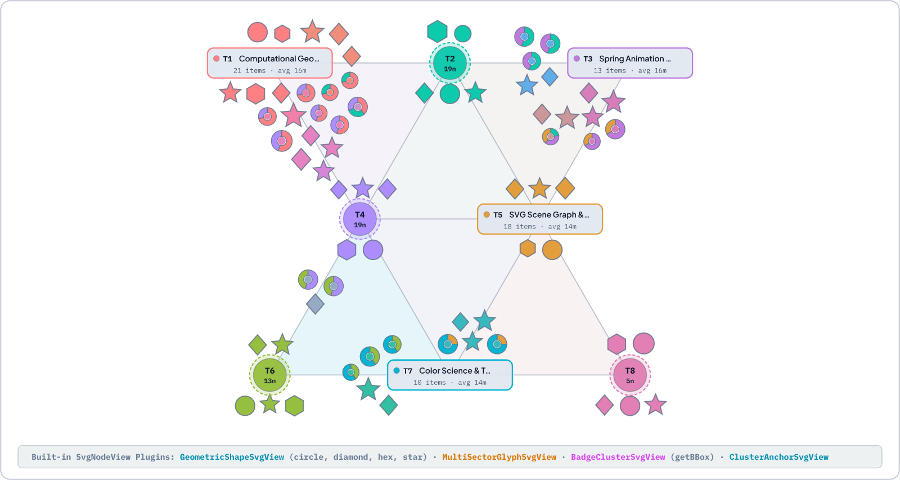

<p align="center">
  
</p>

# @simplex-viz/svg

Framework-agnostic SVG rendering engine, hierarchical `1:4` zoom/drill-down controller, and pluggable `SvgNodeView` / `SvgTriangleView` / `SvgEdgeView` architecture for `@simplex-viz/core`. Zero dependency on React—embeds cleanly into Vanilla TypeScript, Vue, Angular, Svelte, Solid, and Web Components.

- **Live Demo:** <https://hackenberg.tech/simplex-viz/>
- **Source & Monorepo:** <https://github.com/ghackenberg/simplex-viz/tree/main/packages/svg>
- **Companion Packages:** [`@simplex-viz/core`](https://www.npmjs.com/package/@simplex-viz/core) · [`@simplex-viz/react`](https://www.npmjs.com/package/@simplex-viz/react)

## Visual Rendering Showcase

While `@simplex-viz/core` computes pure spatial coordinates, `@simplex-viz/svg` turns each frame into live DOM `<svg>` elements inside any browser container or UI framework. The preview below renders its built-in views together in a single viewport:

<p align="center">
  
</p>

*Figure: Visual showcase of the four built-in `SvgNodeView` plugins rendered on an OKLab-tinted 60° simplex mesh. Content items mix `GeometricShapeSvgView` (circles, diamonds, hexagons, and stars that morph smoothly via 64-point paths) with `MultiSectorGlyphSvgView` (proportional donut glyphs whose sector arcs encode barycentric topic weights). Topic clusters alternate between compact `ClusterAnchorSvgView` vertex rings and auto-measured `BadgeClusterSvgView` cards sized via offscreen `getBBox()`.*

## Features

- **Framework-agnostic SVG scene graph**: Keyed DOM reconciliation for dimmed neighborhood context layers, active mesh triangles, internal `1:4` drillable subdivision edges (`g.sv-drill-edges`), mesh edges, convex hull debug wireframes, cluster nodes, and content nodes.
- **Hierarchical `1:4` Zoom / Drill-Down & Free Camera**: Supports both continuous camera navigation (`createFreeCameraZoomStrategy`, default) and discrete conformal `1:4` drill-down (`createBarycentricZoomStrategy`, `createSemanticZoomStrategy`, `createSubspaceZoomStrategy`) with built-in breadcrumbs (`showZoomBreadcrumbs`), discrete 2-finger pinch-out/in gestures, single-triangle leaf focus (`'triangle-focus'`), uniform 1-ring cluster/subcluster stars with simplex-distance dimming, dimmed clickable neighbors, and direct internal `1:4` subdivision previews rendered 1:1 through the active `SvgEdgeView`.
- **Pluggable triangle face & mesh edge views**: Swap `SvgTriangleView` (`OklabTintTriangleSvgView`, `GradientTriangleSvgView`, `BarycentricSectorTriangleSvgView`, `BlueprintInsetTriangleSvgView`, `DensityHeatmapTriangleSvgView`) and `SvgEdgeView` (`DashedMeshEdgeSvgView`, `ClusterTintedEdgeSvgView`, `PrecisionRailEdgeSvgView`, `MinimalHighlightEdgeSvgView`) live via `setTriangleView` / `setEdgeView` / `setViews`.
- **Automatic offscreen `getBBox()` hull measurement**: Omit `measureConvexHull` on any `SvgNodeView` and `@simplex-viz/svg` automatically renders it in a hidden measurement bin, reads `getBBox()`, and caches a tight convex polygon for `0.0 px` overlap layout.
- **Smooth 60 fps transitions**: Critically damped spring motion + specialized parametric `morph()` or automatic dual-layer crossfade when switching visual presets, drilling into sub-levels, or mutating items.
- **Primary & `'intermediate'` bridge cluster styling**: `BadgeClusterSvgView` and `ClusterAnchorSvgView` automatically render compact chamfered bridge badges/anchors for synthesized zoom midpoints (`cluster.role === 'intermediate'`).

## Installation

Install `@simplex-viz/svg` alone (`@simplex-viz/core` is installed automatically and all strategies, helpers, and types are re-exported directly from `@simplex-viz/svg`):

```bash
npm install @simplex-viz/svg
```

## Quickstart (Zero-Config)

### One-Liner Mount (`createSimplexSvg`)

Pass a container `HTMLElement` or CSS selector together with an array of `{ id, tags }` items to `createSimplexSvg`. Built-in `'geometric'` preset visuals, drag-to-pan, cursor wheel zoom, cluster & triangle click-focus, and floating hover tooltips start immediately:

```ts
import { createSimplexSvg } from '@simplex-viz/svg';

const items = [
  { id: '1', label: 'Simplex Mesh', tags: ['geometry', 'triangulation', 'math'] },
  { id: '2', label: 'OKLab Mixing', tags: ['color', 'geometry', 'perception'] },
  { id: '3', label: 'SAT Solver', tags: ['collision', 'geometry'] },
];

const controller = createSimplexSvg('#graph', items);
```

### Quickstart Default Settings (`createSimplexSvg` & `SimplexSvgController`)

| Option | Default | Description |
| --- | --- | --- |
| `getId` / `getTags` | `item.id` / `item.tags` | Auto-extracted when `TItem` has `id` / `tags` (`getTags` is optional for embedding/similarity strategies). |
| `getLabel` | Heuristic (`label \| title \| headline \| name \| id`) | Fallback label used by presets and hover tooltips. |
| `preset` | `'geometric'` | Built-in preset (`'geometric' \| 'glyphs' \| 'badges'`). |
| `theme` | `'dark'` | Color theme (`'dark' \| 'light'`) for presets, tooltips, and breadcrumbs. |
| `triangleView` | `OklabTintTriangleSvgView` | Default triangulation face renderer. |
| `edgeView` | `DashedMeshEdgeSvgView` | Default mesh edge renderer (also renders internal `1:4` subdivision edges on drillable triangles). |
| `meshStrategy` | `createAdaptiveHexMeshStrategy()` | Aspect-aligned 60° equilateral lattice (adaptive `innerPadding: 32–48`, `minSideLength: 130`, `maxClusters: 14`). |
| `clusteringStrategy` | `createJaccardAnnealingClusteringStrategy()` | Tag clustering with `'planar-hitting-set'` and `'explaining-away'`. |
| `colorStrategy` | `createOklabContrastColorStrategy()` | Perceptual OKLab edge-contrast colors + barycentric mixing. |
| `layoutStrategy` | `createPbdUniformLayoutStrategy()` | Mesh-inward fan seeding + space-filling PBD dispersion + global uniform scale search (`0.0 px` overlap). |
| `zoomStrategy` | `createFreeCameraZoomStrategy()` | Continuous cursor wheel zoom (`onWheel: 'zoom-to-cursor'`), 2-finger pinch, and drag-to-pan. |
| `showZoomBreadcrumbs` | `true` | Displays clickable navigation breadcrumbs automatically when `depth > 0` in drill-down mode. |
| `focusOnClusterClick` / `focusOnTriangleClick` | `true` / `true` | Click-to-isolate in `free-camera` mode when `interactions.onLeftClick` is omitted. |
| `tooltip` | `true` for `createSimplexSvg(el, items)`, `false` in options | Floating DOM hover tooltip (`boolean` or custom `(target) => string` formatter). |

---

## Step-by-Step Customization Guide

### Step 1 — Presets, Custom Domain Records & Tooltip Formatting

```ts
import { SimplexSvgController } from '@simplex-viz/svg';

interface Article {
  readonly slug: string;
  readonly headline: string;
  readonly topics: readonly string[];
}

const controller = new SimplexSvgController('#graph', {
  items: articles,
  getId: (a) => a.slug,
  getTags: (a) => a.topics,
  getLabel: (a) => a.headline,
  preset: 'glyphs', // 'geometric' | 'glyphs' | 'badges'
  theme: 'dark',    // 'dark' | 'light'
  tooltip: (target) => {
    if (target.kind === 'content') {
      return `${target.item.headline} (${target.layoutContext.tags.length} tags)`;
    }
    if (target.kind === 'cluster') {
      return `${target.cluster.defaultLabel}: ${target.cluster.members.length} articles`;
    }
    return `Triangle #${target.triangle.index + 1} (${target.triangle.coveredItemCount} items)`;
  },
});
```

### Step 2 — Swap Core Pipeline Strategies (Embeddings, Soft-Simplex & Composable Layout)

`@simplex-viz/svg` re-exports every `@simplex-viz/core` strategy factory—including `createSoftSimplexTagClusteringStrategy`, `createSoftSimplexEmbeddingClusteringStrategy`, `createEmbeddingClusteringStrategy`, `createSimilarityClusteringStrategy`, `createCollisionDrivenLayoutStrategy`, and `createComposedLayoutStrategy`:

```ts
import {
  SimplexSvgController,
  createSoftSimplexEmbeddingClusteringStrategy,
  createThemeAdaptiveOklabColorStrategy,
  createCollisionDrivenLayoutStrategy,
} from '@simplex-viz/svg';

interface ImageAsset {
  readonly id: string;
  readonly caption: string;
  readonly clipVec: readonly number[];
  readonly colorVec: readonly number[];
}

const controller = new SimplexSvgController('#graph', {
  items: imageAssets,
  getLabel: (img) => img.caption,
  preset: 'glyphs',
  tooltip: true,
  meshOptions: { sideLength: 210, maxClusters: 9 },
  clusteringStrategy: createSoftSimplexEmbeddingClusteringStrategy<ImageAsset>({
    getEmbedding: [
      { name: 'Semantic', getVector: (i) => i.clipVec, weight: 0.7 },
      { name: 'Palette', getVector: (i) => i.colorVec, weight: 0.3 },
    ],
    metric: 'cosine',
    triangleSpread: 0.45,
  }),
  colorStrategy: createThemeAdaptiveOklabColorStrategy(),
  layoutStrategy: createCollisionDrivenLayoutStrategy({ warmStart: true }),
});
```

### Step 3 — Enable Hierarchical `1:4` Zoom / Drill-Down (`zoomStrategy`)

Pass `createBarycentricZoomStrategy()`, `createSemanticZoomStrategy()`, or `createSubspaceZoomStrategy()` to switch from continuous camera panning to conformal `1:4` drill-down. Subdividable triangles preview their internal `1:4` subdivision edges in the active `edgeView` style and pass clicks through content items, while non-subdividable leaf triangles remain focusable via their free background (`'triangle-focus'`) with directly clickable content items:

```ts
import {
  SimplexSvgController,
  createBarycentricZoomStrategy,
} from '@simplex-viz/svg';

const controller = new SimplexSvgController('#graph', {
  items: articles,
  getId: (a) => a.slug,
  getTags: (a) => a.topics,
  zoomStrategy: createBarycentricZoomStrategy({
    clusterZoomMode: 'incident-star', // 'incident-star' | 'spotlight' | 'none'
    adaptiveContrastStretch: true,
  }),
  showZoomBreadcrumbs: true,
  onZoomStateChange: (state) => {
    console.log('Depth:', state.depth, 'Can drill up:', state.canDrillUp);
  },
});

// Programmatic drill-down navigation at any time:
controller.drillDownTriangle(0);
controller.drillUp();
controller.drillToRoot();
```

### Step 4 — Customize Triangle Faces & Mesh Edges (`SvgTriangleView` & `SvgEdgeView`)

```ts
import {
  BarycentricSectorTriangleSvgView,
  ClusterTintedEdgeSvgView,
  DensityHeatmapTriangleSvgView,
  GradientTriangleSvgView,
  PrecisionRailEdgeSvgView,
} from '@simplex-viz/svg';

// Hot-swap triangle face and edge renderers at runtime without re-running layout:
controller.setTriangleView(new GradientTriangleSvgView({ baseOpacity: 0.2 }));
controller.setEdgeView(new ClusterTintedEdgeSvgView({ strokeWidth: 1.4 }));
```

Built-in `SvgTriangleView` plugins:
- `OklabTintTriangleSvgView` *(default)* — Perceptual OKLab-blended face fill with hover/focus border emphasis and vertex markers.
- `GradientTriangleSvgView` — Continuous barycentric gradient shading using three isolated `plus-lighter` `<linearGradient>` passes.
- `BarycentricSectorTriangleSvgView` — Splits each triangle around its centroid into three cluster-colored corner sectors.
- `BlueprintInsetTriangleSvgView` — Architectural double-frame triangle with centroid cross reticle on hover/focus.
- `DensityHeatmapTriangleSvgView` — Scales face saturation by `coveredItemCount` and displays an item count pill.

Built-in `SvgEdgeView` plugins (used for both outer mesh edges and internal `1:4` drillable subdivision previews):
- `DashedMeshEdgeSvgView` *(default)* — Crisp dashed lattice edges that illuminate on adjacent hover/focus.
- `ClusterTintedEdgeSvgView` — Tri-segment gradient transitioning between endpoint cluster hues and their OKLab midpoint mix.
- `PrecisionRailEdgeSvgView` — Parallel double-rail lines with a midpoint diamond marker.
- `MinimalHighlightEdgeSvgView` — Faint structural guides at rest that brighten cleanly on adjacent hover or focus.

### Step 5 — Custom `VisualResolver` & Custom `SvgNodeView` Plugins

Map domain items and clusters into descriptors for built-in node views (`GeometricShapeSvgView`, `MultiSectorGlyphSvgView`, `BadgeClusterSvgView`, `ClusterAnchorSvgView`) or your own `SvgNodeView<TVisual>` centered around `(0, 0)`:

```ts
import {
  SimplexSvgController,
  rectToConvexPolygon,
  ClusterAnchorSvgView,
  type ClusterAnchorVisual,
  type SvgNodeView,
  type VisualResolver,
} from '@simplex-viz/svg';

interface CardVisual {
  readonly title: string;
  readonly colorHex: string;
}

const SVG_NS = 'http://www.w3.org/2000/svg';
const getCardWidth = (title: string) => Math.max(80, title.length * 7 + 20);

export const CustomCardSvgView: SvgNodeView<CardVisual> = {
  // Optional: omit measureConvexHull to measure automatically via offscreen getBBox()
  measureConvexHull: (visual) => rectToConvexPolygon(getCardWidth(visual.title), 28, 6),
  mountOrUpdate: (groupEl, visual, state) => {
    const doc = groupEl.ownerDocument;
    while (groupEl.firstChild) groupEl.removeChild(groupEl.firstChild);

    const width = getCardWidth(visual.title);
    const rect = doc.createElementNS(SVG_NS, 'rect');
    rect.setAttribute('x', String(-width / 2));
    rect.setAttribute('y', '-14');
    rect.setAttribute('width', String(width));
    rect.setAttribute('height', '28');
    rect.setAttribute('rx', '6');
    rect.setAttribute('fill', '#0d1320');
    rect.setAttribute('stroke', state.interaction.isHovered ? '#f8fafc' : visual.colorHex);
    rect.setAttribute('stroke-width', state.interaction.isHovered ? '2' : '1.2');

    const text = doc.createElementNS(SVG_NS, 'text');
    text.setAttribute('text-anchor', 'middle');
    text.setAttribute('y', '4');
    text.setAttribute('fill', '#f8fafc');
    text.setAttribute('font-size', '11');
    text.textContent = visual.title;

    groupEl.appendChild(rect);
    groupEl.appendChild(text);
  },
};
```

### Step 6 — Custom Hover, Click & Wheel Interactions

```ts
controller.setInteractions({
  onContentHover: (ev) => {
    if (ev) console.log('Hovered item:', ev.item, ev.screenPosition);
  },
  onLeftClick: (target) => {
    if (target.kind === 'content') {
      console.log('Clicked item:', target.item);
    }
  },
  onRightClick: (target) => {
    console.log('Context menu target:', target.kind);
    return true; // Suppress browser default context menu
  },
  onWheel: 'zoom-to-cursor', // 'zoom-to-cursor' | 'pan-vertical' | 'none' | custom fn
});
```

---

## API Reference (`createSimplexSvg` & `SimplexSvgController`)

| Method / Option | Description |
| --- | --- |
| `preset` / `setPreset(preset, getLabel?)` | Switches between `'geometric'`, `'glyphs'`, and `'badges'` with smooth transitions. |
| `theme` / `setTheme(theme)` | Switches `'dark'` / `'light'` presets and notifies theme-aware color strategies. |
| `meshStrategy` / `setMeshStrategy(strategy)` | Swaps `SimplexMeshStrategy` (`createAdaptiveHexMeshStrategy`, `createFixedLatticeMeshStrategy`, or custom). |
| `clusteringStrategy` / `setClusteringStrategy(strategy)` | Swaps `SimplexClusteringStrategy` (Jaccard, Soft-Simplex Tags/Embeddings, Embeddings, Pairwise Similarity, Incremental, or custom). |
| `colorStrategy` / `setColorStrategy(strategy)` | Swaps `SimplexColorStrategy` (`createOklabContrastColorStrategy`, `createThemeAdaptiveOklabColorStrategy`, `createPaletteColorStrategy`, or custom). |
| `layoutStrategy` / `setLayoutStrategy(strategy)` | Swaps `SimplexLayoutStrategy` (`createPbdUniformLayoutStrategy`, `createWarmStartPbdLayoutStrategy`, `createLocalAdaptiveLayoutStrategy`, `createCollisionDrivenLayoutStrategy`, `createComposedLayoutStrategy`, or custom). |
| `zoomStrategy` / `setZoomStrategy(strategy)` | Swaps `SimplexZoomStrategy` (`createFreeCameraZoomStrategy`, `createBarycentricZoomStrategy`, `createSemanticZoomStrategy`, `createSubspaceZoomStrategy`, or custom). |
| `showZoomBreadcrumbs` / `setShowZoomBreadcrumbs(show)` | Toggles the built-in top breadcrumb bar when drilled into sub-levels (`default: true`). |
| `drillDownTriangle(index)` / `drillDownCluster(uid)` | Drills into a triangle (`1:4` subdivision or `'triangle-focus'` leaf focus) or cluster (`1`-ring `'incident-star'` / `'spotlight'`). |
| `drillToNeighbor(neighborId)` | Navigates laterally (or auto-zooms out when targeting a neighbor region). |
| `drillUp()` / `drillToDepth(depth)` / `drillToRoot()` | Navigates up one zoom level, to a specific breadcrumb depth, or back to Overview. |
| `getZoomState()` / `getZoomStrategy()` | Inspects active `SimplexZoomState` (`depth`, `activeFrameKind`, `breadcrumbs`, `drillableTriangleIndices`, `focusableTriangleIndices`, `isLeafReached`) and strategy. |
| `setMeshOptions(opts)` / `setLayoutOptions(opts)` | Updates `MeshOptions` (incl. `sideLength`) or `LayoutSolverOptions` at runtime. |
| `triangleView` / `setTriangleView(view)` | Swaps the `SvgTriangleView` plugin rendering triangulation faces. |
| `edgeView` / `setEdgeView(view)` | Swaps the `SvgEdgeView` plugin rendering mesh edges and internal `1:4` drillable previews. |
| `setViews({ contentView, clusterView, triangleView, edgeView })` | Hot-swaps node, triangle face, and mesh edge view plugins at runtime. |
| `tooltip` / `setTooltip(tooltip)` | Enables a floating DOM hover tooltip (`boolean` or `(target) => string`). |
| `addItems(items)` / `removeItems(ids)` / `setItems(items)` | Mutates the dataset live with interruptible spring transitions. |
| `setSizeMultiplier(multiplier)` / `setShowHulls(show)` | Uniformly scales node sizes or toggles convex hull wireframes. |
| `setPinnedIds(ids)` / `setHighlightedIds(ids)` | Controls pinned and highlighted visual emphasis states. |
| `setFocusedClusterUid(uid \| null)` / `setFocusedTriangleIndex(i \| null)` | Isolates a cluster or triangle face in `free-camera` mode. |
| `camera` | Exposes `CameraController` (`zoomToCursor`, `panBy`, `reset`, `getState`, `setState`). |
| `getMetrics()` / `getClusters()` / `getItems()` | Reads live solver telemetry, clusters, and items. |
| `destroy()` | Cancels `requestAnimationFrame`, disconnects `ResizeObserver`, and removes DOM overlays & `<svg>`. |

## License

MIT — see [LICENSE](https://github.com/ghackenberg/simplex-viz/blob/main/LICENSE).
