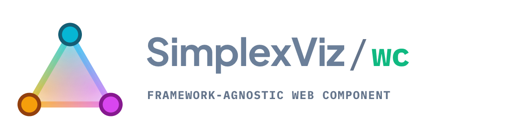
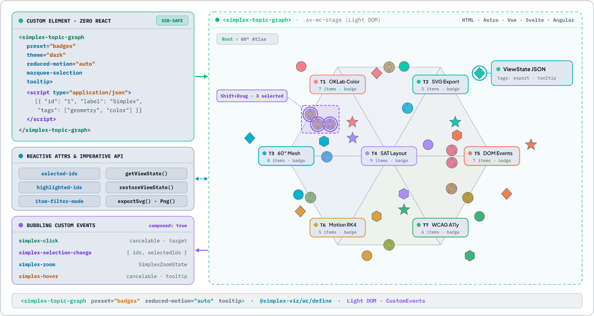

<p align="center">
  
</p>

# `@simplex-viz/wc`

Framework-agnostic Web Component (`<simplex-topic-graph>`) for **SimplexViz** — drop interactive 60° simplicial topic atlases into plain HTML, Vue, Svelte, Angular, Astro, Hugo, or any standard DOM environment with zero React dependency.

- **Live Demo:** <https://hackenberg.tech/simplex-viz/>
- **Source & Monorepo:** <https://github.com/ghackenberg/simplex-viz/tree/main/packages/wc>
- **Companion Packages:** [`@simplex-viz/core`](https://www.npmjs.com/package/@simplex-viz/core) · [`@simplex-viz/svg`](https://www.npmjs.com/package/@simplex-viz/svg) · [`@simplex-viz/canvas`](https://www.npmjs.com/package/@simplex-viz/canvas) · [`@simplex-viz/react`](https://www.npmjs.com/package/@simplex-viz/react)

## Custom Element & Light DOM Architecture

`<simplex-topic-graph>` wraps `@simplex-viz/core` (including shared viewport zoom, click-dispatch, and notifier primitives from `@simplex-viz/core/dom`) and `@simplex-viz/svg` in a standard, SSR-safe Custom Element that renders directly into Light DOM with zero React dependency — supporting declarative HTML attributes, inline `<script type="application/json">` data, imperative controller methods, and bubbling `CustomEvent`s:

<p align="center">
   markup, reactive attributes, bubbling CustomEvents, and a live 60° Light DOM simplex atlas with Shift+Drag marquee selection and hover tooltips" />
</p>

*Figure: Architecture of `@simplex-viz/wc`. Declarative HTML attributes (`preset="badges"`, `reduced-motion="auto"`, `marquee-selection`, `tooltip`), inline JSON datasets, and reactive DOM properties drive an overlap-free 60° Light DOM simplex atlas inside `<simplex-topic-graph>`, while user interactions (`Shift+Drag` marquee selection, click, hover, and zoom) emit standard bubbling `CustomEvent`s (`composed: true`) for seamless integration with HTML, Astro, Vue, Svelte, or Angular.*

## Installation

```bash
npm install @simplex-viz/wc
```

### Entry Points

| Import Path | Target Runtime | DOM-Free | Side Effects | Root Re-Export | Purpose |
| --- | --- | --- | --- | --- | --- |
| `@simplex-viz/wc` | Browser Custom Elements & SSR-safe imports (zero React) | No | `false` | Root | Exports `SimplexTopicGraphElement` and SSR-safe `defineSimplexTopicGraphElement()`. |
| `@simplex-viz/wc/define` | Browser (auto-registration) | No | `true` | **Exclusive subpath** | Side-effect entrypoint registering `<simplex-topic-graph>` and exporting `DEFAULT_SIMPLEX_TAG_NAME`. |

## Quick Start

### Auto-registration via `@simplex-viz/wc/define`

```html
<simplex-topic-graph
  id="atlas"
  preset="badges"
  theme="dark"
  tooltip
  style="width: 100%; height: 520px;"
></simplex-topic-graph>

<script type="module">
  import '@simplex-viz/wc/define';

  const el = document.getElementById('atlas');
  el.items = [
    { id: '1', label: 'Simplex Geometry', tags: ['geometry', 'topology'] },
    { id: '2', label: 'Color Spaces', tags: ['color', 'perception'] },
    { id: '3', label: 'OKLab Mixing', tags: ['geometry', 'color'] },
  ];

  el.addEventListener('simplex-click', (e) => {
    console.log('Clicked:', e.detail);
  });

  el.addEventListener('simplex-selection-change', (e) => {
    console.log('Selected IDs:', e.detail.ids);
  });
</script>
```

### Explicit / SSR-safe registration

```ts
import { defineSimplexTopicGraphElement } from '@simplex-viz/wc';

// Safe to call in Node/SSR (no-op) and idempotent on repeated calls
defineSimplexTopicGraphElement(); // registers <simplex-topic-graph>
```

### Declarative HTML-only usage (inline JSON)

```html
<simplex-topic-graph preset="geometric" theme="light" tooltip style="height: 460px;">
  <script type="application/json">
    [
      { "id": "a", "label": "Alpha", "tags": ["systems", "design"] },
      { "id": "b", "label": "Beta", "tags": ["design", "math"] },
      { "id": "c", "label": "Gamma", "tags": ["systems", "math"] }
    ]
  </script>
</simplex-topic-graph>
```

## Attributes

| Attribute | Type | Default |
| --- | --- | --- |
| `preset` | `'geometric' \| 'badges' \| 'glyphs'` | `'geometric'` |
| `theme` | `'dark' \| 'light'` | `'dark'` |
| `renderer` | `'svg'` | `'svg'` |
| `tooltip` | boolean (or JS property: `SimplexSvgTooltipOption` / `SimplexDomTooltipRenderer`) | `false` |
| `aria-label` | string | `'Interactive simplex topic graph'` |
| `keyboard-navigation` | boolean | `true` |
| `reduced-motion` | `'auto' \| 'true' \| 'false'` | `'auto'` |
| `marquee-selection` | boolean | `true` |
| `shift-click-selects` | boolean | `true` |
| `show-zoom-breadcrumbs` | boolean | `true` |
| `show-hulls` | boolean | `false` |
| `empty-cluster-behavior` | `'normal' \| 'dim' \| 'hide'` | `'normal'` |
| `defer-initial-layout` | boolean or fallback ms | `false` |
| `item-filter-mode` | `'dim' \| 'hide'` | `'dim'` |
| `touch-scroll-lock-px` | number | `8` |
| `click-tolerance-px` | number | `12` |
| `focus-on-cluster-click` | boolean | `true` |
| `focus-on-triangle-click` | boolean | `true` |
| `relayout-on-font-load` | boolean | `true` |
| `timeline` | boolean | `false` |
| `items` | JSON array string | `[]` |
| `selected-ids` | comma-separated or JSON array | `[]` |
| `highlighted-ids` | comma-separated or JSON array | `[]` |
| `pinned-ids` | comma-separated or JSON array | `[]` |

## Events

All custom events bubble (`bubbles: true`, `composed: true`).

- `simplex-click` (cancelable — call `event.preventDefault()` to suppress default drill-down/focus)
- `simplex-hover` (cancelable — call `event.preventDefault()` to suppress built-in tooltip)
- `simplex-zoom` (`detail: SimplexZoomState`)
- `simplex-selection-change` (`detail: { selectedIds: ReadonlySet<string>, ids: readonly string[] }`)
- `simplex-timeline-change` (`detail: SimplexTimelineState`)
- `simplex-metrics` (`detail: LayoutMetrics`)
- `simplex-clusters-change` (`detail: readonly ClusterDescriptor[]`)
- `simplex-legend-change` (`detail: SimplexLegendModel`)

## Imperative Methods

- Data & batching: `addItems`, `removeItems`, `setItems`, `setOptions`, `batch`, `relayout`
- Selection & filtering: `setSelectedIds`, `toggleSelectedId`, `clearSelection`, `getSelectedIds`, `selectItemsInScreenRect`, `setHighlightedIds`, `setHighlightedItems`, `getHighlightedIds`, `setPinnedIds`, `getPinnedIds`, `setItemFilter`, `getItemFilter`
- Navigation & focus: `focusItem`, `getFocusedItemId`, `zoomToItem`, `setFocusedClusterUid`, `setFocusedTriangleIndex`, `drillDownTriangle`, `drillDownCluster`, `drillToNeighbor`, `drillUp`, `drillToDepth`, `drillToRoot`, `getZoomState`, `resetCamera`, `zoomBy`
- Legend, timeline, deep-linking & export: `getLegendModel`, `getTimeline`, `subscribeTimeline`, `getViewState`, `restoreViewState`, `exportSvg`, `exportPng`
- Accessibility & motion: `setReducedMotion`, `getReducedMotion`, `isReducedMotionActive`, `getKeyboardFocusTarget`, `clearKeyboardFocus`

## License

MIT
